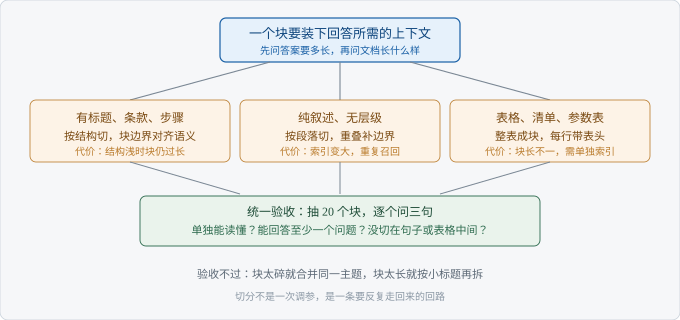

# Ch02 切分策略怎么选

> 考察：你能否按业务结构定切分，而不是背参数
> 出现频率：高｜难度：★★★☆☆
> 一句话答案：按答案需要的上下文定粒度

## 考点地图

> 图 02-1 考点关系

Ch01 把责任分给了检索与生成。切分排在检索之前，它决定库里到底有什么。块切坏了，后面的向量检索再准，也捞不回被劈成两半的答案。

这一章只有一个判断：一个块要装下回答一个问题所需的上下文。装不下，模型缺条件；装太多，无关内容把向量稀释掉。参数都是这个判断的结果，不是理由。

块长和取几块要一起定。块小，就得多取几块才凑够上下文，候选集变大，噪声也跟着进来；块大，可以少取，但每次塞进模型的内容更贵。这两个参数彼此牵连，分开调只会来回摇摆。

往下接 Ch03 的召回失效。切分造成的漏召回，换模型修不好，只能回到块本身。

面试官问切分，多半想看你有没有按文档类型想过，而不是记没记住某个数字。

## 真实提问

「你们知识库那些文档是怎么切片的？我看有人按固定长度切，有人按段落切，你们最后怎么定的？」
「有同事说按 512 切最稳，你觉得呢？」

## 分层解析

**及格**：三种切法能报全。固定长度、按段落、按标题。再加一句「要留重叠」，流程就完整了。但这只是复述工具文档，面试官接着问一句「为什么是这个长度」，你就停在这一档。

**良好**：把粒度和答案绑在一起。你会先问「一个问题要几段话才答得完」，再定块长。FAQ 是一问一答，一块就是一条；合同按条款切，因为条款自带责任边界；操作手册按步骤切，切在步骤中间，读者照着做会出错。

良好档还要说清重叠的作用。它是给边界买的保险，防一句话被劈成两半。重叠补不了粒度问题。

反过来说，文档是纯叙述的长文、没有小标题可用时，按段落切加适度重叠就是更稳的选择。切法没有高下，只有和文档结构配不配。

**优秀**：把代价摆上桌。块小，召回更贴题，但上下文碎，模型可能缺条件；块大，上下文全，但一块混着几个主题，向量被平均，排序变差，也占用更多上下文预算。

优秀档会给一条能执行的验收：切完抽二十个块人工看，逐个问三句——这块单独看能不能读懂、它能不能回答至少一个问题、它有没有被切在句子或表格中间。三句都过，再谈参数。

| 档位 | 判断标准 | 面试官听到什么 |
| --- | --- | --- |
| 及格 | 说得出三种切法与重叠 | 用过工具，没做过取舍 |
| 良好 | 按文档结构定粒度 | 想过业务，能落地 |
| 优秀 | 说清代价与验收方法 | 能对召回质量负责 |

【面试官视角】三档的分水岭不在术语，在「你有没有为切分结果负责」。说参数的是执行者，说结构的是设计者，说代价与验收的是负责人。

## 追问链

1. 「固定长度切有什么问题？」——先给结论：切点随机，会切断句子、表格和条款。答到「切断后两块都不完整，检索和生成同时受损」算过；再补一句「所以结构切分优先，固定长度只做兜底」算优秀。
2. 「重叠设多少？」——答到「重叠是边界保险，代价是索引变大、同一段被重复召回」算过；答到「先看块长和文档的句子密度，再用召回效果确认，不照抄别人的比例」算优秀。
3. 「文档里有表格怎么办？」——按字符切表格一定坏。答到「表格单独成块，保留表头」算过；答到「宽表按行拆，每行都带表头，并在块里写清这张表在讲什么」算优秀。

三问有同一个结构：先说这个做法会坏在哪，再说怎么补，最后说怎么确认补住了。只答第一层，会被听成背结论。

## 高频错误

- 把某个固定长度当标准答案。数字是结果，不是理由。听到「我们都按这个数切」，面试官会默认你没看过文档长什么样。
- 只讲重叠不讲代价。重叠让索引变大，也让同一段内容在候选集里重复出现，挤掉别的块。
- 认为按标题切就够。标题层级浅的文档切出来仍然很长，层级深的文档切出来只剩一句话。
- 一套参数用在所有文档上。客服问答、合同、手册结构完全不同，共用一套参数等于没有设计。
- 切完不看产物。不抽样检查，等于把问题原样留给下游。

【陷阱】「按语义切分」听起来高级。但文档本身有清晰结构时，结构化切分更稳、更可解释。说得出语义切分，却说不清它怎么定边界，会被追问到崩。

## 自测

三分钟。面前是一个客服知识库，三类文档：产品 FAQ、售后政策条款、设备操作手册。说出你的切分方案，并说明为什么这么切。

三档自评这样走：三种切法报得全，算及格；能按三类文档分别给出粒度与切点，算良好；再补上代价说明和一条抽样验收，算优秀。

再补一个反问：上线两周后用户反馈答不全，你先怀疑哪一环？先怀疑块装不下答案所需的上下文，再怀疑检索。

## 下一考点

Ch03 讲向量检索为什么会漏。切分决定库里有什么，检索决定捞不捞得出来，这两件事要分开定位。
