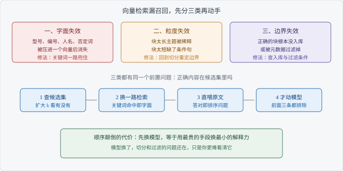

# Ch03 向量检索为什么会漏

> 考察：你能否定位向量检索的失效类型，而不是换模型
> 出现频率：高｜难度：★★★★☆
> 一句话答案：字面信息在压成向量时被丢掉了

## 考点地图

> 图 03-1 考点关系

Ch02 定了块怎么切。这一章问的是另一半：块明明在库里，为什么捞不出来。

向量检索把一段文字压成一个点。压的过程保留大意，丢掉字面。型号、编号、人名、否定词，恰恰是差一个字就查不到的东西。这是**语义压缩**（Semantic Compression）的代价，不是模型没选好。

这一章容易答偏的地方在于：问的是「为什么会漏」，不是「怎么修」。先把漏分成三类，修法自己会浮出来。

**字面失效**：要查的是一串编号、型号或人名，向量里没有这串字符的位置。原文里写着它，压成向量后和「一台设备的说明」几乎一样。否定词同理，「不支持」和「支持」在向量空间里离得很近。信号很明确：换个说法能查到，原样输入查不到。

**粒度失效**：正确答案所在的块太长，主题被别的段落稀释；或者块太短，缺了限定条件，向量指向了另一个意思。信号是：块被**召回**（Recall）了，但排得很后，或者召回的总是同一文档里的相邻块。

**边界失效**：正确内容根本不在候选范围里。没入库、切分时被丢掉、元数据过滤条件写错、索引更新滞后，都算这一类。信号最干脆：k 调到很大也出不来，可你去库里搜关键词，原文明明在。

三类的修法不同。第一类加关键词一路，第二类回到 Ch02 重定边界，第三类查入库与过滤。分不清就调参，等于同时改三个变量，改完也不知道是谁起的作用。

【加分项】主动说出「先扩大 k 看一眼」，面试官会判断你排过障，而不是只读过论文。

## 真实提问

「我们那个问答，用户搜型号老是搜不到，但是问功能就挺准的。这是 embedding 模型不行吧？换个好点的能解决吗？」
「我猜是模型太弱，你帮我确认一下。」

## 分层解析

**及格**：能说出向量检索比的是语义相似，字面不敏感。会提换模型、调 k、加关键词这几个动作。这一档的问题是动作和现象对不上：三个动作打三个方向，面试官问「你先做哪个」就卡住。

**良好**：能分成三类，并给每类一个可观察的现象。字面失效看「换说法能查到、原样查不到」；粒度失效看「召回了但排得靠后」；边界失效看「扩大 k 也出不来，但库里确实有」。分到这一层，你已经有排查路径了。

**优秀**：给出验证顺序，并说清每类的修法边界。你会强调换模型只对字面失效有一点帮助，对切分和过滤造成的漏召回无效。还会补一句：三类同时存在时先修边界，因为前两类修完，边界问题会让效果看起来没动。

| 失效类型 | 你怎么发现的 | 先修什么 | 换模型有用吗 |
| --- | --- | --- | --- |
| 字面失效 | 换说法能查到，原样查不到 | 加关键词一路 | 有一点，但不彻底 |
| 粒度失效 | 召回了，但排在很后 | 重定块边界 | 基本无用 |
| 边界失效 | 扩大 k 也出不来 | 查入库与过滤 | 无用 |

【面试官视角】听到「换模型」，他会判断你在用工具；听到「先分三类」，他会判断你排过障。前者是执行，后者是诊断。诊断能力才是这个岗位要的。

## 追问链

1. 「你怎么证明是向量的问题？」——答到「做对照：同一问题走关键词检索，再把正确段落直接喂给模型」算过；答到「两个对照分别排除检索与生成，剩下那个才是模型」算优秀。
2. 「换个更强的模型能解决吗？」——答到「只能缓解字面失效，编号和型号仍然可能丢」算过；答到「换模型会同时改变召回分布，老问题没定位清楚就换，等于换成一个你看不懂的系统」算优秀。
3. 「修复顺序怎么排？」——答到「先边界、再粒度、最后字面」算过；答到「按成本排：先扩 k，再换一路检索，再改切分，最后才动模型」算优秀。

这三层考的是同一件事：你会不会把猜换成排除。排除法不需要懂模型内部，只需要设计出能分开变量的对照。

## 高频错误

- 一上来就换模型。换完好了你解释不了，更差了你也退不回去。
- 只看第一条结果。正确块可能排在第三、第五。只看 Top-1，会把排序问题误判成召回问题。
- 不分类就调参。k、阈值、模型一起改，任何变化都没法归因。
- 把「答错」当成「没召回」。模型拿到正确段落仍然答错，那是 Ch05 的问题，不在这条链上。
- 只调 k 不查库。k 调到很大仍然没有，说明内容根本不在库里，继续调是浪费。

【减分项】「向量检索就是不如关键词准」。这句话把三类失效压成一句结论，追问一句就散。改成「字面查询关键词更稳，语义查询向量更稳」，才站得住。

## 自测

三分钟作答。题目：用户输入设备型号查不到手册，改用「设备过热怎么办」却能查到相关内容。说出你的定位步骤，以及每一步想排除什么。

对照三档给自己定位：知道向量对字面不敏感，及格；能归到字面失效并给出关键词对照，良好；能排出「扩 k、关键词、直喂原文、换模型」的顺序，并说清每步排除什么，优秀。

再想一步：关键词也查不到，结论还成立吗？不成立。那说明不是字面失效，先回去查内容有没有入库。

## 下一考点

Ch04 讲混合检索与重排。字面失效的常用修法是加一路关键词，但什么时候值得加、加了怎么融合，是另一个判断。
