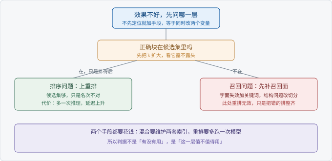

# Ch04 混合检索与重排

> 考察：你能否判断何时该上混合与重排
> 出现频率：高｜难度：★★★★☆
> 一句话答案：两路失败模式互补时才值得

## 考点地图

> 图 04-1 考点关系

Ch03 把漏分成了三类。这一章要回答的是：什么时候值得为漏多花钱。

**混合检索**（Hybrid Retrieval）同时跑两路。向量找语义相近的块，关键词找字面命中的块。它修的是字面失效。

**重排**（Rerank）不新增候选，只对已有候选重新排序。它修的是名次，修不了召回。

判断顺序只有一个：正确块在候选集里吗。在，只是排得后，是排序问题；不在，是召回问题。顺序不能反。反了就会给召回不足的系统加重排，钱花了，指标不动。

两路是否互补，可以数出来。把最近一批失败查询捞出来，逐条标注它是字面没命中，还是语义没命中。全是语义失败，加关键词基本没用；两类都有，混合才划算。这一步不需要改代码，翻日志就能做。

【考点】这题考的不是你知不知道这两个词，是你会不会为一个手段找理由。

## 真实提问

「我们现在就是纯向量检索，效果一般。要不要加个 BM25 做个混合？还有那个重排，我看挺多人在用，是不是都得加上？」
「预算先别管，我想知道加了之后到底解决了什么。」

## 分层解析

**及格**：两个词都认识。混合是向量加关键词，重排是对候选再排一次。知道两个都能提升效果。这一档只能说「有用」，说不出「对什么有用」。

**良好**：能对应上问题。混合补字面，重排改名次，各自有明确的适用面。还会主动说顺序：先确认召回够不够，再谈排序对不对。到这一层，你已经有判断了。

**优秀**：把成本和收益放在一起说。混合要维护两套索引，两路分数不在一个尺度上；重排要多跑一次模型，延迟跟着涨，而且只能改善候选集内部的顺序。验证方式是用固定评测集做增量：先只加一路，再加另一路，看每一层各自带来什么。

还有一个容易被忽略的前提：重排读的是块。块切得碎、缺上下文，重排模型看到的证据本身就不完整，它只能在这个残缺的输入上做判断。上游的问题，下游补不回来。

| 手段 | 解决什么 | 代价 | 什么时候不值得 |
| --- | --- | --- | --- |
| 混合检索 | 字面失效，型号与专名 | 两套索引，分数融合 | 查询全是自然语言，专名很少 |
| 重排 | 候选集内的名次 | 一次额外推理 | 候选集里本来就没有正确块 |
| 两个都上 | 字面漏加排序差 | 两份成本叠在一起 | 没有评测，分不清各自贡献 |

【面试官视角】三档的差距在「有没有代价意识」。说得出好处的人很多，说得出「这个场景不该上」的人少，后者才是能控预算的人。

## 追问链

1. 「RRF 和加权求和怎么选？」——先答分数可比性。**倒数排名融合**（Reciprocal Rank Fusion，RRF）只看名次，不需要两路分数同尺度，稳；加权求和要求分数可比，权重还得有标注数据来调。答到「默认先 RRF，有标注再谈加权」算过；答到「两路分数分布差得远时，加权求和的名次会被一路吃掉」算优秀。
2. 「重排一定涨点吗？」——不一定。候选集里没有正确块，重排只是把错的排得更整齐。答到「先看召回，再谈重排」算过；答到「候选集越脏，重排收益越不确定」算优秀。
3. 「延迟涨多少能接受？」——先问场景。同步问答有等待预算，离线批处理几乎没有。答到「先定预算再选方案」算过；答到「把重排的候选数压下来，只对前若干条精排」算优秀。

三问的共同点是先给条件再给结论。直接说「RRF 更好」，会被追问「什么情况下它不更好」。

如果只给你一句话的篇幅，就说：先看候选集，再谈名次，最后才谈融合。这三步的顺序本身就是答案。

## 高频错误

- 默认混合一定更好。两路都召不回时，混合只是把同一个空集合并了两次。
- 权重拍脑袋。加权求和里的权重是可调参数，没有标注就没有依据，这批查询上调好的数换一批就失效。
- 不测延迟。重排的代价是每次请求多一次推理，压测之前谁都不知道它落在哪。
- 召回不足时先上重排。这是最常见的方向错误，钱花了，指标不动。
- 把两路分数直接相加。余弦相似度和 BM25 分数不在一个尺度，相加的结果没有意义。

【陷阱】「我们上了混合检索，效果提升明显」。这句话如果没有分层评测，面试官会追问「提升来自哪一路」。答不出来，说明你只是把两个开关一起打开了。

## 自测

给自己三分钟。情形是这样：客服问答取前五条，三条相关，最该出现的那条总排在第六第七。先说结论：加混合，还是加重排？

三档怎么分：两个手段各解决什么说得清，及格；判断出这是名次问题、先扩 k 确认，良好；给出「扩 k 看候选、再重排、按评测确认收益与延迟」的完整路径，优秀。

反过来问一句：扩到二十条仍然没有那条，答案要改吗？要改。那就不是名次问题，回到召回面。

## 下一考点

Ch05 讲幻觉怎么定位。检索把证据送到了，模型仍然可能说错，这是另一条链上的问题。
