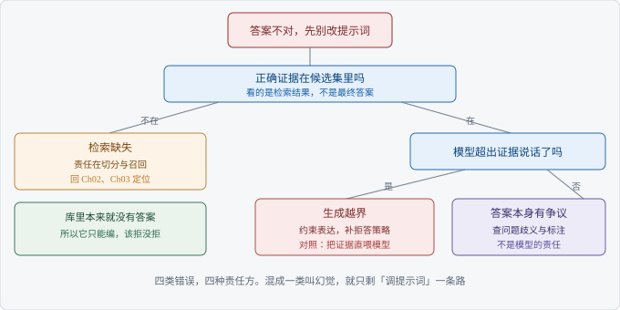

# Ch05 幻觉怎么定位

> 考察：你能否区分检索缺失与生成越界
> 出现频率：高｜难度：★★★★☆
> 一句话答案：先看证据在不在，再看是否越界

## 考点地图

> 图 05-1 考点关系

Ch04 让证据尽量送到。这一章处理剩下的情况：证据送到了，答案仍然不对。

把「答案不对」拆开，至少有四种。第一种，正确证据没进候选集，这是**检索缺失**（Retrieval Miss），责任在切分与召回。第二种，证据在候选集里，模型却说出了证据没有的结论，这是**生成越界**（Generation Overreach），责任在生成侧。

第三种最常被漏掉：库里本来就没有答案，模型硬答。它不是越界，是缺少拒答策略。第四种，答案本身有争议，问题有歧义，或者标注写错了，这一类不该算模型的账。

四类的修法完全不同。检索缺失回 Ch02 和 Ch03 改切分与召回；生成越界改约束与拒答；该拒没拒要定策略；标注问题改评测集。

分错的代价很实在。把检索缺失当成生成越界，你会去改提示词，改十版也不动，因为证据压根没送到。反过来，把生成越界当成检索缺失，你会一直加候选、扩 k，噪声越来越多，模型越容易顺着无关段落往下编。

【考点】表面在问幻觉，实际在问你敢不敢把责任切开。把所有错误都叫幻觉，是最省事也最没用的答法，因为修法会全错。

## 真实提问

「我们这套问答，偶尔会瞎编，用户投诉过两次。我看有人说加个引用就能解决，是不是这样？」
「上次我让团队加了引用，好像也没什么用。」

## 分层解析

**及格**：知道幻觉是模型说了没有依据的话。会提加引用、改提示词、调温度。这一档的动作都落在生成侧，默认问题出在模型。

**良好**：能区分两类责任。证据没找到，修检索；证据在而模型越界，修生成。说得出用什么判断：把检索结果单独打出来看，正确段落有没有在里面。

判断方法很土但有效。把这一条问题的前几条原文打印出来，逐条扫，看正确那句在不在。十分钟能做完，比改十版提示词可靠得多。

**优秀**：给出定位顺序，同时说清引用不是保险。引用能点回原文，只证明「有出处」，不证明「这段话支持这个结论」。模型可以引对段落，说错话。优秀档还会补第三类：库里没有答案时该拒答，拒答能力要单独测，不能混在准确率里。

| 现象 | 证据在候选集吗 | 责任方 | 先改哪里 |
| --- | --- | --- | --- |
| 答案里的数字，库里查不到 | 不在 | 检索 | 切分与召回 |
| 证据在，答案多出一句结论 | 在 | 生成 | 表达约束与拒答 |
| 库里没有答案，模型硬答 | 本来就没有 | 策略 | 拒答判定与话术 |
| 答案对，引用指错段 | 在 | 引用对齐 | 引用生成与核对 |

【面试官视角】听到「加个引用就好了」，对方会判断你没查过引用本身的错。这句话是这一行最典型的减分句，因为它把两个问题当成了一个。

## 追问链

1. 「加了引用就没有幻觉了吗？」——答到「引用只保证有出处，不保证结论被出处支持」算过；答到「每条引用要落到具体段落，再逐句核对这段是否支持结论，这一步目前多半靠人审或专门的判定程序」算优秀。
2. 「评测集能测出幻觉吗？」——答到「它只覆盖标过的类型，没标的测不出来」算过；答到「样本要按失效类型分层，必须包含库里无答案的题，否则拒答能力一直是盲区」算优秀。
3. 「凭什么说是模型越界？」——答到「把那段原文直接塞进上下文，看它是否仍然说错」算过；答到「这是唯一干净的对照：检索固定，只变生成，答错就是越界」算优秀。

三问指向同一个动作：控制变量。定位不是靠感觉，是靠一次只改一个东西，看结果往哪边动。

## 高频错误

- 把所有错误都叫幻觉。命名一错，后面的排查方向就全错。
- 以为加引用就安全。引用准确和答案正确是两件事，前者容易做，后者难。
- 不区分检索侧和生成侧，直接改提示词。提示词改不好，往往是证据本来就没送到。
- 用「降低温度」当解决方案。温度影响的是表达的随机性，不影响证据在不在。
- 只盯着最后那句话，不看中间结果。检索列表和引用段落都不看，等于放弃了唯一的证据链。

【陷阱】「我们的模型现在不怎么编了」。这句话没法验证。对方会接着问「你怎么测的」，答不出样本和口径，前面说的都作废。

## 自测

掐三分钟。给你的情况是：用户问保修期，系统答「三年」，政策文档写「两年」，而这条政策确实被检索到了。这是哪一类问题，你拿什么证明？

按三档打分：认定问题在生成侧，及格；说得出「证据已经在候选列表里」这个判断依据，良好；设计出「固定证据、只变生成」的对照，并说明引用怎么核对，优秀。

换个条件再问：这条政策根本没被检索到，结论要跟着变吗？要变。那就是检索缺失，先去 Ch03 的三类里定位。

## 下一考点

Ch06 讲怎么评测 RAG。定位靠个案，评测靠样本集；个案能救一次事故，样本集才能防下一次。
