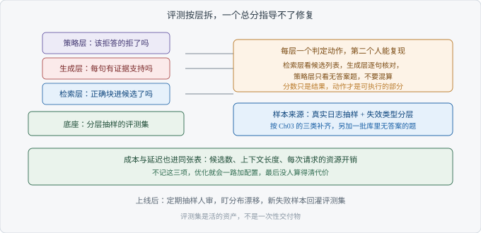

# Ch06 怎么评测 RAG

> 考察：你能否设计一套能执行的评测
> 出现频率：高｜难度：★★★★☆
> 一句话答案：召回、引用、拒答分开测

## 考点地图

> 图 06-1 考点关系

Ch05 靠个案定位，一次只能救一个事故。这一章把它变成可重复的东西：一组固定的题，一套能复现的判定。

地基是**评测集**（Evaluation Set），也就是一组问题和对应的期望答案。它决定你能测出什么。样本里没有的情况，指标永远看不见。

图上分三层。检索层看正确块有没有进候选；生成层看答案的每一句有没有证据支持；策略层看该拒答的有没有拒。三层不能混算，混算出来的分数只能告诉你「变差了」，说不出哪一层变差。

图的最下层是成本。候选数、上下文长度、每次请求的开销，和准确类指标放在同一张表里看。不然优化会一路加配置，没人算得清代价。Ch04 里那些手段该不该开，最后也要由这张表回答。

起步规模不用大。每层每类先给几条题，够跑通流程就行。题集真正的战斗力来自线上：每次翻车都是一个新样本，回灌一次，题集就厚一层。

【考点】考的是设计能力：新人照着你的方案，能不能跑出同样的结论。

## 真实提问

「我们想给 RAG 做个评测，老板问效果怎么样，我现在只能拿几个例子手动试。这套评测该怎么搭？」
「我不要那种漂亮的报表，我要能看出下一步该改哪儿。」

## 分层解析

**及格**：有测试集，能人工核对，能算一个比例。这一档只有一个总分，老板问「哪里不行」的时候答不上来。

**良好**：能分三层指标，并说清每层怎么判。样本也会按失效的类别分层，参照 Ch03 的三类补齐。到这一层，评测已经能指导修复了。

**优秀**：能讲清这套东西怎么建、怎么养。来源是真实日志抽样，不是自己编题；每类失效都要有样本；必须有一批库里查不到的题，否则拒答这条路一直是盲区；标注要双人做，口径写下来，两个人不一致的题要么修题要么剔除。

还要说清每个指标的判定动作。召回看的是候选列表里有没有那条，不是看最终答案像不像；引用看的是逐句能不能在证据里找到支持；拒答只看无答案的那批题，不和准确率混算。

还有两件事要提前定：谁判、多久跑一次。没有责任人的评测集，三个月后必然没人维护，题还是老的，结论也是老的。

| 层 | 指标 | 判定动作 | 变差时先改哪里 |
| --- | --- | --- | --- |
| 检索层 | 召回 | 正确块是否出现在候选列表 | 切分与召回 |
| 生成层 | 引用支持 | 逐句核对能否在证据里找到依据 | 表达约束 |
| 策略层 | 拒答 | 无答案题是否明确说不确定 | 拒答判定 |
| 成本 | 单次开销 | 记录候选数与上下文长度 | 候选规模 |

【面试官视角】分档只看一件事：这套评测别人能不能跑。只有总分的是自己在试；有分层和判定动作的，是团队资产。

## 追问链

1. 「评测集怎么建？」——答到「从真实日志抽样，按失效类型分层」算过；答到「加一批无答案题，双人标注并写口径，题集随版本走」算优秀。
2. 「指标怎么定？」——答到「每个指标配一个判定动作，别人能复现」算过；答到「指标要能指向责任方，检索层的指标不能靠看最终答案来判」算优秀。
3. 「上线后怎么监控？」——答到「定期抽样人审，看趋势」算过；答到「盯分布漂移，把线上新出现的失败样本回灌进评测集，每次改动跑同一套题对比」算优秀。

三问的顺序就是搭建顺序：先有题，再有判定，最后才有监控。反过来先上监控，你会发现不知道该看什么。

## 高频错误

- 只有一个总分。总分能证明变化，不能指导修复。
- 样本不覆盖失效的类别。全是容易题，分数很好看，线上照样翻车。
- 忽略成本与延迟。只看准不准，会在预算爆掉之后才发现问题。
- 用模型评模型，不做校准。判定模型自己也会偏，抽一批人工核对是必须的。
- 评测集一次建完就不动。业务在变，题不更新，半年后它测的是另一个系统。

【陷阱】「准确率还行」。这句话缺三样东西：题集怎么来的、判定的口径、算的是哪一层。面试官补问一句，答不上来就变成空话。

## 自测

三分钟作答。题目：一个企业知识库问答，搭一套最小可执行的评测。说出题从哪来、分几层、每层怎么判、上线后看什么。

评分标准：有固定题集和人工核对，及格；三层分明且各有判定动作，良好；再加上样本分层、查不到的题、成本入表与回灌机制，优秀。

最后补一刀：老板只要一个数字，你给哪个？给分层的那几个，并说明合成一个数会丢什么。这一步守不住，前面的设计都会被压回一个总分。

## 下一考点

前六个考点到这里收束。Ch07 把它们串成一场系统设计。回到 Ch05 的定位表，把每一类错误挂到一条指标上；挂不上的那一类，就是你的评测还缺的样本。
