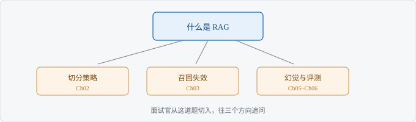

# Ch01 什么是 RAG

> 考察：你是否分得清检索与生成各自的责任
> 出现频率：高｜难度：★★★☆☆
> 一句话答案：先检索资料，再让模型基于资料回答

## 考点地图

> 图 1-1 考点关系

这道题是 RAG 系列的第一层。往下一层是切分与检索，往右是幻觉与评测。面试官问「什么是 RAG」，通常不是要定义，而是在找一个切入点，决定后面往哪追问。你答得越具体，他越容易往深处问；你答得越空，他越会换题。

如果面试官是业务面，他可能停在「解决什么问题」；如果是技术面，他会顺着「召回」往下问。你可以主动把话头引到你熟悉的方向：说完定义，补一句「真正难的是检索质量」。这句话会把追问引到检索，而不是模型参数。

答完定义后停半秒，看对方反应。他如果低头记，说明想往下问；他如果换题，说明这题过了。

## 真实提问

「你简历里写了做过 RAG，那你说说，RAG 到底解决了什么问题？」

## 分层解析

**及格**：能说出检索和生成两个步骤。及格答案只描述流程：先查资料，再把资料给模型。它没有解释为什么需要这一步。面试官听到这里，会追问「那和直接问模型有什么区别」。

**良好**：能说清它缓解的是知识过期与凭空编造。良好答案要说出问题：模型的知识有截止时间，而且会在没有依据时编造。RAG 把「凭记忆答」换成「看着资料答」。这句话一说，面试官就知道你理解动机。

良好答案还有一个加分点：能区分「知识过期」和「幻觉」。前者是不知道，后者是编造。两者修法不同，能分开说，说明你真正做过排查。

**优秀**：能指出检索质量决定上限，并给出评测思路。资料没找对，模型再强也只能在错误证据上表达。你会主动提评测：召回率、引用准确率、拒答率分开看。指标不用多，三个够用。

| 档位 | 判断标准 | 面试官听到什么 |
| --- | --- | --- |
| 及格 | 知道两个步骤 | 做过，但没想过为什么 |
| 良好 | 知道解决什么问题 | 有判断，能落地 |
| 优秀 | 知道边界与评测 | 能负责一条链路 |

三档之间的差别不在术语，在「有没有边界」。及格只说流程，良好说动机，优秀说边界。面试时如果不确定自己在哪档，宁可从良好答起，再补一句边界，不要一上来堆术语。

【考点】这题表面问定义，实际考你是否知道责任划分。检索错了，生成再强也救不回来。

## 追问链

1. 「检索不准怎么办？」——先分召回与重排。答到「先看正确证据在不在候选里，再谈排序」算过。只说「换个模型」不算。
2. 「怎么判断答案有依据？」——答到「引用要能点回原文，评测要看引用准确率」算过。只说「让模型别编」不算。
3. 「什么时候不该用 RAG？」——答到「需要多跳推理或实时计算时不适合」算过。只说「都能用」不算。

追问链的答法有一个通用结构：先给判断，再给依据，最后给验证方法。比如「检索不准」先分召回与重排，再说怎么判断，最后说怎么验证。只给判断，会被认为背答案。

## 高频错误

- 把 RAG 说成「给模型加记忆」——记忆是训练层的事，RAG 是推理层取证据。这句话一出口，面试官会判断你没做过。
- 只说向量检索——真实系统通常还有关键词与重排。只提向量，会被追问「专有名词搜不到怎么办」。
- 不提评测——说不出怎么判断好坏，等于没交付过。面试官会认为你只搭过 Demo。

还有一类隐性错误：把 RAG 和「搜索」混为一谈。搜索只返回文档，RAG 还要让模型基于文档表达。混为一谈会被追问「那模型做了什么」，答不上来就露馅。

## 自测

限时 3 分钟，用自己的话讲一遍 RAG。讲完对照三档：只讲两步是及格；讲清知识过期与幻觉是良好；能讲清检索决定上限并给出三个指标是优秀。如果卡在「为什么不用微调」，回到考点地图里的边界分支复习。

评分：讲清两步及格；讲清解决什么问题良好；讲清边界与评测优秀。

自测时录音，回放听三件事：有没有一句话说清动机，有没有提到检索决定上限，有没有给出可验证的指标。三件都有，优秀；缺一件，良好；只有流程，及格。如果只能记住一句，就记「检索决定上限，模型只负责表达」。

## 下一考点

Ch02 讲切分策略怎么选，这是 RAG 的第一个工程取舍。
