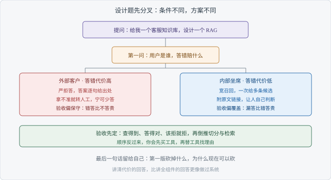

# Ch07 系统设计题：设计一个 RAG

> 考察：你能否在信息不全时先定约束，再给方案
> 出现频率：高｜难度：★★★★☆
> 一句话答案：先问约束与验收，再谈组件

## 考点地图

> 图 07-1 考点关系

六个考点各自独立：一个定义、一类失效、一套评测。这一题把它们串成一条线，考的是你怎么开头。

系统设计（System Design）没有标准答案，面试官也不指望你在白板上写出一套能上线的系统。他看三件事：你有没有先问清条件，你的设计站不站得住，你知不知道自己放弃了什么。

所以起点不是组件，是约束。同样是客服知识库，答案可以差很远。用户是外部客户还是内部坐席，答错的代价是重答一次还是赔一笔钱，知识库一周更新一次还是一天更新三次。这三条一变，方案跟着变。

这类题通常只给一句背景，剩下的靠你问。开头几分钟问条件，中间讲链路，最后说取舍。顺序一乱，后面每一步都要回头补前提，听的人也跟着断线。

Ch06 那套评测在这里换个身份出现：它是你的验收标准。你先说清怎么算答对，再倒推要什么切分、什么检索、什么拒答策略。

条件不会自己浮出来，得靠你问。至于面试最后轮到你问对方什么，Ch08 有单独的答法。

【考点】查的是把模糊需求变成可执行方案的能力，不是背组件清单。

## 真实提问

「给你一个客服知识库，设计一个 RAG 系统，你从哪开始？」
「别讲概念，我想听你怎么落地。」
「时间不多，你先说思路。」

## 分层解析

**及格**：从组件讲起。切分、向量库、检索、提示词，一路报下来，末尾补一句「大概就这样」。这一档缺的不是知识，是顺序：先选工具，再回头找问题。

**良好**：先问条件。用户是谁、问题长什么样、答错的代价多大、知识库多久变一次。问完再给方案，每一步能说出为什么是它。到这一档，方案已经可以讨论了。

**优秀**：先给验收，再给方案。他会说「这套东西算不算成，看三件事：查得到、答得对、该拒就拒」，然后倒推设计。他还会主动交代不做什么，第一版砍掉了哪些能力。

及格和良好之间隔着一句追问。面试官问「为什么这么切」，及格档会重复参数，良好档会说清文档长什么样、人又是怎么问的。

优秀档还有一个特征：有一条主线。整段回答跟着「一次提问从进来到出去」走一遍，而不是把模块排成一排。听的人跟得上，也就记得住。

| 动作 | 你要说清什么 | 面试官在听什么 |
| --- | --- | --- |
| 澄清 | 用户、问题类型、答错代价、更新频率 | 你会不会先摸边界 |
| 定验收 | 查得到、答得对、该拒就拒 | 你手里有没有可检验的标准 |
| 画链路 | 一次提问从进来到出去的每一步 | 方案是否连贯 |
| 说取舍 | 放弃了什么，为什么现在可以放弃 | 你知不知道代价 |

【面试官视角】组件谁都能背下来。先问条件的人，进团队后能自己接需求；直接报组件的人，需要有人替他把范围划好。

## 追问链

1. 「知识库多大，文档多久更新一次？」——答到「先问规模与更新频率，它们决定要不要做增量索引」算过；答到「更新频率还决定缓存能不能用，旧答案会不会被继续引用」算优秀。
2. 「你怎么保证答得准？」——答到「分层看：先看正确内容在不在候选列表里，再看答案有没有超出证据」算过；答到「每层给一个判定办法，换个人也能复现，出问题能定位到层」算优秀。
3. 「系统上线后答错了，你先改哪？」——答到「先看是没查到还是答偏了，两类改法不同」算过；答到「按影响面和改动代价排序，先修高频且低风险的那一类」算优秀。

第二问和第三问是一件事的两头：能定位，才谈得上修。定位不了就动手，改的是运气。

## 高频错误

- 上来就报组件。听的人不知道你为什么选这些，也没法判断对错。
- 只讲正常路径。没有拒答，没有兜底，也没有答错之后的处理。
- 把方案讲成产品介绍。通篇优点，一句代价都没有。
- 不区分场景。内部坐席和外部客户共用一套阈值、一套话术。
- 被问住就改口。面试官一质疑就推翻自己，比答错更伤。

【陷阱】「看情况」。这句话本身没错，停在这里就成了空话。要说清看什么情况，不同情况怎么分叉。

## 自测

限时三分钟。题目：一个内部 IT 支持知识库，五百人用，文档由三个团队维护。说出你先问什么、验收怎么定、链路怎么走、第一版砍掉什么。

三档怎么分：能报出组件并说清各干什么，及格；先问条件再给方案，良好；先定验收、给出链路、主动交代取舍，优秀。

写完再补一句：面试官说预算只够做一版，你砍哪块。答得出砍什么、为什么先砍它，这一题就稳了。

再检查一遍：你的回答里有没有一处范围是你自己划的，比如第一版只支持哪一类问题。划得出范围，说明你想过代价。

## 下一考点

方案讲完，面试官往往换一种问法：不聊设计，聊你自己。Ch08 处理的就是这类没有标准答案的问题。
