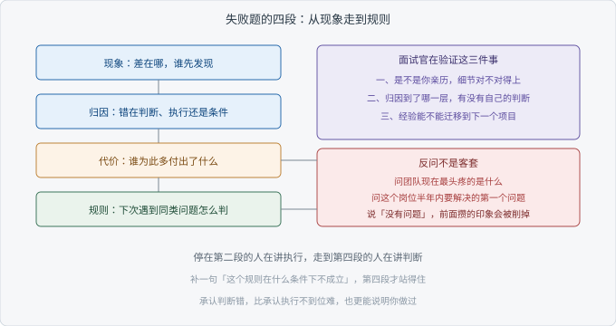

# Ch08 开放题与反问

> 考察：你能否把一次失败讲成可复用的判断
> 出现频率：中｜难度：★★★★☆
> 一句话答案：讲清代价、归因和改法

## 考点地图

> 图 08-1 考点关系

这道题看着最松，其实最紧。其余的题都有对错，这一题没有。没有对错的时候，面试官看的不是答案，是你怎么想事。

他通常想确认三样东西。第一，这件事是不是你真做过，细节骗不了人。第二，你归因归到哪一层，是怪数据、怪需求、怪同事，还是能找到自己的判断错在哪。第三，你有没有把这次失败变成一条以后能用的规则。

复盘（Retrospective）这个词在团队里常被用坏，变成追责会。面试里要的版本不一样：只回答「当时我依据什么做了那个决定，那个依据哪里不成立」。

挑哪个失败也有讲究。挑最惨的那个，容易讲成事故通报；挑一个你能说清判断过程的小失败，反而更有说服力。面试官要的是你的思路，不是你受过多大的委屈。

Ch07 考的是往前看：给定条件，你怎么设计方案。这一章考的是往后看：事情已经发生，你怎么解释它。两件事用的是同一种能力，把模糊的东西拆成可检验的判断。

开放题还有半个身子在反问环节。面试官说「你有什么想问我的」，这不是客套。你怎么问，暴露你把这份工作理解成什么。

这类题不只有失败一种问法。「你最近在学什么」「你觉得自己最缺什么」，考的是同一件事：你知不知道自己差在哪。

【考点】查的是自省与判断，不是讲故事的能力。

## 真实提问

「你做过的最失败的 RAG 项目是什么？」
「随便讲一个，不用挑最好听的。」
「失败在哪儿，你当时怎么处理的？」

## 分层解析

**及格**：讲了一个失败的项目，停在「效果不太好」。对方听不出差在哪、差多少、后来怎样。

**良好**：能说清三件事：失败长什么样，归因到哪一层，当时怎么改的。这一档已经证明你做过，也想过。

**优秀**：多两样东西。一是代价：这次失败让谁多花了时间，或者让哪个决定被推迟。二是规则：你从里面带走一条判断，并说清它在什么条件下不成立。

第二样更值钱。承认自己判断错，比承认执行不到位难。前者要否定当时的自己，后者只需要怪排期。

良好和优秀之间藏在细节里。说「后来换了模型」，和说「后来把拒答与召回分开处理」，一听就分出层次。现象也一样：说「答非所问」太空，说「客户问退换货期限，系统答了发货时间」，对方立刻知道问题长什么样。

| 段落 | 你要说清什么 | 面试官在验证什么 |
| --- | --- | --- |
| 现象 | 具体差在哪，谁先发现 | 这事是不是你亲历 |
| 归因 | 错在判断、执行还是条件 | 你会不会往深处看 |
| 代价 | 谁为此多付出了什么 | 你有没有担起责任 |
| 规则 | 下次遇到同类问题怎么判 | 经验能不能迁移 |

【面试官视角】听完这段，他心里会贴一个标签：会复盘的人，还是会被同一块石头绊第二次的人。

## 追问链

1. 「当时为什么没早发现？」——答到「没有可比对的基线，只能凭感觉判断好坏」算过；答到「就算有基线，判定口径也没定，两个人看同一个答案会得出不同结论」算优秀。
2. 「如果重来一次，第一步改什么？」——答到「先定验收标准再动手」算过；答到「先做一个能跑通的最小版本，用它验证最不确定的那个假设」算优秀。
3. 「你还有什么想问我的？」——答到「问团队现在最头疼的是什么」算过；答到「问这个岗位半年内要解决的第一个问题，以及现在卡在哪」算优秀。

第三问常被浪费。说「没有问题」，等于告诉对方你对这份工作没有具体想象。问薪资不丢人，但放在最后，前面先问事。

前两问管过去，第三问管现在：你关心什么，从反问里听得出来。

## 高频错误

- 挑一个假失败。把成功项目说成失败，细节一问就露。
- 全程怪外部。数据脏、需求变、排期紧，句句属实，但没有一句是自己的判断。
- 只讲情绪不讲事实。说了很多难受，说不出哪里错了。
- 讲完就停。没有改法，也没有带走的规则。
- 反问说「没有问题」。这一句会把前面攒下的印象削掉一截。

【减分项】「我们领导决定的」。这句话把责任推干净，也把你自己从项目里摘了出去。

## 自测

限时三分钟。题目：讲你做过的 RAG 项目里最失败的一次，说清现象、归因、代价、规则，最后准备一个反问。

三档分开看：能讲完一件事，及格；有归因和改法，良好；有代价、有可迁移的规则、反问问到点上，优秀。

讲完自己检查一遍：这段里哪一句是你当时的判断，而它错了。找不出来，说明还在讲执行，没讲判断。

评分时留意一件事：讲得流畅不等于讲得好。流畅是练过的痕迹，具体才是做过的痕迹。

## 下一考点

八个问题走到这里，全书收尾。回到 Ch07 的四步答题卡：澄清、验收、链路、取舍。最后一栏的取舍，和你这一章要讲的规则，是同一件事的两面。
