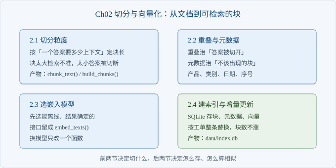
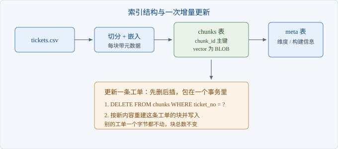

# Ch02 切分与向量化

> 本章解决：怎么把三百条工单变成能按意思查到的块？
> 前置：Ch01｜阅读 40 分钟｜动手 2 小时｜交付物：可检索的切分与索引

## 章首导图



> 图 2-1 本章结构

## 场景开场

周三下午，客服主管沈岚把一张清单推到你面前。上面是十条同事常被问住的问题，比如「显示器黑屏但灯还亮着」「HY-100 到底保几年」。

你按 Ch01 的做法跑关键词匹配，十条只中三条。剩下七条，客户用的词和工单里写的词不一样。

沈岚不问原理，只问一句：能不能让同事输入自己的问法，也能翻到对应的处理记录。你手上没有向量库，也不想先申请预算。

这一章要做的，是把「一条工单」变成「一块能被查到的文字加一个向量」。

### 2.1 切分粒度怎么定

> 路径：必读

这一节定块的长度：一块里要装多少字，才够回答一个问题。

粒度不取决于文档多长，取决于答案需要多少上下文。工单的答案通常是一句处理结论，加上一句适用条件。把结论和条件切散，检索回来就只有半句话。

先把三种切法摆出来对比。

| 切法 | 一块装什么 | 好处 | 代价 |
| --- | --- | --- | --- |
| 整条工单 | 现象加全部处理 | 上下文完整 | 一条工单讲两件事时，主题被稀释 |
| 按句切 | 一个动作 | 定位最准 | 答案被切断，引用只剩半句 |
| 按长度切、句子对齐 | 现象加一到两句处理 | 答案与条件同块 | 超长工单仍会分成两块 |

读这张表只看「代价」列。好处是理想情况，代价才是你每天要处理的情况。

本例取九十字为上限、二十字为重叠。依据是样例工单的正文长度：一条工单的现象加处理，多数在五十到九十字之间。块长定得比正文略小，长工单自然分成两块，短工单一块装完。

切分不按字数硬切，按句子边界切。硬切会把「更换同规格适配器」切成「更换同规格适」和「配器」，检索时两个半句都匹配不上。

```python
def chunk_text(text, size=90, overlap=20):
    sentences = split_sentences(text)
    chunks, cur = [], []
    for s in sentences:
        if cur and sum(len(x) for x in cur) + len(s) > size:
            chunks.append("".join(cur))
            tail, acc = [], 0
            for prev in reversed(cur):
                tail.insert(0, prev)
                acc += len(prev)
                if acc >= overlap:
                    break
            cur = tail if acc + len(s) <= size else []
        cur.append(s)
    if cur:
        chunks.append("".join(cur))
    if len(chunks) >= 2 and len(chunks[-1]) < 25:
        chunks[-2] += chunks[-1]
        chunks.pop()
    return chunks
```

完整函数在 `src/ch02/chunk.py`，运行 `python -m ch02.chunk`。四十八条工单切成五十三块，最短四十四字、最长八十八字，平均六十二字。

尾部合并那三行是补丁。最后一块只剩十几个字时，它单独成块没有检索价值，并回上一块更划算。

【代价】块越小，检索越准，但单块的信息越少。块越大，答案越完整，但一条工单会挤掉别的工单的候选位。这个平衡跟语料绑定，换一批工单要重定，没有通用值。

### 2.2 重叠与元数据

> 路径：必读

这一节解决两个具体问题：答案被切在接缝处，以及不该出现的块被检索到。

重叠按整句取，不按字数取。按字数取会把一句话截成两半，两半都不完整，引用时也对不上原文。按句取，接缝处重复的是完整的一句，随便引哪一块都能核对。

二十字的依据是句长，不是拍脑袋：样例工单的句子多在十五到三十五字之间，取一句话作为重叠，刚好够衔接。

元数据解决另一类问题。同事问「打印机怎么连网」，如果索引里混着键盘和电源的记录，它们会占掉候选位。把产品和类别存进块里，检索时先筛掉不相关的产品。

| 字段 | 例子 | 用途 | 谁维护 |
| --- | --- | --- | --- |
| ticket_no | T-1013 | 引用与去重 | 工单系统 |
| product | P200 打印机 | 按产品过滤 | 工单系统 |
| category | 安装配置 | 按问题类型过滤 | 客服标注 |
| created_at | 2025-05-02 | 按时间过滤、判断新旧 | 工单系统 |
| seq | 0 | 同一工单内的顺序 | 切分脚本生成 |

字段不要贪多。每加一个字段，就多一个可能填错的地方，也多一个过滤条件要维护。先用四个能过滤的，其余放正文。

```python
for seq, piece in enumerate(chunk_text(text, size, overlap)):
    out.append({
        "chunk_id": f"{row['ticket_no']}-{seq:02d}",
        "ticket_no": row["ticket_no"],
        "product": row["product"],
        "category": row["category"],
        "seq": seq,
        "text": piece,
    })
```

块号用「工单号加序号」，好处是能从块号直接看出它属于哪条工单。调试时看到 T-1042-01，不用再查表。

【陷阱】重叠会让同一句话出现在两块里。检索时两块一起进候选，占掉两个位置。去重按工单号做，不要按块号做，否则等于没去重。

### 2.3 选 embedding 模型

> 路径：必读

这一节决定用什么把文字变成向量，以及在什么条件下允许换。

选择顺序是先能跑，再谈效果。离线跑不起来的模型，在客户内网里一行代码都验证不了。

三个候选的差别不在效果排行，在于你能不能验收。

| 方案 | 能否离线 | 结果是否确定 | 换模型的代价 | 适用 |
| --- | --- | --- | --- | --- |
| 哈希 n-gram 嵌入 | 能 | 是 | 重算全量向量 | 先跑通链路、做基线 |
| 本地小模型 | 能，要预下载 | 是 | 重算全量向量，换维度 | 语义改写成主要问题时 |
| 在线接口 | 不能 | 多数可复现 | 重算、按量计费、要密钥 | 有预算且允许出网 |

本机默认用第一种。它把中文双字和英文数字词哈希到固定维度，再归一化。它只认字面重合，不理解同义改写，这一点必须提前说清楚，否则后面调不动时会怀疑整个方案。

嵌入（Embedding）的接口只留两个函数：一条文本进，一个等长向量出。换模型时改这两个函数，上层不动。

```python
def embed_one(text, dim=DEFAULT_DIM):
    vec = [0.0] * dim
    for tok in tokens(text):
        idx, sign = _bucket(tok, dim)
        vec[idx] += sign
    norm = math.sqrt(sum(v * v for v in vec))
    return [v / norm for v in vec] if norm else vec
```

运行 `python -m ch02.embed` 会打印三组余弦值。同一句话换个说法，得分零点七八；两句无关的话，得分负零点一二。这说明它抓的是字面重合。

注意第三组：查询写「E-204 定影单元温度异常」，语料写「打印机报 E-204」，得分只有零点一八。字面只重合一个错误码，语义分被拉低了。这类查询要靠字面检索补，Ch05 处理。

【版本】维度不要写进数据库表结构，也不要写进业务代码。维度从向量长度读，换模型只重算向量，不改表。写死了，换模型那天要改三处。

### 2.4 建索引与增量更新

> 路径：选读

这一节解决「数据变了，索引怎么跟上」。

全量重建只适合第一次。工单每天都在新增和修改，每次重建意味着演示数据停在第一天，或者每次演示前等一次全量。

结构只有两张表：一张存块，一张存元信息。向量序列化成二进制存进同一行，读的时候还原成浮点数组。



> 图 2-2 索引结构与一次增量更新

更新一条工单只有两步：删掉它的全部块，按新内容重建。两步放在一个事务里，中途失败就整体回滚。

```python
def replace_ticket(ticket_no, description, resolution, db_path=DB):
    conn = connect(db_path)
    old = conn.execute(
        "SELECT product, category, created_at FROM chunks WHERE ticket_no=?",
        (ticket_no,)).fetchone()
    row = {"ticket_no": ticket_no, "product": old[0], "category": old[1],
           "created_at": old[2], "description": description,
           "resolution": resolution}
    with conn:
        conn.execute("DELETE FROM chunks WHERE ticket_no=?", (ticket_no,))
        for chunk in build_chunks([row]):
            _insert(conn, chunk)
    return len(build_chunks([row]))
```

运行 `python -m ch02.index build`，五十三块、四十八条工单。再运行 `python -m ch02.index update T-1020 "..." "..."`，块数仍是五十三。块数不变，说明是替换不是追加。

【注意】只追加不删除，是这类项目最常见的隐性故障。旧答案留在索引里，新答案排第二，客户看到的还是过时的话。改完必须用同一句话问两次，确认返回的是新内容。

【代价】SQLite 单文件，写的时候整库加锁。演示和单机够用，多个客服同时改工单时会锁等待。真到那一步，先换成支持并发的库，再考虑分片，顺序不要反。

## 本章小结

| 要点 | 结论 |
| --- | --- |
| 粒度 | 由「一个答案需要多少上下文」定，不由文档长度定 |
| 切法 | 按句子边界切，不按字数硬切 |
| 重叠 | 按整句取，保证接缝处可被引用 |
| 元数据 | 存四个可过滤字段就够，多了维护不起 |
| 嵌入 | 先选离线、结果确定的，接口收成两个函数 |
| 索引 | 按工单删了重建，不追加 |

## 动手练习

1. 把块长从九十改到五十，重跑 `python -m ch02.index build`，记录块数变化。验收：能说出块数从多少变成多少，并解释原因。
2. 造一条超长工单（现象加处理超过两百字），重新建索引，找到它被切成的块。验收：打印出每块的首尾各十个字，确认接缝处是完整句子。
3. 用 `update` 改一条工单的处理结论，再用 Ch01 的关键词方式查它。验收：查到的内容是新结论，不是旧的。

## 自查清单

- [ ] 块长有依据，能从语料长度推出来
- [ ] 切分按句子边界，接缝处是完整句
- [ ] 每个块都带工单号、产品、类别、序号
- [ ] 嵌入函数只有两个，换模型不改上层
- [ ] 向量维度从数据读，没写死在表结构里
- [ ] 更新一条工单后，块总数不变
- [ ] 同一句话问两次，第二次返回新内容

## 常见坑

| 现象 | 原因 | 怎么办 |
| --- | --- | --- |
| 检索到的块只有半句话 | 按字数硬切 | 改成按句切，接缝处补整句重叠 |
| 一条工单占满前五名 | 同工单多块都进候选 | 按工单号去重，只留名次最高的一块 |
| 改了工单但答案没变 | 只追加没删除 | 先删后插，放同一个事务 |
| 换模型后程序报维度错 | 维度写死在表或代码里 | 维度从向量长度读，重算全量 |
| 短工单检索不到 | 尾部碎块没并回 | 尾块低于阈值时并入上一块 |

## 下一章

块和向量都有了，但还不能回答「哪几条最相关」。Ch03 接上检索：先过滤，再算相似度，最后用十条样本量一次召回。
