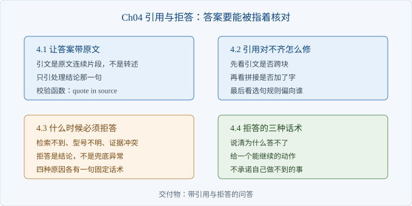
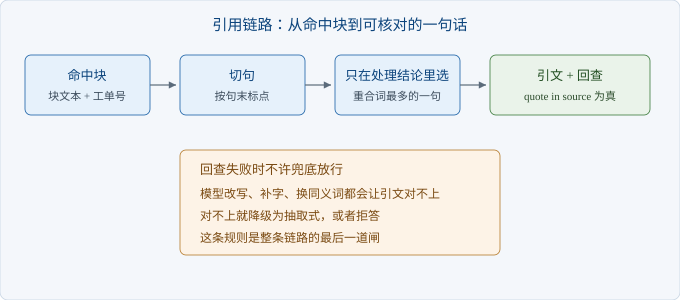

# Ch04 引用与拒答

> 本章解决：怎么让每个答案都能指着原文核对，答不了时敢说答不了？
> 前置：Ch03｜阅读 40 分钟｜动手 2 小时｜交付物：带引用与拒答的问答

## 章首导图



> 图 4-1 本章结构

## 场景开场

周五评审，沈岚点开你做的演示页面，输入「HY-100 保修几年」。屏幕上出现一段话，读起来很顺。

她把这段话复制到工单系统里搜，搜不到。因为那是模型用自己的话说的，原句里写的是「整机保修三年，面板与背光同在整机范围内」。

她要的不是顺，是能核对。客户拿着截图来投诉时，客服得能翻到那一行字。

第二件事更难开口：有些问题语料里根本没有答案。上一版为了不让页面空着，硬凑了一句，结果比不答更糟。

### 4.1 让答案带原文

> 路径：必读

这一节把「答案」从一段转述改成一段原文。

规则只有一条：引用必须是原文里连续存在的一段，不是模型加工后的句子。



> 图 4-2 引用链路

选句只在处理结论里选。工单的正文结构是「现象」加「处理」，现象是客户说的话，处理才是答案。把现象句引出来，读者看到的是问题，不是解法。

块里用「处理：」作为分界。选句时先定位这个标记，只在其后挑句子；挑中的句子太短，就把下一句并进来，保证引文读得通。

```python
def best_span(text, question, min_len=24):
    sents = split_sentences(text)
    start = next((i for i, s in enumerate(sents) if MARK in s), 0)
    q = set(tokens(question))
    scored = [(sum(1 for t in tokens(s) if t in q), -i, i)
              for i, s in enumerate(sents) if i >= start]
    _, _, idx = max(scored)
    span = "".join(sents[max(start, idx - 1):idx + 1])
    nxt = idx + 1
    while len(span) < min_len and nxt < len(sents):
        span += sents[nxt]
        nxt += 1
    return span[len(MARK):] if span.startswith(MARK) else span
```

去掉开头的「处理：」是最后一步。它属于排版标记，不属于答案；去掉之后，引文仍然是原文的子串，核对不受影响。

运行 `python -m ch04.cite`，引文是「HY-100 整机保修三年，面板与背光同在整机范围内，随机附件保修一年」，校验结果「对齐」。

同一段代码喂一句改写过的「整机保修五年」，校验结果「对不齐」。这一行是整个链路的底线：模型说了什么不重要，能不能在原文里找到才算数。

【注意】引文长度要控制在一到两句。整段贴上去，读者找不到关键句，等于没给引用。

### 4.2 引用对不齐怎么修

> 路径：必读

这一节处理「答案看着对，点开原文找不到」的情况。

三种原因，按排查成本从低到高排。

| 现象 | 原因 | 修法 |
| --- | --- | --- |
| 引文前半句在 A 块、后半句在 B 块 | 引文跨越了切分接缝 | 选句只在单块内做，跨块就截断到句号 |
| 引文比原文多几个字 | 拼接时加了前缀，或模型改写过 | 只保留原文子串，前缀在展示层加 |
| 引文是现象句，不是处理句 | 选句规则按重合词打分，现象句与问题更像 | 限定只在「处理」之后选句 |

第三条最隐蔽。问题本身就是从现象句改写的，重合词天然更多，按重合度选句必然选中现象。

修法不是调权重，是限定取值范围。范围错了，权重怎么调都错。

校验函数要独立于生成逻辑。生成部分改十次，校验部分一行不动，这样每次改完都能立刻知道有没有退化。

```python
def verify(quote, source_text):
    return quote.replace(" ", "") in source_text.replace(" ", "")
```

比较前去掉空格，是因为展示层可能重排空白；除此之外一个字都不许动。大小写、全半角、标点，都不做容错。容错一次，就会掩盖一次真实的改写。

【排查】对不齐时按这个顺序查：第一步，打印引文和源块原文，肉眼比对首尾；第二步，确认引文是否只来自一块；第三步，确认选句范围是否包含现象句；第四步，才怀疑模型改写。前三步都在代码里，几十秒能看完。

### 4.3 什么时候必须拒答

> 路径：必读

这一节定「什么情况下不许答」。

三种情况必须拒答：检索不到证据、型号不明确、证据之间互相矛盾。

| 判定 | 检查什么 | 本例的线 | 返回原因 |
| --- | --- | --- | --- |
| 范围外 | 查询里的词有多少出现在语料中 | 覆盖率低于三成半 | out_of_scope |
| 没证据 | 第一条的相似度 | 低于零点一五 | no_evidence |
| 缺型号 | 政策类问题是否只说品类 | 出现品类词但没型号 | need_model |
| 证据冲突 | 同一产品不同工单的时长是否打架 | 两条以上且取值不同 | conflict |

覆盖率这一行值得多说一句。它统计的是查询切出的词有多少在语料里出现过，跟语义无关，只是「这些词我们这儿有没有」。它便宜、可解释，也足够挡住「你们支持比特币吗」这类问题。

相似度阈值依赖打分口径。换成混合检索后，分数从余弦变成名次累加，这个零点一五就失效了，必须重标。所以接口里留了一个统一的置信度字段，谁改检索器谁负责填。

```python
if coverage(question, db_path) < MIN_COVERAGE:
    return refuse("out_of_scope")
hits = get(question, k)
if not hits or top_conf(hits[0]) < MIN_SCORE:
    return refuse("no_evidence")
if _need_model(question, db_path):
    return refuse("need_model")
if _conflict(hits):
    return refuse("conflict")
return compose(hits[0], question)
```

运行 `python -m ch04.answer`，四个例子分别是：作答、缺型号、范围外、作答。

冲突判定有一段容易被忽略：只有同一产品的不同工单才算冲突。同一条工单里写了「整机三年、附件一年」，那是两个范围，不是矛盾。

【代价】拒答会直接损失「看起来能答」的比例。演示时少答一条，客户会觉得系统笨；乱答一条被当场核对出来，客户会怀疑全部结果。两害相权，选前者。

阈值不是真理。这四个数是拿二十条样本标出来的，换语料要重标，标完还得留几条没参与调参的题做验证。

### 4.4 拒答的三种话术

> 路径：选读

这一节定拒答时说什么，因为「不知道」三个字会让客户直接挂电话。

拒答必须包含两件事：为什么答不了，下一步能做什么。

| 话术 | 用在什么情况 | 说什么 | 给什么下一步 |
| --- | --- | --- | --- |
| 答不了 | 没证据、超出范围 | 现有工单里没有能支撑这个答案的记录 | 补充型号与现象，或转人工登记服务单 |
| 缺信息 | 型号不明、批次不明 | 这条要按型号分开看，不同型号处理不一样 | 补充型号或机身序列号 |
| 口径冲突 | 两条记录互相矛盾 | 现有两条记录口径不一致，按出货批次区分 | 提供序列号确认批次，或转人工确认 |

三句话的共同点是都不解释技术原因。客户不需要知道什么是召回率，他需要知道下一步找谁。

话术不能承诺做不到的事。「我帮你查一下」在自动化系统里是空话，除非真的有人接手。写了就要有接手的人，否则第二次问会更生气。

话术要和返回原因一一对应，不要在代码里随手拼字符串。原因变了话术不变，客户会收到一句与问题无关的安慰。

拒答记录要留下来。哪类问题最常被拒，就是下一轮补语料的清单。这份清单比任何主观判断都准。

【提示】把拒答原因也返回给前端，但只用枚举值，不要把内部阈值暴露给客户。前端可以据此显示不同的引导按钮。

## 本章小结

| 要点 | 结论 |
| --- | --- |
| 引用 | 原文连续子串，只在处理结论里选句 |
| 对齐 | 校验独立于生成，除了空格不做容错 |
| 拒答 | 没证据、缺型号、证据冲突，三种都要拒 |
| 阈值 | 跟打分口径绑定，换检索器就重标 |
| 话术 | 说清为什么答不了，给一个能继续的动作 |

## 动手练习

1. 把 `best_span` 的选句范围改回全块，重跑 `ch04.cite`。验收：引文变成现象句，能说出为什么。
2. 造一条与现有工单矛盾的记录，让它进候选前二，再问那个问题。验收：返回原因变成 conflict，话术是第三条。
3. 把覆盖率门槛从三成半降到两成，用五条范围外的问题试。验收：记录有几条被误答，并说明代价。

## 自查清单

- [ ] 引用是原文子串，不是转述
- [ ] 选句只在处理结论里，不引现象句
- [ ] 校验函数与生成逻辑分离
- [ ] 检索不到时返回固定话术，不是空字符串
- [ ] 型号不明时先问型号，不猜
- [ ] 冲突判定只比较同一产品
- [ ] 每条话术都有下一步动作
- [ ] 拒答原因记了日志

## 常见坑

| 现象 | 原因 | 怎么办 |
| --- | --- | --- |
| 引文在原文里找不到 | 模型改写过，或拼接加了前缀 | 只保留子串，前缀放到展示层 |
| 引文很长但没重点 | 整段贴上去 | 截到一到两句，超长就断在句号 |
| 该拒答时硬答 | 只看相似度，没看覆盖率 | 加范围判定，两者都过才作答 |
| 该答时拒了 | 阈值按别的打分口径标的 | 换检索器后重标阈值 |
| 拒答后客户更生气 | 只说不知道，没给下一步 | 话术里必须带一个动作 |

## 下一章

答案有了，引用也能核对，但仍有整类问题查不到：型号、错误码、极短查询。Ch05 补一条字面检索通道，再谈要不要加重排。
