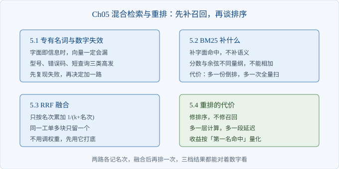
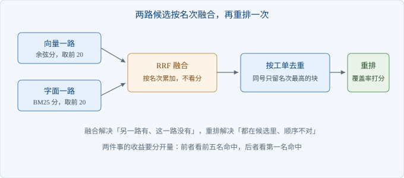

# Ch05 混合检索与重排

> 本章解决：向量查不到的型号与错误码，怎么补回来，补完值不值？
> 前置：Ch04｜阅读 40 分钟｜动手 2 小时｜交付物：混合检索与重排链路

## 章首导图



> 图 5-1 本章结构

## 场景开场

周一早上，沈岚转来一条客户原话：「机器开不了机，指示灯不亮，是不是电源坏了。」

你在系统里输入这句话，前五条出来的是电源过载、批次保修、指示灯闪烁三次，没有一条是显示器那条「无法开机，电源灯不亮」。

她又试了一条：「打印出来侧面有黑印，型号 P200。」这次命中了，因为型号是整串字符，向量抓得住。

同一个系统，两种结果。她想不通差别在哪，你也说不清，只能说「再调调」。

这一章先把差别说清楚，再决定加什么、不加什么。

### 5.1 专有名词与数字失效

> 路径：必读

这一节解释为什么有些查询一定查不到，以及怎么确认是同一类问题。

向量是由词的重合算出来的。查询里的词和语料里的词重合得少，分数就低，和两句话意思是否相同关系不大。

「开不了机」和「无法开机」讲的是同一件事，双字却只有「机」这一个字相交。这种差距，换成更大的模型也补不回来，因为模型没在这个语料上训练过。

字面即信息的情况有三类：型号、错误码、极短的部件名。这三类的共同点是，人看一眼就能对上，机器却要靠字符完全一致。

先复现一次失败，别急着改代码。

```python
for q in ("机器开不了机指示灯不亮", "E-311 纸张尺寸不匹配"):
    print(f"q={q}")
    for i, hit in enumerate(search(q, 3), 1):
        print(f"  {i}. {hit['score']:.2f} {hit['ticket_no']} {hit['text'][:26]}")
```

运行 `python -m ch05.bm25`，第一条查询的前三名是 T-1017、T-1043、T-1001。要的那条排在第三，进了候选，但向量一路根本没给它位置。

能进候选就有救。这是这一章最重要的一句：混合检索不生产答案，它只把另一路认为相关的候选搬过来。

【提示】复现失败时记下三个数：gold 在向量里的名次、在字面里的名次、两路候选的交集大小。交集越小，融合的空间越大。

### 5.2 BM25 补什么

> 路径：必读

这一节说清第二路检索补的是哪一块，以及它的边界在哪。

BM25 是一种按词打分的检索方法，三件事决定分数：词在这条文档里出现几次，这个词在整个语料里有多罕见，这条文档有多长。

罕见词权重高，是它管用的原因。TN-210 这种型号在全库只出现一次，谁包含它谁就排前面。向量做不到这一点，向量把每个词压进固定维度，罕见词的优势被平均掉了。

| 对比项 | 向量一路 | BM25 一路 |
| --- | --- | --- |
| 依据 | 词的组合与语义邻近 | 词频与稀有度 |
| 擅长 | 换个说法问同一件事 | 型号、错误码、部件名 |
| 不擅长 | 罕见字符串、长短差异大 | 同义改写、语序变化 |
| 分数含义 | 余弦，零到一之间 | 无上界，随语料变化 |
| 额外成本 | 一次向量比对 | 一次全量扫描加一份词表 |

分数那一行决定了后面不能用加法。两路的分不在一个量纲上，加起来没有意义，谁大谁就赢，结果是某一路永远压着另一路。

BM25 也不是万能的。查询写「开不了机」，文档写「无法开机」，BM25 一样查不到，因为它只看字面。

```python
def score(self, q_tokens, i):
    tf, dl = self.tf[i], self.lens[i]
    s = 0.0
    for t in q_tokens:
        f = tf.get(t)
        if not f:
            continue
        idf = self.idf.get(t, 0.0)
        s += idf * f * (self.k1 + 1) / (
            f + self.k1 * (1 - self.b + self.b * dl / self.avg))
    return s
```

那段分母是长度归一化。长文档天然含更多词，不罚一下，长文档会霸榜。本例的工单长度接近，这一项影响不大，但语料一旦混进长文档就会显形。

【代价】BM25 每次查询都要扫全量文档。五十三块是毫秒级，几十万块就要建倒排索引，再往上要考虑专门的检索服务。演示阶段不值得提前做。

### 5.3 RRF 融合

> 路径：必读

这一节解决「两路分数不能相加，那怎么合」。

办法是丢掉分数，只用名次。每条候选在每一路里的名次取倒数，累加，按总分重排。



> 图 5-2 融合与重排流程

公式是一除以（常数加名次）。常数取六十，是这类做法的常用起点，作用是压平头部的差距：第一名和第二名差多少，不会因为常数小而被放大成几倍。

这个做法不完美。它假设两路同等可信，也丢掉了「第一名领先很多」这个信息。好处是不用调权重，先跑起来再说。

```python
def rrf(rankings, k=RRF_K):
    scores = {}
    for ranking in rankings:
        for i, key in enumerate(ranking, 1):
            scores[key] = scores.get(key, 0.0) + 1.0 / (k + i)
    return sorted(scores.items(), key=lambda x: x[1], reverse=True)
```

融合之后必须按工单去重。同一工单切出的两块可能都进候选，占掉两个位置，把别的工单挤下去。去重放在融合之后、截断之前，顺序不能反。

运行 `python -m ch05.fuse`，第一条查询三行结果分别是向量、字面、融合。融合名单里 T-1001 回到第四位，向量名单里它根本不在。

这就是混合检索的全部收益：把一个本来找不到的候选搬到前五里。它不负责把它排到第一。

【注意】去重按工单号，不按块号。按块号去重等于没去重，因为块号本来就各不相同。

### 5.4 重排的代价

> 路径：选读

这一节回答一个问题：候选已经进来了，要不要再排一次。

排一次有收益。融合只按名次算，不看查询是否被完整覆盖；有的块只命中查询里的一半词，却因为两路都排得靠前而占了第一。重排用覆盖率重新打分，能把这类块压下去。

代价也要说清。重排是链路里多出来的一层，多一层就多一段耗时，也多一处要维护的规则。

```python
for h in hits:
    toks = tokens(h["text"])
    cover = len(q_set & set(toks)) / max(len(q_set), 1)
    latin_hit = 1.0 if q_latin and q_latin <= _latin(toks) else 0.0
    model_hit = 1.0 if any(m.lower() in h["product"].lower() for m in q_latin) else 0.0
    h["confidence"] = round(cover, 3)
    h["rerank"] = round(cover + 0.6 * latin_hit + 0.3 * model_hit, 4)
```

三个分量各管一件事：覆盖率管「查询的词有没有都出现」，型号一致管「产品对不对」，错误码整体命中管「字符串有没有完整出现」。

置信度那一行不是给排序用的，是给拒答用的。Ch04 的阈值按余弦标定，换了检索器就失效；这里把覆盖率写成统一的置信度，阈值只跟这一个量挂钩。

收益要用数字说话。同一批十五道有标准答案的题，三档链路的结果如下。

| 链路 | 第一名命中 | 前五名命中 |
| --- | --- | --- |
| 纯向量 | 12/15 | 14/15 |
| 混合 | 12/15 | 15/15 |
| 混合加重排 | 14/15 | 15/15 |

读表的方法：混合补的是「前五名」，重排补的是「第一名」。两列各涨各的，不要混着看。

数字来自 Ch06 的评测脚本，`python -m ch06.eval --compare` 可以复现。样本只有十五道，涨一两条说明方向对，不足以说明稳定。

【代价】重排让每次问答多一次全候选打分。本例候选只有二十条，耗时几乎看不出来；候选上千条时，这一层会变成延迟的主要来源，那时要么把候选池收小，要么换成更快的打分方式。

【排查】重排后结果反而变差，按这个顺序查：第一步，看置信度是否被覆盖；第二步，看型号判定是否把通用件误判成不匹配；第三步，看候选池是否太小，正确答案根本没进来。第三步最常见，也最容易被忽略。

要不要上重排，取决于你的失败是哪一类。第一名错、前五名对，重排值得；前五名里根本没有，重排白加一层。

## 本章小结

| 要点 | 结论 |
| --- | --- |
| 失效 | 型号、错误码、短查询，向量天生不占优 |
| BM25 | 补字面，靠稀有词加权，不补同义改写 |
| 融合 | 分数不可比就用名次，RRF 不用调权重 |
| 去重 | 融合后按工单去重，再截断 |
| 重排 | 补第一名，不补召回，代价是一层延迟 |

## 动手练习

1. 把 BM25 的常数项从一点五改到零点五，重跑三档对照。验收：记录第一名命中数的变化，并解释原因。
2. 关掉按工单去重，用「HY-200 支架孔距」查询。验收：打印融合名单，指出被同一工单占掉的位置。
3. 给重排加一条规则：查询里出现错误码且完整命中时加一分。验收：在十五道题上重跑，说明第一名命中是否变化。

## 自查清单

- [ ] 能复现至少一条向量漏召回
- [ ] 两路候选池大小一致，方便对照
- [ ] 融合只用名次，没有把分数相加
- [ ] 融合后按工单去重，再截断
- [ ] 重排打分有可解释的分量，不是黑箱
- [ ] 置信度是统一口径，拒答阈值跟它挂钩
- [ ] 收益按「第一名」和「前五名」分开记录

## 常见坑

| 现象 | 原因 | 怎么办 |
| --- | --- | --- |
| 两路分数直接相加 | 量纲不同，一路永远赢 | 改用名次融合 |
| 前五名里同一工单占三条 | 没按工单去重 | 融合后去重再截断 |
| 加了 BM25 后短查询变差 | 短查询词少，稀有词权重被放大 | 对极短查询回退到向量一路 |
| 重排后延迟翻倍 | 候选池太大 | 收小候选池，或只对前若干条重排 |
| 拒答阈值突然失灵 | 分数口径从余弦变成名次 | 统一用置信度字段，重标阈值 |

## 下一章

链路走到这里，能答、能引、能拒、能补召回。剩下的问题是：这些改动到底有没有让系统变好，能不能交给客户。Ch06 用二十道题给出基线，并把上线前的检查项列成一张表。
