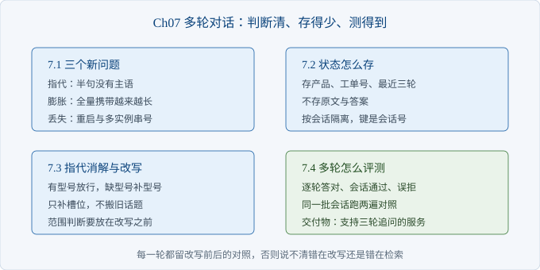
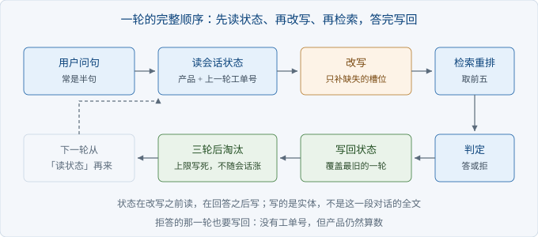

# Ch07 多轮对话与上下文

> 本章解决：用户追问「那保修呢」时，怎么让系统知道他在问哪台机器
> 前置：Ch06｜阅读 40 分钟｜动手 2 小时｜交付物：支持三轮追问的问答服务

## 章首导图



> 图 7-1 本章结构

## 场景开场

周三下午，华阳精工的客服主管转来一段会话记录。

客户第一句：显卡花屏出现彩色条纹。系统答了显存虚焊那条。

第二句：保修期多久。系统答了显卡整机三年。

第三句：显卡风扇保修吗。系统回了一句「这条要按型号分开看，请补充型号」。

客户的原话是：我前面说的不就是显卡吗。

你把第三句单独丢进系统，结果一样，照样要型号。系统把每一句都当第一句处理。

这一章要做的事，是让它记住前面说过什么，并说清记多少、记多久、怎么验证它真的记住了。

### 7.1 多轮带来的三个新问题

> 路径：必读

单轮只有一个输入，多轮有三个问题要分开修：指代、上下文膨胀、状态丢失。混在一起修会互相抵消。

指代的麻烦在于半句没有主语。用户不会每句都重复产品名，「它」「这台」「那换屏呢」里没有可检索的名词。这类句子直接丢给检索器，等于用一句没有主语的话去查库。

膨胀的麻烦在于字数是累加的。把每轮的问与答全文拼进提示词，第三轮就要带上前两轮的全部内容。本例三轮的实测是：只存实体占四十个字符，全量携带要一百三十四个。

状态丢失的麻烦在于看不见。会话状态如果只放在进程内存里，服务重启就没了；多实例部署时请求落到别的实例，用户刷新一下页面，系统退回第一轮。

| 维度 | 单轮 | 多轮 | 要补的东西 |
| --- | --- | --- | --- |
| 输入 | 一句完整问句 | 常是半句 | 改写 |
| 成本 | 固定 | 随轮次增长 | 状态压缩 |
| 失败表现 | 答错 | 答成上一轮的问 | 逐轮评测 |
| 调试方式 | 复现一句 | 要复现整段 | 会话回放 |

三个问题里，膨胀最容易被忽略，因为演示时看不出来。演示只有三轮，多带的字不够多；真实会话十几轮，账单和耗时一起涨。

```python
@dataclass
class Turn:
    question: str        # 用户原话
    rewritten: str       # 送进检索的问句
    notes: list[str]     # 改了什么，排查时先看这里
    ticket_no: str = ""
    product: str = ""
    refused: bool = False
```

每一轮都留一份改写前后的对照。没有这份对照，用户说「它答错了」时，你判断不了错在改写还是错在检索。

【注意】`notes` 不是日志装饰。排查多轮问题，第一个要看的就是这一轮到底被改成了什么。

### 7.2 会话状态怎么存

> 路径：必读

状态只存三样：当前产品、上一轮工单号、最近三轮的问句。原文与答案都不进状态。

理由很直接。下一轮要判断的只有两件事：在说哪个产品，刚才落在哪条工单。把上一轮的完整答案带上，除了让提示词变长，对判断没有帮助。



> 图 7-2 改写与检索的位置

| 字段 | 例子 | 为什么要存 | 不存什么 |
| --- | --- | --- | --- |
| product | A100 显卡 | 下一句多半省了主语 | 不存整段产品描述 |
| ticket_no | T-1026 | 用户说「就这条」时要能回去 | 不存引文原文 |
| turns | 最近三轮问句 | 判断是不是同一话题 | 不存模型回答 |

轮次要设上限。本例留三轮：第一轮交代现象，第二轮问政策，第三轮追问细节，正好够用。留十轮的结果是上下文越来越长，而前面几轮对当前判断的影响已经很小。

上限管的是体积，不是准确率。产品槽位每轮都会刷新，删掉旧轮次不会让这一轮答错，只会让状态变小。把上限从三改到一，答对数不变，状态占用从四十个字符降到十三个。

```python
def ask(self, question: str) -> Turn:
    rewritten, notes = rewrite(question, self.state())
    result = self.ask_fn(rewritten, self.k)
    hits = self.retrieve(rewritten)
    top = hits[0] if hits else {}
    ...
    self.turns.append(turn)
    if len(self.turns) > self.max_turns:
        self.turns.pop(0)
    return turn
```

运行 `python -m ch07.pipeline`，三轮的实测输出如下。

```text
轮次      用户问         改写后                   动作      工单      状态/全量字符
第 1 轮  显卡花屏出现彩色条纹  显卡花屏出现彩色条纹            不改写     T-1007  16/46
第 2 轮  保修期多久       A100 显卡 保修期多久         补产品     T-1026  27/89
第 3 轮  显卡风扇保修吗     A100 显卡风扇保修吗          补型号     T-1026  40/134
```

最后一列是「状态占用字符数 / 全量携带字符数」。三轮时差了三倍多，轮次越多，差距越大。

【代价】状态压得越紧，能接的追问越少。只存产品，遇到「刚才那条工单的检测周期」就答不了。折中的做法是存工单号：需要细节时按号回查原文，而不是把原文一直带在上下文里。

状态还要按会话隔离。用进程内的字典存，键必须是会话号，不能是用户号。同一个用户可能同时开两个窗口问两台设备，按用户存会让两边互相污染。

### 7.3 指代消解与查询改写

> 路径：必读

改写只做一件事：把缺的槽位补上，把指代换成具体对象。

规则三条，按顺序判断。本轮已含型号就原样放行；含品类但缺型号，就把品类换成完整产品名；两样都没有，就在前面补产品名。另外去掉「那」「还有」这类起句词。

| 用户问 | 状态里的产品 | 改写后 | 动作 |
| --- | --- | --- | --- |
| 它保修多久 | A100 显卡 | A100 显卡保修多久 | 还原指代 |
| 保修期多久 | A100 显卡 | A100 显卡 保修期多久 | 补产品 |
| 显卡风扇保修吗 | A100 显卡 | A100 显卡风扇保修吗 | 补型号 |
| 那换屏要钱吗 | A100 显卡 | A100 显卡 换屏要钱吗 | 去语气词、补产品 |
| A100 的发票丢了怎么办 | A100 显卡 | A100 的发票丢了怎么办 | 不动 |

读这张表要看清一件事：改写补的是缺失的槽位，不是把上一轮的话搬过来。上一轮的错误码、故障词都不该进新问句，否则新问题会被旧问题压住。

```python
def rewrite(question: str, state: dict) -> tuple[str, list[str]]:
    q, notes = question.strip(), []
    product = str(state.get("product") or "")
    if not product:
        return q, notes
    model, kind = split_product(product)
    q, dropped = _strip_filler(q)
    if dropped:
        notes.append("去语气词")
    for p in PRONOUNS:
        if p in q:
            q = q.replace(p, product)
            notes.append(f"还原「{p}」")
            break
    if model and model.lower() in q.lower():
        return q, notes
    if kind and kind in q:
        q = q.replace(kind, product, 1)
        notes.append("补型号")
    else:
        q = f"{product} {q}"
        notes.append("补产品")
    return re.sub(r"\s+", " ", q).strip(), notes
```

【陷阱】改写会把范围外的问题也拽进来。`python -m ch07.rewrite` 的最后一行是「你们支持比特币付款吗」，带状态后变成「A100 显卡 你们支持比特币付款吗」，看起来像本产品的问题。正确顺序是先做范围判断，超范围直接拒答，不进改写。本例为了让副作用显形，没有加这层判断。

【排查】改写之后答错，按这个顺序查：第一步，看改写有没有覆盖本轮的新词；第二步，看状态里的产品是不是过期了，用户中途换了设备；第三步，看上一轮是不是拒答。拒答那一轮没有工单号，状态里只剩产品，改写会显得过于自信。

### 7.4 多轮的评测怎么做

> 路径：选读

多轮不能只测末轮，也不能只测首轮。按轮次记，再按会话汇总。

评测复用 Ch06 里跑的那条链路，指标名也与单轮对齐，两张表才能并排看。多出来的只有会话通过这一项。

三个指标：逐轮答对、会话通过、误拒。逐轮答对指第一名就是标准工单且没有拒答；会话通过指三轮全对；误拒指证据在前五却被拒。第三个指标在单轮评测里容易被忽略，在多轮里会放大，因为用户已经说清产品，系统还问一遍型号，体验最差。

| 链路 | 逐轮答对 | 前五命中 | 误拒 | 会话通过 |
| --- | --- | --- | --- | --- |
| 无状态 | 4/9 | 9/9 | 2/9 | 0/3 |
| 有状态 | 7/9 | 9/9 | 2/9 | 2/3 |

```python
def summarize(rows: list[dict]) -> dict:
    cases = sorted({r["case"] for r in rows})
    return {
        "right": sum(1 for r in rows if r["right"]),
        "total": len(rows),
        "recall": sum(1 for r in rows if r["recall"]),
        "refused": sum(1 for r in rows if r["refused"]),
        "cases": len(cases),
        "passed": sum(1 for c in cases if all(r["right"] for r in rows if r["case"] == c)),
    }
```

前五命中两边都是九分之九，说明候选一直够用，差别在排序与拒答。会话通过从零到三分之二，最直接的原因是第三轮不再被要求补型号。

没通过的那一条值得单独看。它第二轮问「保修期多久」，改写后带上「HY-100 显示器」，两条保修口径不同的工单同时进前五，拒答规则里的冲突判断被触发，直接拒了。

改写没有写错，做法不对。产品名应该当过滤条件，不该拼进查询串。拼进串里，同产品的政策类工单会一起涌进候选，冲突判断反而更容易被触发。

【待确认】改写该不该带产品名，取决于你的检索器支不支持元数据过滤。支持就用过滤，查询串保持原样；不支持才拼字符串，并接受它压过新词的风险。本例属于后者，所以那一条会话的第二、三轮都没通过。

样本只有九轮，涨三条只能说明方向对。要拿它做验收，先扩到三十轮以上，并且覆盖至少四个产品，否则测不出跨产品串台。

## 本章小结

| 要点 | 结论 |
| --- | --- |
| 三个新问题 | 指代、膨胀、丢失，分开修 |
| 状态 | 只存产品、工单号、最近三轮 |
| 上限 | 轮次写死，不随会话增长 |
| 改写 | 只补缺失槽位，不搬旧话题 |
| 评测 | 逐轮答对与会话通过分开记 |

## 动手练习

1. 跑一遍 `python -m ch07.pipeline`，把三轮的「状态/全量字符」抄下来。验收：能说出第三轮全量携带是状态的几倍。
2. 把 `MAX_TURNS` 从三改到一，重跑会话与多轮评测。验收：说明状态字符数怎么变，以及答对数为什么不变。
3. 给改写加一层范围判断：超范围的问题不进改写，直接拒答。验收：`python -m ch07.rewrite` 最后一行的输出不再带产品名。

## 自查清单

- [ ] 每一轮都记下改写前后的问句
- [ ] 状态里没有原文与模型回答
- [ ] 轮次上限是写死的常量
- [ ] 状态按会话隔离，不按用户
- [ ] 改写只补槽位，不搬旧错误码
- [ ] 范围判断放在改写之前
- [ ] 评测按轮次记，也按会话汇总
- [ ] 误拒单独统计，没混进答对率

## 常见坑

| 现象 | 原因 | 怎么办 |
| --- | --- | --- |
| 第三轮答成第一轮的问题 | 改写只补了产品，没换话题 | 只补槽位，不重复旧故障词 |
| 越聊越慢越贵 | 历史全文都拼进提示词 | 状态只留实体，轮次设上限 |
| 刷新页面就失忆 | 状态放在进程内存 | 落到会话存储，键用会话号 |
| 超范围问题被硬答 | 先改写后判范围 | 顺序倒过来，先判再改 |
| 两家客户会话串了 | 状态键用了用户号 | 键改成会话号 |

## 下一章

会话层接住追问之后，问题从「答不答得上」变成「答错的那条谁来修」。Ch08 把差评、语料更新、灰度与月报做成四条常规动作，让系统在交付之后继续变好。
