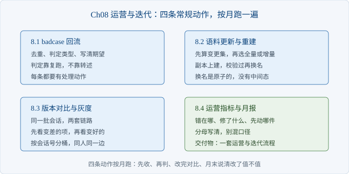
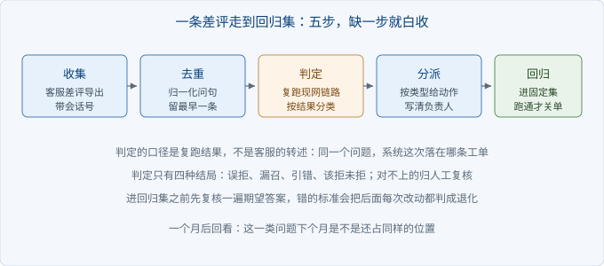

# Ch08 运营与迭代

> 本章解决：上线之后，靠什么把答错的那些问题一条条修掉
> 前置：Ch07｜阅读 40 分钟｜动手 2 小时｜交付物：一套运营与迭代流程

## 章首导图



> 图 8-1 本章结构

## 场景开场

系统上线两个月，华阳精工的售后经理在群里发来一张截图。

截图里是同一个问题：「屏幕一片黑但灯还亮」，这个月出现三次，三次都是系统拒答，三次都由人工兜底。

她附了一句话：这个我们已经报过两次了，到底在不在修。

你翻聊天记录，第一次是口头说的，第二次发在群里，都没有落到任何一张表上。第三次仍然没有人知道该改哪里。

这一章要把这类口头反馈变成一张有编号、有类型、有负责人的清单，并且让它每个月跑一遍。

### 8.1 badcase 回流机制

> 路径：必读

回流要解决的是「反馈进不来、进来了没人认领、认领了不知道改没改好」这三件事。

一条差评要变成 badcase，过五步：收集、去重、判定、分派、回归。



> 图 8-2 一条差评走到回归集

判定这一步最容易被做成形式。让客服自己填「答错了」，填出来的原因五花八门，无法统计。

正确做法是复跑一遍现网链路，看系统这一次实际落在哪条工单，再和客服标注的期望工单比。分类规则只有五种，全部由结果决定，不由人决定。

| 类型 | 判据 | 处理动作 |
| --- | --- | --- |
| 误拒 | 期望工单在前五，却被拒答 | 调范围阈值，补口语同义词 |
| 漏召 | 期望工单不在前五 | 查语料缺不缺，再查切分 |
| 引错 | 答了，但第一名是别的工单 | 查型号与错误码是否完整命中 |
| 该拒未拒 | 期望是拒答，却给了答案 | 补边界题，收紧阈值 |
| 答非所问 | 工单对了，客户仍说没用 | 人工复核，多是同产品口径打架 |

```python
def judge(row: dict) -> tuple[str, str]:
    expected = row.get("expect")
    result = ask(row["question"], K)
    hits = retriever(K)(row["question"])
    top = hits[0]["ticket_no"] if hits else ""
    if expected and result["refused"]:
        rank = next((i for i, h in enumerate(hits, 1) if h["ticket_no"] == expected), 0)
        return ("误拒" if 0 < rank <= K else "漏召"), top
    if not expected and not result["refused"]:
        return "该拒未拒", top
    if not expected:
        return "正确拒答", top
    if top != expected:
        return "引错", top
    return "答非所问", top
```

误拒与漏召要分开判。现象都是「系统说不知道」，动作却相反：一个要放宽，一个要补语料。混成一类，就会出现「明明证据在前五，却一直在补工单」的无效劳动。

运行 `python -m ch08.badcase`，十四条反馈跑出来是这样。

```text
反馈 14 条，去重后 13 条，重复 1 条
差评 10 条，登记为 badcase

编号      类型        期望      实际      问句
F-001   误拒        T-1004  T-1042  屏幕一片黑但灯还亮
F-003   漏召        T-1003  T-1011  纸总卡在出纸口
F-004   误拒        T-1021  T-1020  键盘洒了水
F-005   误拒        T-1043  T-1017  机器上的灯闪三下
F-006   误拒        T-1013  T-1013  联不上 wifi
F-007   误拒        T-1015  T-1015  扫描件灰蒙蒙的
F-008   误拒        T-1017  T-1018  电源一插就跳闸
F-009   漏召        T-1034  T-1048  换新的要等几天
F-010   该拒未拒      -       T-1028  可以做定制吗
F-011   误拒        T-1024  T-1024  HY-100 保修几年
```

十条里七条是误拒，共同点是客户用了口语：「屏幕一片黑」不是「黑屏」，「洒了水」不是「进水」。证据就在前五，被范围判断挡在门外。

清单的价值不在告诉你「系统变差了」，而在告诉你「同一类缺陷占了七成，改一处能带走一批」。

【注意】去重按归一化后的问句做，不按时间做。同一个问题被两个客户各报一次，是同一件事；按时间排会让同一处缺陷在清单里出现两行，做修复的人以为有两处。

### 8.2 语料更新与索引重建

> 路径：必读

语料每月都在变：新工单进来，老工单改处理方式，合并的工单下线。重建只回答一个问题：这一次要不要全量重算。

先算变更集。拿工单号做主键，比较每条工单全部块文本的指纹。指纹没变就不必重新嵌入，这一步能省下大部分算力。

| 方式 | 代价 | 什么时候用 |
| --- | --- | --- |
| 全量重建 | 全部工单重新嵌入 | 换嵌入模型、改切分参数 |
| 增量重建 | 只重算新增与修改的工单 | 日常更新，占多数 |
| 下线处理 | 从快照移除，不重算 | 工单合并或作废 |

```python
def diff(old: dict[str, str], new: dict[str, str]) -> dict[str, list[str]]:
    added = sorted(set(new) - set(old))
    removed = sorted(set(old) - set(new))
    changed = sorted(t for t in set(old) & set(new) if old[t] != new[t])
    return {"added": added, "changed": changed, "removed": removed}
```

运行 `python -m ch08.reindex`，输出是这一段。

```text
工单快照：48 条，变更后 48 条
变更集：新增 1　修改 1　下线 1
  新增 T-1049
  修改 T-1017
  下线 T-1020

全量：48 条工单、53 块，全部重新嵌入
增量：2 条工单、约 2 块，其余复用旧向量

暂存库 index.staging.db：块数、空文本、维度、样例查询四项通过
切换：index.current.db 已换名，用时 1.53 ms，暂存库残留 False
```

增量只碰新增与修改的两条。下线的那条从快照里移除，不需要重新嵌入，因为它的向量不会再被查到。

演示用复制代替建索引，为的是把校验与切换这两步单独跑通。真实的流水线里，建索引命令先在暂存库上跑完，再进校验，顺序不能反。

真正危险的不是算得慢，是重建期间线上查的是半成品。在同一个库上边删边建，中间那几分钟里用户会查到缺了一半的语料，而且现象随机。

做法是换一份副本：把线上库复制成暂存库，在暂存库上建，校验通过后用一次换名操作切过去。同一块磁盘上的换名是原子的，读到的要么旧库，要么新库。

校验至少要四项：块数不少于基线、没有空正文、向量维度唯一、样例查询能命中。第三项最容易被跳过，换嵌入模型时忘了改维度，正好会栽在这里。

【代价】换名切换要求暂存库与线上库在同一块磁盘上。跨盘复制再换名，就不是原子操作了，中间会有一段两边都没有的窗口。

回滚的准备也要提前做：切换前把旧库改名留档，出问题就用同样的方式换回来。留档不占额外算力，只占磁盘。

【排查】切换后效果变差，先看块数比切换前少没少；再看上周的 badcase 有没有重新出现；最后看维度与切分参数是不是被顺手改了。参数这一项最难查，因为「顺手」通常没人记在变更单上。

### 8.3 版本对比与灰度

> 路径：必读

改完之后要说清值不值。办法是同一批会话、两套链路、逐项对照。

B 版就是 Ch07 那层的会话版，A 版是加会话层之前的单轮链路。两套只差这一层，其余不动。

对比的规矩只有一条：除了被改的那一项，其余全部相同。换了检索又要换提示词，一起上，涨了也说不清是谁的功劳。

| 版本 | 逐轮答对 | 前五命中 | 误拒 | 会话通过 |
| --- | --- | --- | --- | --- |
| A 单轮 | 4/9 | 9/9 | 2/9 | 0/3 |
| B 会话 | 7/9 | 9/9 | 2/9 | 2/3 |

```python
def compare(cases: list[dict], plans: list[tuple[str, bool]]) -> list[dict]:
    return [{"name": name, "mode": use, **summarize(run(cases, use))} for name, use in plans]

def bucket(session: str, percent: int = 10) -> str:
    return "B" if zlib.crc32(session.encode("utf-8")) % 100 < percent else "A"
```

答对涨了三轮，三组会话里通过两组，误拒一项没动。代价在耗时上：会话层每轮多一次检索，p50 大约翻倍。

读法固定：先看误拒有没有涨。这一项涨了，说明改动把该答的问题挡掉了，比答对涨三条更严重，直接回滚。

放量用灰度。按会话号分桶，不要按请求分。同一个用户在同一段会话里看到两套答案，比看到一套差答案更让人困惑。

运行 `python -m ch08.release`，一百个会话的分桶结果是十二个进 B 版，同一会话号每次都落同一边。

【注意】灰度期间两版都要记指标，不要只记新版。只看新版，出问题时你无法判断是改动带来的，还是这一周的提问本来就变难了。

放量的顺序是先内部、再一小批客户、再全量。每一档至少跑满一个完整的工作日，因为周末的提问分布和工作日不一样。

### 8.4 运营指标与月报

> 路径：选读

月报只回答三个问题：当月错在哪、修了什么、下月先动哪一件。

指标不在多，在能指向动作。「答对率涨了」不能指向动作，「误拒占 badcase 的七成」能：去调阈值。

| 字段 | 口径 | 指向的动作 |
| --- | --- | --- |
| 反馈条数 | 当月有反馈的会话 | 判断样本够不够 |
| 差评率 | 差评数除以反馈条数 | 分母写清，别用全部提问 |
| badcase 数 | 去重后登记条数 | 衡量收集是否到位 |
| 失效分布 | 按五种类型计数 | 决定先修哪一类 |
| 两版对照 | 同一批会话跑两遍 | 决定放量还是回滚 |

```python
def build(badcases: list[dict], feedback: list[dict], rows: list[dict]) -> str:
    a, b = rows
    by_type: dict[str, int] = {}
    for c in badcases:
        by_type[c["type"]] = by_type.get(c["type"], 0) + 1
    top = max(by_type.items(), key=lambda kv: kv[1]) if by_type else ("无", 0)
    ...
    return "\n".join(lines)
```

差评率的分母要写清。用有反馈的会话做分母，得到的是「报了的人里有多少不满意」；用全部提问做分母，得到的是「所有提问里有多少不满意」。两个数差得很远，混着用会让月度对比失真。

月报里必须有一句承认样本量的话。本例的样例只有十四条反馈，够验证流程，不够下结论。写清这一点，比把结论写得漂亮更有用。

【待确认】月报该由谁写，行业里两种做法都有。产品经理写，视角偏业务，容易漏技术退化；工程师写，视角偏指标，容易漏客户原话。折中是工程师出数、客服主管补三条客户原话，两边各签一次。

## 本章小结

| 要点 | 结论 |
| --- | --- |
| 回流 | 五步走完才算登记，判定靠复跑 |
| 分类 | 误拒与漏召必须分开，动作相反 |
| 重建 | 先算变更集，副本上建，换名切换 |
| 对比 | 只改一项，先看变差的项 |
| 灰度 | 按会话分桶，两版都记指标 |

## 动手练习

1. 跑 `python -m ch08.badcase`，把十条 badcase 按类型数一遍。验收：能说出占比最高的一类，以及它对应的动作。
2. 在 `corpus_change.jsonl` 里加一条修改，重跑 `python -m ch08.reindex`。验收：增量条数从二变三，全量块数不变。
3. 把灰度的比例从十改到三十，重跑 `python -m ch08.release`。验收：进 B 版的会话数变多，且同一会话号的结果不变。

## 自查清单

- [ ] 反馈有统一入口，不靠聊天记录
- [ ] 去重按归一化问句做
- [ ] 失效类型由复跑结果判定
- [ ] 每条 badcase 有负责人和处理动作
- [ ] 重建在副本上做，切换是换名
- [ ] 切换前留了旧库，能回滚
- [ ] 对比只改一项，先看误拒
- [ ] 灰度按会话分桶，两版都记指标
- [ ] 月报写清了分母与样本量

## 常见坑

| 现象 | 原因 | 怎么办 |
| --- | --- | --- |
| 同一问题在清单里出现两次 | 没做归一化去重 | 按归一化问句去重 |
| 一直在补语料但没效果 | 误拒被当成漏召 | 分类时看期望工单在不在前五 |
| 重建后效果变差 | 切到了半成品索引 | 副本上建，校验过再换名 |
| 灰度期间客户投诉答案不一致 | 按请求分桶 | 改成按会话号分桶 |
| 月报数字对不上月 | 分母换了口径 | 固定分母并写进口径说明 |

## 下一章

本书到这里结束。交付出去的除了代码，还有这份每月跑一遍的清单：差评怎么收、语料怎么换、新版怎么放、月底怎么汇报。这四件事有人接，系统才会一年比一年准。
