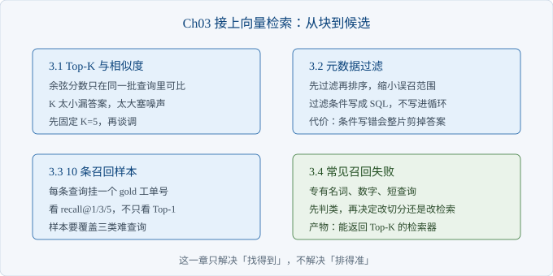
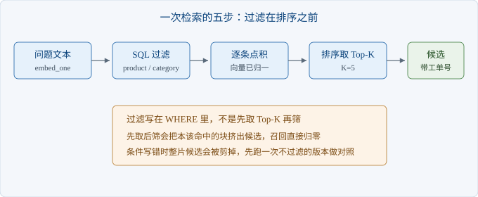

# Ch03 接上向量检索

> 本章解决：怎么从一堆块里挑出最可能回答问题的几条？
> 前置：Ch02｜阅读 40 分钟｜动手 2 小时｜交付物：能返回 Top-K 的检索器

## 章首导图



> 图 3-1 本章结构

## 场景开场

沈岚把十条问题写在便签上，逐条念给你听。念到第五条时她停下，说这条昨天刚被客户投诉过。

你打开编辑器，索引里有五十三块，肉眼看得过来。她的担心不是现在，是三个月后工单涨到几千条的时候。

你要给她一个能重复的动作：输入一句话，出来不超过五条候选，每条带工单号。她还要能看见「哪几条没找到」。

这一章把索引接成检索器，并且第一次给召回算个数。

### 3.1 Top-K 与相似度

> 路径：必读

这一节定「取几条」和「凭什么排前面」。

先把流程摆清楚：问题变成向量，和库里每个向量算一次相似度，按分数从高到低取前 K 条。向量在 Ch02 已经归一化，所以点积就是余弦。



> 图 3-2 检索流程

为什么归一化能省一次除法：两个向量的长度都是 1，余弦的分子分母里各有一个长度，直接约掉。少一次开方，在几千条的量级上差异不大，但代码少一半。

K 不是越大越好。K 太小，正确答案排第六就永远看不到；K 太大，后面几条基本是噪声，还会挤占后面喂给模型的位置。

本例固定 K 等于五。依据是工单语料里同一类问题通常只有两三条相关记录，取五条能把它们都装进来，又不至于把无关产品带进来。

```python
def search(question, k=5, product=None, category=None, db_path=DB):
    rows = _load(db_path, where, params)
    q = embed_one(question)
    for r in rows:
        r["score"] = sum(x * y for x, y in zip(q, r["vector"]))
        r.pop("vector")
    rows.sort(key=lambda r: r["score"], reverse=True)
    return rows[:k]
```

运行 `python -m ch03.search`，第一组查询的前三名是 T-1004、T-1001、T-1037，分数依次为零点三七、零点二二、零点一一。

分数本身没有绝对含义。零点三七不代表「三十七分像」，只代表在这一批候选里排第一。换个问法，第一名的分数可能低不少，但那仍然是第一名。

【代价】余弦分数不可跨查询比较，也就不能拿来当「置信度」直接对外承诺。拒答阈值必须按同一套打分口径重新标定，Ch04 会给一个可用的做法。

### 3.2 元数据过滤

> 路径：必读

这一节解决误召回：检索回来的块主题对，产品不对。

同事问打印机连不上网，返回的第一条却是键盘的无线断连。两句话都讲「连不上」，字面很像，产品完全不同。

过滤要在排序之前做。先筛掉不该出现的产品，再在剩下的块里排序。反过来做，是取完前五再筛，正确答案可能本来在第六，筛完一条不剩。

| 过滤字段 | 取值示例 | 什么时候用 | 写错的后果 |
| --- | --- | --- | --- |
| product | P200 打印机 | 问题里出现明确型号 | 型号写错，候选清零 |
| category | 硬件故障 | 用户明确在问故障还是政策 | 类别标注不全，漏掉一部分 |
| created_at | 2025-06-01 之后 | 政策调整后只看新记录 | 老工单仍有参考价值时被剪掉 |
| 组合条件 | 产品加类别 | 品类大、记录多 | 条件过严，召回骤降 |

过滤条件写成 SQL 的 WHERE，不写进 Python 循环。写进循环等于把全表读进内存再筛，数据量一大就卡。

```python
conds, params = [], []
if product:
    conds.append("product = ?")
    params.append(product)
if category:
    conds.append("category = ?")
    params.append(category)
where = f"WHERE {' AND '.join(conds)}" if conds else ""
rows = _load(db_path, where, tuple(params))
```

参数用占位符，不用字符串拼接。拼字符串会把用户输入当 SQL 执行，这是老问题，但它每年都还在发生。

过滤不是默认打开。用户没说型号时不要猜，猜错会把正确答案挡在门外。宁可在候选里混两条别的产品，也不要在第一步就把答案筛没。

【陷阱】加了过滤之后命中为零，先怀疑条件，不要怀疑语料。把条件去掉跑一次，如果结果正常，问题就在条件上；如果仍为零，才回去看切分和嵌入。

### 3.3 召回评估的 10 条样本

> 路径：必读

这一节给「找得准不准」一个可重复的数字。

没有样本就没有召回率。你只能凭感觉说「好像还行」，而感觉在演示当天最不可靠。

十条样本，每条两个字段：问题，以及标准答案所在的工单号。工单号是唯一标识，不要写「那条讲保修的」，那种标注无法自动判分。

| 字段 | 含义 | 例子 | 写错的后果 |
| --- | --- | --- | --- |
| question | 客户的原始问法 | 机器开不了机指示灯不亮 | 写成书面语，测不出真实难度 |
| gold_ticket | 答案所在工单号 | T-1001 | 写成产品名，无法自动判分 |
| 备注（可选） | 为什么选它 | 现象与处理都在这一条 | 换人维护时看不懂 |

十条规定要覆盖三类：日常问法、带型号或错误码的问法、说法与语料不一致的问法。第三类最容易漏，也最容易在真实场景里翻车。

```python
CASES = [
    ("显示器黑屏但电源灯亮着", "T-1004"),
    ("发票丢了还能保修吗", "T-1028"),
    ("机器开不了机指示灯不亮", "T-1001"),
]
for k in (1, 3, 5):
    hit = sum(1 for r in ranks if 0 < r <= k)
    print(f"recall@{k} = {hit}/{len(ranks)}")
```

运行 `python -m ch03.eval_small`，本次结果是：第一名命中八条，前三名命中九条，前五名命中九条。

差距说明两件事。第五条（发票丢了的保修问题）正确答案排在第二，只差一位，排序还能再调；第八条根本没进前五，属于召回失败，调排序救不回来。

第八条是查询「机器开不了机指示灯不亮」，语料写的是「显示器无法开机，电源灯不亮」。两句话说的是同一件事，双字重合却很少。

【提示】把没命中的那条单独存下来，别急着改参数。一条样本调一次参，等于用一条数据过拟合；攒到五条以上再动阈值。

十条样本撑不起「准确率高」这种结论，只能说「比上周好」或「比上周差」。样本扩到二十条在 Ch06 做，那时才有资格谈基线。

### 3.4 常见召回失败

> 路径：选读

这一节给一张分类表：命中不了时，先判断属于哪一类，再决定改哪里。

三类高发，按出现频率排：专有名词与型号、数字与错误码、极短查询。

| 类型 | 典型现象 | 判断方法 | 先改什么 |
| --- | --- | --- | --- |
| 专有名词 | 型号、部件名查不到 | 把查询改成同义描述，能查到就说明是字面问题 | 补字面检索，或给型号加别名 |
| 数字与错误码 | E-204、TN-210 命不中 | 分数普遍偏低，且候选与查询无关 | 数字单独成词，别被切碎 |
| 极短查询 | 「黑屏」「卡纸」 | 返回一堆不同产品 | 补上下文，或先让用户选产品 |
| 说法不一致 | 开不了机对不上无法开机 | 人工看两条文本，确认是同一件事 | 语料加同义词，或换检索方式 |

判断顺序不要跳。先说清「是找不到，还是排得后」，前者改召回，后者改排序。两件事混着改，改完也不知道是哪一处起的作用。

短查询还有一个隐蔽问题：它几乎没有可供比对的词。两个字最多产生一个双字组合，撞上谁就是谁。

【排查】按这个顺序看：第一步，去掉过滤再查一次；第二步，换成工单里的原话再查一次；第三步，看 gold 块是否在索引里；第四步，才怀疑嵌入模型。前三步能排掉大部分「以为是模型问题」的情况。

专有名词与数字这两类，向量检索天生不占优。字面即信息时，字符重合比语义接近更有用，Ch05 会补一条字面通道。

## 本章小结

| 要点 | 结论 |
| --- | --- |
| 相似度 | 归一化后点积即余弦，分数只在同批候选内可比 |
| Top-K | 按语料里同类记录的条数定，本例取五 |
| 过滤 | 在排序前做，条件写进 SQL，参数用占位符 |
| 评估 | 十条样本，gold 写工单号，看 1/3/5 三档 |
| 失败分类 | 先分「找不到」还是「排得后」，再决定改什么 |

## 动手练习

1. 把 K 从五改成二，重跑评估脚本。验收：记录前三名与第一名两组命中数的变化，并解释哪一条被挤出。
2. 给 `search` 加一个 `created_at` 过滤，只查最近三个月。验收：打印过滤前后的命中数，说明何时该用它。
3. 自己写三条新样本，其中一条故意用与语料完全不同的说法。验收：跑出这三条的名次，并判断失败属于哪一类。

## 自查清单

- [ ] 向量已归一化，相似度用点积
- [ ] K 有依据，不是随手写的
- [ ] 过滤在排序之前，条件写进 SQL
- [ ] SQL 用占位符参数，没有字符串拼接
- [ ] 十条样本都写了工单号
- [ ] 样本覆盖了说法不一致的情况
- [ ] 能说出每条未命中的失败类型

## 常见坑

| 现象 | 原因 | 怎么办 |
| --- | --- | --- |
| 第一名分数很低 | 说法与语料差得远 | 先看是不是召回失败，别急着调阈值 |
| 加了过滤后一条都不剩 | 条件写错或标注不全 | 去掉条件对照跑一次 |
| 前五名全是同一工单 | 同工单多块入候选 | 按工单号去重 |
| 调完参数评估变好，上线变差 | 样本太少，过拟合 | 扩样本，或换一批没调过的题 |
| 分数拿来当置信度对外承诺 | 跨查询不可比 | 用覆盖率等可解释的量替代 |

## 下一章

有了候选，还不能直接回给客户。Ch04 把命中的块变成带原文的答案，并规定哪些情况下必须先说「答不了」。
