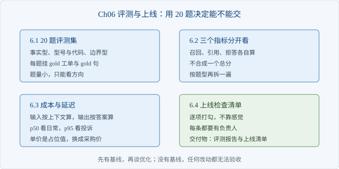

# Ch06 评测与上线

> 本章解决：用二十题基线决定能不能上线
> 前置：Ch05｜阅读 40 分钟｜动手 2 小时｜交付物：评测报告与上线清单

## 章首导图



> 图 6-1 评测流程

## 场景开场

周五下午，项目经理问你：「下周一能上线吗？」你手上有一版能演示的系统，但说不出它到底行不行。演示时客户问了十个问题，答对七个，剩下三个里一个答错、两个说不知道。这三个到底算不算问题，你没有依据。这一章要做的，是把「感觉还行」变成「有基线、能复现」的评测报告。

### 6.1 二十题评测集

> 路径：必读

评测集不是越多越好，是越有代表性越好。二十题足够覆盖三类失效：事实型、型号与代码、边界型。

事实型考的是常规问答，答案在文档里能直接找到。型号与代码考的是字面精确匹配，向量检索最容易在这里漏。边界型考的是该不该拒答，包括超出范围、证据冲突、语料没有覆盖。

| 题型 | 题数 | 考什么 | 典型失败 |
| --- | --- | --- | --- |
| 事实型 | 8 | 常规问答 | 答非所问 |
| 型号与代码 | 7 | 字面精确 | 漏召 |
| 边界型 | 5 | 该不该拒答 | 编造 |

题目要人写，不要用模型生成。模型生成的题目会带模型自己的用词习惯，测出来偏乐观。每题必须标注三样：问题、期望答案所在工单、期望行为（回答还是拒答）。

二十题从哪来：先从客服最近一个月真实提问里抽，再按三类补齐。抽题时保留原话，不要改写成书面语。原话里的错别字、简称、口语，正是系统要面对的输入。

```python
def load_set(path: str) -> list[dict]:
    with open(path, encoding="utf-8") as f:
        return [json.loads(line) for line in f if line.strip()]
```

评测集一旦定稿就冻结。调参之后不能改题，改了就无法比较前后两版。要加题，另开一份，标好版本。

题目难度要有梯度：一半是常见问题，三成是长尾，两成是边界。全是简单题，评测会虚高；全是难题，基线太低，改动看不出收益。

### 6.2 指标：召回、引用、拒答

> 路径：必读

三个指标必须分开看，合成总分等于把问题藏起来。

召回看正确工单有没有进前五。引用看答案里的引文是不是原文、是不是对得上问题。拒答看边界题有没有被正确拒绝，同时看误拒——该回答的题被拒了多少。

| 指标 | 口径 | 不合格的信号 |
| --- | --- | --- |
| 召回@5 | 正确工单进前五的比例 | 低于约定值，先修检索 |
| 引用准确 | 引文是原文且对齐问题 | 召回高但引用低，修拼接 |
| 拒答正确 | 边界题被正确拒绝 | 低，说明约束不够 |
| 误拒 | 该答的题被拒 | 高，说明拒答过严 |

为什么要分开看：一次改动可能让召回涨、引用跌。只看总分，你会以为改对了。分开看，才知道哪一层退步。

基线怎么定：第一次跑出来的数就是基线，写进评测报告。之后每次改动都要对比基线，涨了要能解释，跌了要能定位。没有基线，调参就是碰运气。

指标要写进报告，不要只留在终端里。报告至少包含：评测集版本、代码版本、四项指标、失败样本清单。没有版本的报告，两周后没人能复现。报告要给客户看，客户看不懂指标，但看得懂失败样本。

```python
def summarize(records):
    answerable = [r for r in records if r["expect"] == "answer"]
    boundary = [r for r in records if r["expect"] == "refuse"]
    answered = [r for r in records if not r["refused"]]
    return {
        "recall": sum(1 for r in answerable if 0 < r["rank"] <= 5),
        "citation": sum(1 for r in answered if r["cite_ok"]),
        "refusal": sum(1 for r in boundary if r["refused"]),
        "false_refuse": sum(1 for r in answerable if r["refused"]),
    }
```

【注意】引用准确率的分母是「回答了的题」，不是全部题。拒答的题没有引用，算进分母会拉低指标，让你误判。

### 6.3 成本与延迟

> 路径：选读

上线前必须能算出两件事：每次问答花多少钱，慢的时候有多慢。

成本按 token 估：输入是问题加检索到的上下文，输出是答案。单价用你的采购价，不要用示例常量。上下文取前三块，不要把所有候选都塞进去，成本会翻倍。

延迟看分位，不看平均。平均值会被大量快请求拉低，用户感知的是慢的那一次。

```python
def cost_of(prompt_tokens: int, answer_tokens: int) -> float:
    return (prompt_tokens * PRICE_IN + answer_tokens * PRICE_OUT) / 1000

def percentile(values, q):
    ordered = sorted(values)
    idx = min(len(ordered) - 1, max(0, math.ceil(q * len(ordered)) - 1))
    return ordered[idx]
```

| 项 | 口径 | 上线前要求 |
| --- | --- | --- |
| 单次成本 | 输入加输出按单价折算 | 低于预算上限 |
| P50 延迟 | 一半请求快于此 | 体验基线 |
| P95 延迟 | 二十分之一请求慢于此 | 决定要不要加超时 |

延迟超标时，先看慢在哪：检索、重排、还是模型调用。检索本地算，通常最快；重排与模型调用是外部依赖，最容易抖。把每一段单独计时，才知道该优化谁。

【代价】把上下文从五块减到三块，成本会降，但召回可能掉。这个取舍要用评测集验证，不能拍脑袋。这是上线前的底线。

### 6.4 上线检查清单

> 路径：必读

上线不是「演示通过」，是「检查项全过」。清单写死，逐项打勾，不靠感觉。

清单分三类：功能、质量、运维。功能看链路是否完整，质量看三个指标是否达标，运维看超时、降级、回滚是否就绪。

| 类别 | 检查项 | 通过标准 |
| --- | --- | --- |
| 功能 | 问题进、答案出 | 十条样本全通 |
| 功能 | 引用可追溯 | 每条答案带工单号 |
| 功能 | 拒答有出口 | 拒答时给出下一步 |
| 质量 | 召回@5 | 达到约定值 |
| 质量 | 引用准确 | 达到约定值 |
| 质量 | 误拒 | 低于约定值 |
| 运维 | 模型超时 | 有超时与降级 |
| 运维 | 回滚 | 一次命令能回滚 |
| 运维 | 监控 | 召回与拒答有告警 |

上线后第一周每天看一次指标，不要只看可用性。系统活着但答错，比宕机更难发现。指标掉了先回滚，再定位，不要在线上直接调参。

清单要在上线前一周发给项目经理，让他知道还差哪几项。临时发现缺项，比延期更贵。清单不是形式，是最后一次对齐。

【注意】清单上任何一项没打勾，就不发。项目经理可以决定延期，但不能决定跳过。

## 本章小结

| 要点 | 结论 |
| --- | --- |
| 评测集 | 二十题覆盖三类失效，定稿冻结 |
| 指标 | 召回、引用、拒答分开看 |
| 成本 | 按 token 算，上下文取前三块 |
| 延迟 | 看 P95，不看平均 |
| 上线 | 清单全过才发 |

## 动手练习

1. 用现有评测集跑一遍，记录三个指标。验收：输出四项数字，能指出最差的一项。
2. 把上下文从三块改到五块，重跑成本与召回。验收：记录成本变化与召回变化，给出取舍结论。
3. 补三道边界题，重跑拒答。验收：拒答正确率变化可解释。

## 自查清单

- [ ] 评测集覆盖三类失效
- [ ] 三个指标分开统计
- [ ] 成本按真实单价算过
- [ ] 延迟看了 P95
- [ ] 上线清单逐项打勾

## 常见坑

| 现象 | 原因 | 怎么办 |
| --- | --- | --- |
| 总分涨了但体验差 | 指标合成掩盖退化 | 分开看四项 |
| 引用率虚高 | 分母算了拒答题 | 分母只算回答题 |
| 成本超预算 | 上下文塞太多 | 取前三块 |
| 上线后卡顿 | 只看平均延迟 | 看 P95 并加超时 |
| 调参后无法比较 | 评测集被改过 | 冻结评测集 |

## 下一章

把前六章的交付物串起来，就是一条能演示、能评测、能上线的问答链路。Ch07 接着解决用户连着追问时系统失忆的问题。
