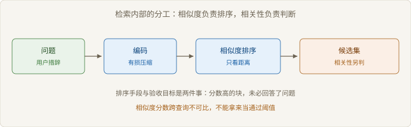
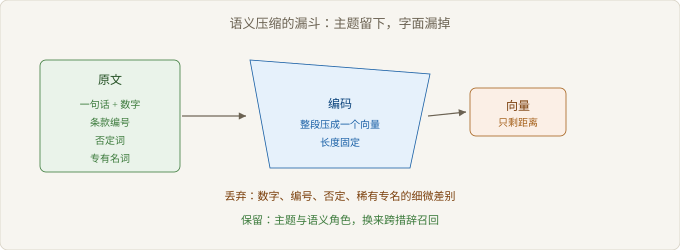

# Ch02 检索的本质

> 本章回答：相似度为什么不等于相关性？
> 前置：Ch01｜预计 50 分钟
> 读完你能判断：一次召回失败属于哪一类

## 概念地图



> 图 2-1 相似与相关的分工

Ch01 的结论是分工：检索管证据是否到场，生成管表达是否准确。本章只打开前一半。

检索内部有四个概念。相似度（Similarity）是排序手段，相关性（Relevance）是验收目标。语义压缩（Semantic Compression）解释相似度失真的来源。稀疏与稠密是两条召回路径，失效分类把前三个概念落到可判断的现象上。

四者的关系可以压成一句：压缩决定相似度能看见什么，两条路径决定候选集里有什么，分类决定你该修哪一步。

## 反直觉开场

一个团队嫌召回太杂，把相似度门槛调高了一档。他们预期噪声变少、答案变准。

上线后答案质量反而下降。抽查发现，被筛掉的恰恰是正确答案所在的片段：那段文字用词与提问不同，分数天然偏低。留下来的高分片段措辞贴近问题，内容却只是一段主题概述。

门槛没有筛掉噪声，它筛掉了改写。这个现象指向一个判断：相似度衡量措辞距离，相关性衡量能否回答问题。两者多数时候同向，在关键处会分叉。

### 2.1 相似度不是相关性

> 路径：必读

相似度是向量空间里的距离，回答「这两段文字像不像」。相关性回答「这段文字是否回答了这个问题」。前者是手段，后者是目标。

两者分叉的地方有规律。三类最常见：否定、条件、指代。

否定只改一个词，向量几乎不动。「支持七天无理由退货」与「不支持七天无理由退货」落在同一个邻域里，排序几乎并列。模型拿到后者，答案就反了。

条件改变适用面，主题不变。「正式员工离职提前三十天」与「试用期离职提前三天」讲的是同一件事的两个分支。向量看到同一主题，读者只关心自己那一条。

指代与省略让查询本身不完整。「这个流程要走几步」里的「这个」不在查询里，检索只能按「流程」去找，召回的是一堆流程概述。

| 反例 | 相似度表现 | 相关性表现 | 判断依据 |
| --- | --- | --- | --- |
| 否定句 | 与肯定句几乎并列 | 结论完全相反 | 答案是否定还是肯定 |
| 条件分支 | 同主题高分 | 只有一支适用 | 读者的身份与场景 |
| 指代省略 | 按字面主题召回 | 意图缺失 | 查询是否自带主语 |

【常见误解】「相似度高就说明检索对了」。相似度只能给候选排序，不能判断候选是否回答问题。验收必须落在相关性上，也就是人工判断或规则判断那一层。

推论有两条。第一，相似度分数不能当阈值用，它跨查询不可比。第二，把相似度当质量指标，团队会去优化一个与目标无关的数。

### 2.2 语义压缩的代价

> 路径：必读

把一段文字编码成向量，是一次有损压缩。压缩保留主题与语义角色，丢掉字面细节。丢什么，决定检索在什么地方失灵。

最容易被丢掉的是四类信息：数字与单位、编号与型号、否定词、专有名词的细微差别。

机制可以拆成三步。编码时，模型把整段文字压成一个固定长度的向量。检索时，用同一套编码把问题压进同一空间。排序时，按距离取近邻。

```text
输入：文本块 T，问题 Q
步骤：
  1. v_T ← encode(T)      // 整段压成一个向量，长度固定
  2. v_Q ← encode(Q)
  3. 候选 ← topk(sim(v_Q, v_T))
损失点：
  - 步骤 1 丢字面：数字、编号、否定、稀有词
  - 步骤 3 只留序：分数没有可解释的量纲
```

【推导】压缩为什么必然丢字面：向量维度远小于文本的信息量，编码器只能保留对训练目标有用的差异。训练目标奖励「主题相近」，不奖励「数字准确」。数字于是在向量里被抹平。

图 2-2 画的是这个漏斗：原文进来，语义留下，字面漏掉。



> 图 2-2 语义压缩的漏斗

这个代价换来的是跨措辞召回。用户说「退钱」，文档写「退款」，字面不通，语义相通。压缩正是为此存在。

所以判断很直接：问题依赖字面精确时，稠密一路不能单独承担；问题依赖同义改写时，稀疏一路不能单独承担。

### 2.3 稀疏与稠密的互补

> 路径：必读

稀疏检索按词项匹配，稠密检索按向量距离。两条路径的失败模式不同，这是它们值得并存的唯一理由。

稀疏擅长稀有词、编号、精确短语。它的问题是同义词：用户写「报销」，文档写「费用核销」，一个词都对不上。

稠密擅长改写与语义近似。它的问题是字面精度：型号、条款号、否定，都容易被压平。

| 维度 | 稀疏检索 | 稠密检索 |
| --- | --- | --- |
| 命中场景 | 编号、型号、精确短语 | 同义改写、跨语言表述 |
| 典型漏召 | 同义词、口语化提问 | 数字、否定、稀有专名 |
| 对切分敏感度 | 高，切断了词就丢 | 中，段落级语义仍在 |
| 主要成本 | 词典维护、语言相关 | 编码与索引的算力 |

【前提】互补要成立，两路错误得互不相关。若两路都栽在同一处资料空白上，合并只会得到两份空结果。

要不要融合，可以先做一次交集统计：两路各自的前若干条候选，重叠多少。重叠高，融合的空间就小；重叠低，且两侧各自都能捞到一部分对的块，融合才可能带来增量。

### 2.4 检索失败的分类

> 路径：选读

修检索之前先分类。分类错了，调参会一直在错的层上打转。

四类失败按发生顺序排列。语料缺失：文档里没有答案。切分切断：答案被切在两个块之间。查询偏差：问题缺主语，或用了文档里不存在的说法。排序错位：正确块进了候选集，但排在后面被截断。

| 现象 | 定位方法 | 归属 |
| --- | --- | --- |
| 检索结果主题都不对 | 人工在语料里搜关键词，确认是否收录 | 语料缺失 |
| 命中的块读起来像半句 | 看块首尾是否有「但是」「因此」「上述」 | 切分切断 |
| 换一种问法就能找到 | 用文档措辞重问，对比两次结果 | 查询偏差 |
| 正确答案在候选深处 | 扩大截断位次，看答案是否出现 | 排序错位 |

定位顺序由内到外：先看候选集里有没有正确答案。有，问题在排序或截断；没有，再看是语料、切分还是查询。

这个顺序的价值是成本。排序问题改融合与截断，切分问题要重建索引，语料问题要回到文档治理。三者的修复成本相差很远，顺序反了会先花掉最贵的那笔。

【边界】分类依赖一个前提：你能拿到正确答案所在的原文。拿不到时，任何分类都只是猜测。

## 权衡表

| 方案 | 代价 | 适用条件 |
| --- | --- | --- |
| 只用稠密检索 | 字面精确的查询会漏，否定与数字不可靠 | 问题以自然语言改写为主，语料是说明性文档 |
| 只用稀疏检索 | 同义改写召不回，口语提问命中差 | 查询含编号与型号，语料术语稳定 |
| 两路并行加融合 | 索引与查询开销叠加，需要调权重 | 两路候选重叠低，且各自都能召回部分正确答案 |
| 先做查询改写再检索 | 改写会引入语义漂移，需要可回退 | 用户提问口语化、含指代，问题分布集中 |
| 扩大截断位次 | 生成侧上下文变长，噪声跟着进来 | 正确块常落在候选中段，生成侧能承受噪声 |

## 失效边界

- 问题依赖字面精确匹配时，稠密检索的排序不可信，相似度高低与答案对错无关。
- 语料里没有答案时，任何相似度都只是对噪声排序，调参不会改善结果。
- 查询本身含指代或省略时，检索无法还原完整意图，得先澄清或改写。
- 相似度分数跨查询不可比，把它当成统一的通过阈值会系统性地误杀改写。
- 两路都缺同一段资料时，合并不带来新证据，只重复失败。

## 延伸阅读

- 稀疏检索的经典综述：看清词项匹配为什么在编号与专名上仍难被替代。
- 稠密检索的双塔论文：理解问题与段落如何被映射进同一个空间，以及这个空间的偏差从哪来。
- 关于否定与数值推理的评测集：它用具体题目说明向量相似度在这些类型上系统性偏低。

## 下一章

分类里最贵的一步是切分。Ch03 讨论粒度与重叠各自换来什么，以及切分错了之后，为什么调优都在补一个结构性缺口。
