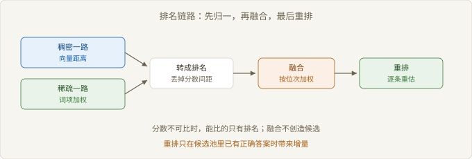
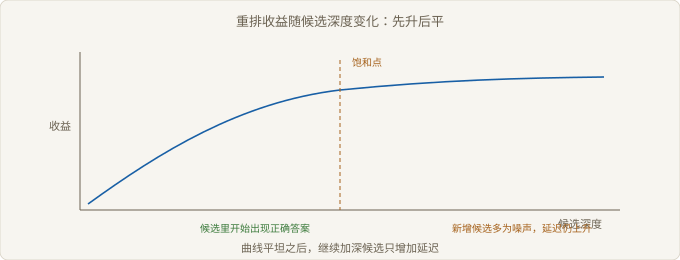

# Ch04 融合与重排

> 本章回答：两路检索何时才互补？
> 前置：Ch03｜预计 50 分钟
> 读完你能判断：该不该上混合与重排

## 概念地图



> 图 4-1 排名链路：先归一，再融合，最后重排

Ch03 决定了候选块长什么样。本章处理候选块怎么合并、怎么排序。

链路有四段：多路召回、把分数转成排名、融合、重排。倒数排名融合（Reciprocal Rank Fusion）只做第三步，它假设各路都大致靠谱。重排（Rerank）做第四步，它对候选逐条重估相关性。

## 反直觉开场

一个团队上了混合检索：稠密一路加稀疏一路，再用融合把两边结果合并。上线后指标几乎不动。

复盘发现，两路的前若干条候选高度重叠。稀疏召回的，稠密也召回了；融合只是把同一批文档换了个顺序。真正缺的那几条，两路都没召回到。

融合不创造证据，它只在已有候选之间重新分配权重。这个判断决定了融合的适用面，也决定了它最容易失效的位置。

### 4.1 排名信号的可比性

> 路径：必读

两路检索的分数通常不可比。稠密一路是向量距离，稀疏一路是词项加权和，量纲不同，分布也不同。

不可比时，能比的只有排名。排名丢掉了分数间距，但保留了两路各自对「谁更靠前」的判断。

| 信号 | 取值范围 | 跨路可比 | 处理方式 |
| --- | --- | --- | --- |
| 向量相似度 | 有界，随模型而变 | 否 | 转排名，或分路归一 |
| 词项加权分 | 无上界，随文档长度变 | 否 | 转排名 |
| 模型打分 | 无界，随批次变 | 否 | 转排名 |
| 排名位次 | 从 1 开始 | 是 | 直接融合 |

【常见误解】「把分数归一化到同一区间就能相加」。归一化只统一了区间，没统一分布。一路的分数密集在高位，另一路稀疏，相加后仍由前者主导。

可比性问题还有一层：同一路检索内部，分数跨查询也不可比。同一个分数在短查询和长查询里代表不同的置信度，所以阈值型规则天然不稳。你能依赖的只有同一查询内部的相对次序。

### 4.2 RRF 的假设

> 路径：必读

RRF 的做法只有一步：每一路给出排名，按位次取倒数求和，再排序。

```text
输入：多路排名列表 L1..Ln，平滑常数 k
for doc in 所有候选:
    score[doc] = Σ 1 / (k + rank_i(doc))
输出：按 score 降序
# 未出现在某一路的文档，该路不贡献分数
```

它有三个假设。每路都大致靠谱：随便一路都不至于全是噪声。多路错误不相关：一路漏掉的，另一路有机会补上。位次可信：第 1 名确实比第 10 名更可能相关。

| 假设 | 成立时 | 不成立时 |
| --- | --- | --- |
| 每路大致靠谱 | 融合稳定优于单路 | 噪声路拉低正确候选 |
| 错误不相关 | 覆盖率上升 | 融合只是重复同一批结果 |
| 位次可信 | 倒数权重有意义 | 长尾路的高位次被过度奖励 |

【前提】RRF 不比较分数，只比较位次。这个设计让它对量纲免疫，也让它无法利用「这一路非常确信」的信息。

平滑常数的作用是压低头部差异。它取大，位次差异被抹平，融合更平均；它取小，头部那一路更强势。没有普适最优值，取多少取决于各路质量是否均衡。

取值不该靠直觉。固定一批带标注的问题，把常数当超参扫一遍，看融合结果与单路的差距怎么变。差距对常数不敏感时，说明两路质量接近，随便取；敏感时，说明有一路在拖后腿，先修那一路。

### 4.3 重排的边际收益

> 路径：必读

重排对候选逐条重估，把「主题相关」提升为「能否回答」。它的收益有一个明确前提：正确答案已经在候选池里。

候选池里没有正确答案时，重排只是在错误集合里挑一个更顺眼的。



> 图 4-2 重排收益随候选深度的变化

图 4-2 的形状是先升后平。候选深度增加，可选的正确项变多，收益上升；过了某一点，新增候选几乎都是噪声，收益不再增长，延迟继续上升。

| 条件 | 重排有收益 | 重排无收益 |
| --- | --- | --- |
| 候选池 | 含正确答案，但位次靠后 | 不含正确答案 |
| 候选同质度 | 主题相近、答案不同 | 全是同一段落的重复 |
| 延迟预算 | 允许逐条打分 | 强实时，加一跳就超时 |
| 截断位次 | 生成侧只吃前几条 | 生成侧本来就吃全部候选 |

【代价】重排把延迟从「一次向量检索」变成「一次检索加一次逐条打分」。候选越多，代价越线性。

重排还有一处隐性成本：它需要一个比召回更精细的模型。两套模型意味着两套版本、两套评测、两套故障模式。团队常常只算推理开销，不算维护开销。

重排和截断位次是一对参数。截断位次决定候选池有多深，重排决定从池里挑谁。位次放宽而重排不变，等于把噪声也交给重排；位次收紧而重排很强，等于让好模型无事可做。两者要一起调，单看一个都会得出错误结论。

### 4.4 融合失效

> 路径：选读

融合失效有四种典型形态，都可以在离线阶段测出来。

| 失效形态 | 现象 | 判据 |
| --- | --- | --- |
| 候选高度重叠 | 融合后排名与单路几乎一致 | 两路前若干条的交集占比高 |
| 两路同源 | 一路是另一路的改写 | 索引来自同一份语料与同一套切分 |
| 噪声路拖累 | 融合结果差于最好单路 | 分路评测，比较单路与融合 |
| 权重失衡 | 某一路长期主导 | 看融合结果的来源分布 |

第一种最容易被忽略。两路候选重叠高时，融合的数学没变，信息没增。此时该做的不是调权重，是让两路真正异质：换切分、换语料切片、换召回目标。

你可以先量一下两路的交集：各取前若干条，算重叠占比。占比高，说明两路看到的是同一批文档，融合的空间有限；占比低，再看两侧是否各自含有正确答案。前者决定要不要融合，后者决定融合有没有用。

【争议】融合一定优于单路吗。没有定论。多路都在同一份语料上、用相近的表示时，融合常打平；语料异构、查询类型分散时，融合才稳定带来增量。

融合还有一个前提常被跳过：两路的时间预算要匹配。一路快一路慢，整体延迟由慢的那路决定，融合的收益要先扣掉这笔等待。

权重也会随时间漂移。语料扩充、切分调整、模型换版本，任何一处变动都会改变两路的相对强弱。上线时调好的权重，半年后可能已经偏向噪声更多的那一路。定期重评，比一次调优更重要。

## 权衡表

| 方案 | 代价 | 适用条件 |
| --- | --- | --- |
| 只用稠密一路 | 字面精确的查询漏召 | 提问以自然语言改写为主 |
| 只用稀疏一路 | 同义改写召不回 | 查询含编号、型号，术语稳定 |
| 排名融合两路 | 索引与查询开销叠加，需要调平滑常数 | 两路候选重叠低，错误类型不同 |
| 加权分数融合 | 需要分路校准分数，校准一旦漂移就失效 | 两路分数可通过标注数据对齐 |
| 融合加重排 | 多一跳延迟与一套额外模型 | 候选池够深，答案常落在中段 |

## 失效边界

- 两路候选高度重叠时，融合不产生新信息，只是换了个顺序重排。
- 如果两路都卡在同一个语料缺口上，融合只是把两份空结果叠在一起。
- 正确答案不在候选池时，重排无法创造它，只会把最像的噪声顶上来。
- 延迟预算紧张时，重排的代价会吃掉它带来的收益。
- 分路质量差距过大时，RRF 的等权假设让噪声路持续拖累结果。

## 延伸阅读

- RRF 的原始论文：它给出只比排名的动机，以及这个选择为什么对量纲免疫。
- 关于混合检索的对比研究：用实验说明融合在什么语料条件下才带来增量，什么条件下打平。
- 重排模型的评测工作：解释候选深度与收益曲线的关系，以及延迟在什么位置开始不划算。

## 下一章

候选定了，错误只剩两种归属。Ch05 给出一条定位流程：先确认证据在不在，再判断模型是否越界。
