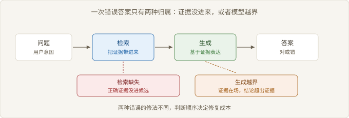
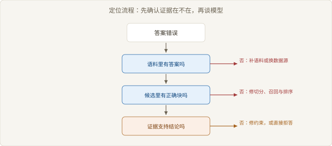

# Ch05 幻觉的定位

> 本章回答：一次错误答案，该修检索还是修生成？
> 前置：Ch04｜预计 50 分钟
> 读完你能判断：一次错误答案该修哪一层

## 概念地图



> 图 5-1 两个失败点在责任链上的位置

Ch04 结束在候选排序。候选定下来之后，错误可以归到两处：检索缺失（Retrieval Miss）、生成越界（Generation Overreach）。前者的根因在语料、切分、召回；后者的根因在约束与模型行为。本章画出一条判断路径，把一次错误答案分到这两类里。

## 反直觉开场

一个团队给答案加了引用，每条结论后面标出处。他们预期幻觉会明显减少。

上线后，错误的答复没变少，只是每条都多了一行出处。抽查发现，模型引用的段落确实与问题主题相关，却不支持它给出的结论。

引用约束的是「有没有出处」，不是「出处是否支持结论」。这个区别决定了引用能做什么、不能做什么。

### 5.1 检索缺失

> 路径：必读

答案错，先看证据在不在。这一步不需要模型，只要把标准答案塞回候选集，再跑一遍。

| 判据 | 操作 | 结论 |
| --- | --- | --- |
| 证据是否在语料里 | 在原文中搜索答案关键词 | 不在则语料缺失 |
| 证据是否进候选 | 把正确段落加入候选重跑 | 答对则检索缺失 |
| 证据是否被截断 | 看命中块的完整性 | 半句则切分问题 |
| 证据是否排太后 | 扩大截断位次 | 出现则排序问题 |



> 图 5-2 错误答案的定位流程

图 5-2 的顺序不能颠倒。先确认语料有没有，再确认候选有没有，最后才看排序。跳过前两步直接调提示词，是最常见的误修。

【推导】这个回填实验为什么有效：把标准答案塞进候选，只改变了「证据到没到场」这一个变量。模型能答对，说明生成能力够，问题在检索；仍然答错，说明问题在生成。变量只有一个，结论才站得住。

定位还需要一个前提：你手上有正确答案的原文。没有原文时，任何定位都是猜测，此时该做的是补标注，不是调参。

顺序也决定成本。语料缺口得回到内容治理，切分不当得重建索引，排序偏差只改截断位次，越界则改约束。这几件事的工作量不在一个档上，先定位再动手，避免用调参去填一个结构性坑。

### 5.2 生成越界

> 路径：必读

证据在场，模型仍可能超出证据。越界有四种常见形态。

合并：把两段不同条件的证据拼成一条通用结论。外推：从一条具体规则推出未写明的例外。补全：证据只有半句，模型用常识补上另一半。改写失真：把「可以申请」写成「自动生效」。

```text
检查：答案中的每个断言 a
for a in 断言集合:
    支撑 ← 在候选块中找能推出 a 的句子
    if 支撑 为空:
        标记 a 为越界候选
    elif 支撑 只覆盖 a 的一部分:
        标记 a 为部分支撑
# 只标记，不自动改写；人工确认后再决定拒答或补证据
```

【常见误解】「越界是模型不听话」。多数越界来自证据不足与问题诱导：证据只覆盖一半，问题又要求一个确定答案，模型只能补全。约束提示能减少一部分，不能消除。

四种形态里，合并最难发现。它读起来逻辑通顺，引用的每一段都在候选里，只是把它们拼成了一个原文没有的结论。检查时要把结论拆回断言，逐条找支撑。

外推与补全有一个共同点：它们都发生在证据的边缘。块被切开、条款只写了正面情形、示例没覆盖例外，模型就会沿着最省力的方向补齐。

改写失真最少见，也最难查。它不改结论的方向，只改强度与条件：「可以申请」变成「自动生效」，「通常」变成「一律」。意思差一点，责任差很多。

### 5.3 引用能否约束生成

> 路径：必读

引用把「说出处」变成显式动作。它改变的是可检查性，不是正确性。

| 引用做法 | 约束了什么 | 没有约束什么 | 代价 |
| --- | --- | --- | --- |
| 句末标出处 | 结论有对应段落 | 段落是否支持结论 | 生成略慢，格式易错 |
| 限定只能引用候选 | 编造出处的行为 | 引用与结论的错配 | 需要后处理校验 |
| 逐句对齐校验 | 每句都能追溯到原文 | 推断性结论仍可能越界 | 需要额外一轮判断 |
| 无支撑即拒答 | 无证据时的编造 | 证据不足但拒答的体验 | 拒答率上升 |

【代价】引用提高的是可审计性。审计能发现问题，不等于问题不会发生。

要让引用真正约束生成，得把「引用」升级为「支撑」：不只要求标出处，还要求出处能推出这句话。这一步通常要额外一轮判断，代价是多一次调用与更长的响应。

拒答是引用的配套动作。只标出处不给拒答，模型在证据不足时仍会硬答；只拒答不给引用，用户不知道为什么被拒。两者一起用，才有可用的边界。

校验的粒度也要选。按句校验能抓到局部越界，但切断了跨句推理；按段校验保留了论证结构，却容易放过一句错话。答案越长，按句校验的成本越高，收益越依赖断句质量。

### 5.4 评测的局限

> 路径：选读

评测集只能测出它收录的失败类型。没被写进去的失败，指标上看不见。

| 盲区 | 表现 | 补法 |
| --- | --- | --- |
| 语料缺失类 | 评测问题都能在语料里找到答案 | 加入无答案问题，测拒答 |
| 越界类 | 只测有唯一答案的问题 | 加入证据不足、需拒答的问题 |
| 时效类 | 评测集是静态快照 | 定期用新文档重跑 |
| 长尾问法 | 问题措辞与真实用户不同 | 从线上日志采样 |

【边界】评测通过不等于线上可用。评测集与真实问题分布的差距，决定了这个等号能不能成立。

评测还有一个结构性偏差：它偏好可判定的题。有唯一答案的问题好标、好评，需要拒答或需要多段证据的问题难标、难评。于是评测集天然偏向简单那一侧，指标也就天然偏高。

构造评测集时，比例要按线上分布配。全是可判定的题，指标好看；全是无答案的题，拒答率好看。两类都要有，且比例要能说出理由。说不清比例，指标只能横向比版本，回答不了能不能上线。

线上抽检是评测的补充。评测集是固定的，线上问题一直在变；每周抽一批真实错误，按两条路径过一遍，比盯一个总分更容易发现新问题。抽检的代价是要占人工工时，收益是能看见评测集没收录的那部分失败。

## 权衡表

| 方案 | 代价 | 适用条件 |
| --- | --- | --- |
| 先修检索 | 可能要重建索引，周期最长 | 证据命中率低，越界占比小 |
| 先修生成 | 提升有限，且会掩盖检索问题 | 证据命中率高，答案仍然错 |
| 生成侧加引用校验 | 多一跳判断，延迟上升 | 答案需要可审计，允许少量拒答 |
| 直接拒答 | 可用性下降，用户会转人工 | 高风险场景，无法逐条核对证据 |
| 分层评测 | 需要两套标注与两条流水线 | 团队要持续定位，而非一次性上线 |

## 失效边界

- 评测集不含无答案问题时，检索缺失会被误判成生成越界，修错层。
- 当模型读不懂证据时，把答案塞进候选也答不对，回填实验同样失效。
- 引用只保证有出处，不保证出处支持结论，标了引用仍可能全错。
- 线上问题分布漂移后，历史评测结论不再成立，指标会虚高。
- 只做拒答不做引用时，用户无法判断被拒的理由，信任下降。

## 延伸阅读

- 幻觉研究综述：把模型编造拆成不同来源，能帮你判断一次错误该归到哪一类。
- 引用与归因的评测工作：说明「有出处」与「出处支持结论」之间的距离有多远。
- 关于拒答与校准的研究：解释为什么让模型说「不知道」比让它答对更难。

## 下一章

定位解决的是单次错误。Ch06 把视角拉到方案层：当语料、推理、时效三个前提有一个不成立时，RAG 本身就不该上。
