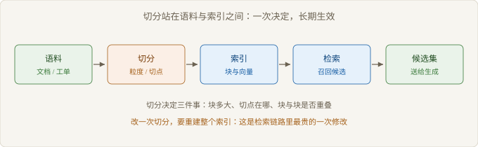

# Ch03 切分的代价

> 本章回答：粒度与重叠各自换来什么？
> 前置：Ch02｜预计 50 分钟
> 读完你能判断：一个切分方案值不值得

## 概念地图



> 图 3-1 切分在检索链路中的位置

Ch02 把检索失败分成四类，其中切分切断最贵：它不在查询侧，也不在排序侧，改一次要重建整个索引。

切分站在语料与索引之间。它决定三件事：一个块装多少上下文，切点落在哪里，块与块是否重叠。这三件事分别是：切分粒度（Chunk Granularity）、边界切断（Boundary Cut）、重叠策略。结构化切分是第四件事：文档自带层级时，切点该由结构决定，而不是由字数决定。

## 反直觉开场

一个团队把块长压到原来的四分之一。召回指标上升，因为小块主题更集中，相似度更容易命中。

但答案质量下降。模型拿到的证据变成碎片：一段话被切成三截，条件在前一截，结论在后一截。模型要么答不全，要么用常识补上缺的那截。

召回变好、答案变差，两个结果并不矛盾。它们衡量的是不同的事：召回看块是否命中主题，答案看块是否装得下证据。

### 3.1 粒度与上下文

> 路径：必读

粒度不是独立参数，它是「答案需要多少上下文」的函数。回答问题所需的最小证据有多长，块就该有多长。

粒度偏大时，一个块里混着多个主题。向量被平均，主题被稀释，相似度对任何具体问题都不高不低。检索能召回，但召回的是「这一节大致相关」。

粒度偏小时，块的主题纯，匹配准，证据却不完整。条件、例外、前提常落在相邻块里，模型只看到结论。

| 粒度档 | 召回表现 | 答案完整度 | 索引规模 | 典型失败 |
| --- | --- | --- | --- | --- |
| 整篇文档 | 低，主题被稀释 | 高 | 小 | 进不了候选 |
| 章节级 | 中 | 较高 | 中 | 一节多主题时精度差 |
| 段落级 | 高 | 中 | 较大 | 条件与结论被拆开 |
| 句子级 | 最高 | 低 | 大 | 证据不足，模型补全 |

判断方法不是选档，是抽样：取二十个真实问题，找到答案原文，量一量答案所在的语义单元有多长。这个长度的分布，就是粒度的下界。

【推导】粒度为什么不能由文档长度决定：一篇长文档里，某个问题可能只需要一句话。块长按文档长度定，等于假设所有问题的证据长度一样，这个假设在真实语料里不成立。

粒度还有一个隐性约束：块要能被独立引用。一个块如果非读上一块才能理解，它在生成侧就是半个证据。

粒度也受问题类型影响。事实型问题要一句话，粒度可以小；流程型问题要一串步骤，粒度必须装下整段流程。同一份语料服务两类问题时，一套块长会顾此失彼。常见做法是两套索引，代价是维护成本翻倍。

### 3.2 边界切断

> 路径：必读

切断指切点落在语义单元中间。它伤害的不是召回，是答案。

三种切断最常见。条件与结论被分开：「若客户在三十天内提出」在一个块，「经审核后可全额退款」在下一个块。表格被拦腰截断：表头在上一块，数据行在下一块。步骤被拆散：第一步在块尾，第二步在块首。

图 3-2 画的是第一种：答案需要两块同时在场，检索只带回其中一块。


> 图 3-2 边界切断如何制造半句证据

切断有一个可观测的信号：命中的块读起来像半句。块首出现「但是」「因此」「上述」「该」这类承接词，块尾停在逗号或从句中间，都说明切点切在了单元内部。

【反例】「按段落切就不会切断」。段落是排版单元，不是语义单元。一条规则常跨三段：标题、条件、例外。按段落切，条件与例外仍然分家。

定位切断后，修复有三条路：挪切点、加重叠、父块回填。三条路的代价不同，权衡表里一并比较。

### 3.3 重叠的收益与成本

> 路径：必读

重叠的作用，是把切点处的信息复制到相邻块。切点仍然存在，但答案不再只落在一侧。

```text
参数：块长 size，步长 stride，重叠量 = size - stride
for start in range(0, len(text), stride):
    chunk = text[start : start + size]
    emit(chunk)
# 重叠越大，同一段文字出现在越多块里
```

重叠的收益是局部的：它只修复切点附近的丢失，对「答案分散在三个块」无能为力。

重叠的成本是全局的：索引变大，重复块互相挤压排名，生成侧可能拿到同一段话的三个版本。

| 重叠策略 | 修复的切断 | 代价 |
| --- | --- | --- |
| 无重叠 | 无 | 切点处必然丢失 |
| 固定小重叠 | 句子被截断 | 索引略增，收益有限 |
| 半块重叠 | 条件与结论分离 | 索引接近翻倍，重复命中明显 |
| 父块回填 | 小块命中、大块给上下文 | 要维护两层索引与映射 |

【代价】重叠买到的是切点附近的连续性，付出的是索引体积与排名去重。重叠超过一半之后，收益不再增长，成本继续上升。

还有一个副作用常被忽略：重叠让同一段文字以不同上下文出现。检索时它们互相竞争名额，一个块被选中，另一个就挤掉了本该进来的第三段。

### 3.4 结构化切分

> 路径：选读

文档自带层级时，切点应该由结构决定。标题层级、表格边界、代码块边界都是天然的语义分隔。

结构化的价值在可解释：每个块都能说出它属于哪一节、哪张表。检索命中后，可以把同级标题一起带进上下文，补足主题。

| 结构类型 | 切法 | 何时不适用 |
| --- | --- | --- |
| 多级标题 | 按最低一级标题切，向上带父标题 | 标题层级混乱或缺失 |
| 表格 | 表头与数据行同块，按行组切 | 表格跨页且表头不重复 |
| 代码与配置 | 按函数或配置段落切 | 长函数跨多块 |
| 问答与条款 | 一问一答、一条一款为块 | 答案引用其他条款 |

【边界】结构化切分依赖解析质量。解析失败时，结构退化为纯文本，切分回到定长，此时它并不比定长更好，只是更贵。

结构化的另一个前提是结构本身可信。标题写错层级、条款编号跳号，切出来的块会带着错误的边界，比定长更难排查。

结构化切分还有一个收益：块可以带上路径。命中一个块时，把它的标题路径一并给模型，等于免费补了一层上下文。这个收益不增加索引体积，但会让上下文变长，需要在生成侧做截断。

## 权衡表

| 方案 | 代价 | 适用条件 |
| --- | --- | --- |
| 定长切分 | 无视语义边界，切断率高 | 语料格式混乱，先要跑通链路 |
| 按段落切分 | 段落跨主题时块内被稀释 | 文档段落短、主题单一 |
| 按标题层级切分 | 依赖解析质量，深层标题块过小 | 文档有稳定层级，如手册与规范 |
| 语义切分 | 计算开销高，边界不稳定 | 语料无结构，但句子边界清晰 |
| 小块加父块回填 | 要维护两层索引与映射 | 答案需要上下文，召回要求又高 |

## 失效边界

- 文档没有稳定结构时，结构化切分退化为定长，收益消失，成本仍在。
- 答案需要跨三个以上块拼合时，重叠只覆盖相邻块，拼不齐证据链。
- 表格与图注被切开后，数字失去表头，文字失去对象，两块都不可用。
- 块长小于最小证据单元时，召回再准也答不全。
- 语料本身是碎片，例如工单与聊天记录，切分无法创造它没有的上下文。

## 延伸阅读

- 稠密段落检索的论文：它把段落当作检索单位，说明块级检索为什么成立，以及块长的默认值从哪来。
- 关于长文档问答的切分实证研究：对比不同块长对答案完整度的影响，能校准你对粒度的直觉。
- 版面解析与表格抽取的综述：解释结构化切分的前置条件为什么是解析质量。

## 下一章

切分定下候选块，候选怎么合并、怎么排序是下一步的问题。Ch04 讨论两路检索何时才互补，以及融合为什么常常只是重排。
