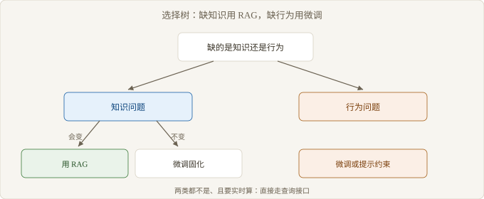

# Ch06 RAG 的失效边界

> 本章回答：什么时候不该用 RAG？
> 前置：Ch05｜预计 50 分钟
> 读完你能判断：该用 RAG、微调还是都不用

## 概念地图


> 图 6-1 三个前提同时成立，RAG 才成立

前五章讲的是 RAG 内部怎么运作：Ch01 划分责任，Ch02 讲检索为什么失真，Ch03 讲切分的代价，Ch04 讲融合的边界，Ch05 讲错误怎么定位。

本章把视角拉回方案层：这套机制的三个前提，有一个不成立时，整条链路就不该上。

失效边界（Failure Boundary）是本章的核心概念。它不是「效果差一点」，而是「机制的前提不成立」。三个前提是：资料里写着答案、一次检索就能取到、更新跟得上变化。

## 反直觉开场

三个需求摆在桌上。第一个是客服问答，第二个是本月工单统计，第三个是把回复统一成某种语气。

看起来最像 RAG 的是第一个，它也确实该用 RAG。同样像 RAG 的第二个，答案写在一张随时变化的表里，检索这条路走不通。第三个与知识无关，考的是说话方式。

误判的根源是把「有文档」当成「适合 RAG」。判据不在资料多不多，而在它能不能原样摘出来。

### 6.1 语料不覆盖

> 路径：必读

语料里没有的东西，检索不可能凭空找到。这条最直白，也最常被跳过。Ch02 把语料缺失排在四类失败之首，因为另外三类的修复都以语料存在为前提。

覆盖不看文档有多少，看问题落不落在里面。问题分布决定该补什么，文档数量只是结果。先摸清问题，再谈扩充。

| 判据 | 检查方法 | 不满足时 |
| --- | --- | --- |
| 答案是否在语料里 | 抽样问题，人工在语料中找答案 | 补语料或换数据源 |
| 语料是否可维护 | 看更新流程与责任人 | 建流程，否则索引必然过期 |
| 问题是否落在语料范围 | 问题按主题聚类，对照语料目录 | 缩小范围，或明确拒答 |
| 答案是否可摘取 | 看答案是一段话还是一个计算结果 | 计算类走查询接口 |

【反例】「把数据库导出成文档，就能用 RAG 查了」。导出的是一份快照，问题问的是当下。快照会过期，检索会把过期答案当成事实。

覆盖还有一个容易被忽略的维度：语料的权威性。文档里有答案，但那是三年前的版本、或者是某个部门的草稿，检索会把它当成唯一事实。覆盖不等于正确，判断时要问一句，这份语料谁在维护。

检查要落到问题上，不是落到文档上。取一批真实问题逐条问：需要的证据在语料里存在吗。存在但分散，是切分问题；存在但过期，是维护问题；不存在，才轮到补资料。

### 6.2 查询需要推理

> 路径：必读

单次检索假设答案集中在一处。多跳问题不满足这个假设：答案要先把 A 与 B 关联，再用关联结果去找 C。

```text
问题：某供应商的结算周期是多少
单跳假设：语料中有一段直接写明
实际路径：
  1. 找到该供应商的合同编号
  2. 用编号找到合同条款
  3. 从条款读出结算周期
# 三步中任何一步缺失，单次检索都答不出
```

【推导】多跳为什么放大错误：每一跳都可能召回错的东西，错的东西在下一跳被当成前提。跳数越多，链条越难核对，而 Ch04 的融合补不上断掉的那一环。

多跳不是不能做，是要显式拆成多步，并接受更长的响应与逐步累积的偏差。只有在问题非要跳几层才能答时，才值得付这笔代价。

拆分方式有三种：把问题改写成若干子问题分别检索；边检索边判断下一步查什么；把结构化查询交给工具，只让检索补齐文字证据。三种方式的共同点是把一次生成拆成多次判断。

Ch03 的切分在这里会再放大一次问题。多跳需要的证据分散在不同块、甚至不同文档，切得越细，跨块拼合越难。切分与多跳是叠加的代价，不是各自独立的两个问题。

### 6.3 实时性要求

> 路径：必读

索引与语料不同步时，检索会把旧条目当成现行事实。Ch01 把这种情况叫「知道旧的」：它不是缺印象，而是记住了旧版本。

| 时效档 | 索引策略 | 适用场景 | 风险 |
| --- | --- | --- | --- |
| 天级 | 批量重建 | 制度、手册、文档库 | 当天变更答不出 |
| 小时级 | 增量写入 | 工单、公告 | 删除与更正滞后 |
| 分钟级 | 流式写入 | 价格、库存 | 成本高，一致性难保证 |
| 实时 | 不走检索 | 账户余额、订单状态 | 需要查询接口 |

【边界】要求秒级一致的场合不该走这条路。索引再快也有写入延迟，而结构化查询本来就是为这种一致性设计的。

时效还有一个隐性成本：删除。新增一条文档容易，删掉一条要同时清索引、清缓存、清可能已经生成的答案。很多团队做了增量写入，却没做删除同步，结果是检索一直能召回已经作废的条目。

时效的判据可以用一句话问出来：如果答案在昨天变了，今天的系统会不会答错。会，说明索引跟不上语料的变更速度，此时要么提高更新频率，要么把这类问题交给查询接口。

### 6.4 该用微调还是 RAG

> 路径：选读

判断可以压成一个问题：缺的是知识，还是行为。

知识问题用 RAG：答案在外部资料里，会变，需要出处。行为问题用微调：要的是格式、语气、稳定的输出结构，与事实无关。



> 图 6-2 知识问题与行为问题的选择树

| 维度 | RAG | 微调 |
| --- | --- | --- |
| 解决的问题 | 知识缺失与过期 | 行为、格式、风格 |
| 更新方式 | 更新语料与索引 | 重新训练 |
| 可追溯性 | 可给出处 | 难以追溯 |
| 主要成本 | 索引与检索链路 | 标注数据与训练 |
| 失效方式 | 语料缺口、时效、推理 | 过拟合，知识仍然过期 |

两者可以叠加，但代价叠加。知识要更新、行为要稳定时，常见做法是先用 RAG 保证事实，再用轻量约束保证格式。

顺序有讲究。先上检索能立刻验证知识够不够，成本低、可回滚；先做微调则要等标注与训练跑完，才知道知识缺口仍在。先便宜后昂贵，是这个组合的现实走法。

【争议】微调能否替代 RAG 来注入知识。多数实践认为不能稳定替代：训练进去的知识无法给出处，也无法保证更新后立即生效。也有场景用微调固化高频事实，效果可接受，前提是事实变化慢。

Ch05 的定位方法在这里仍然适用。上了 RAG 仍然答不出，先确认是知识没覆盖，还是行为没约束。前者是方案选错，后者是层选错。

## 权衡表

| 方案 | 代价 | 适用条件 |
| --- | --- | --- |
| 纯 RAG | 依赖语料覆盖与索引时效 | 知识型问答，语料可维护 |
| 纯微调 | 需要标注数据，知识更新要重训 | 行为与格式问题，知识变化慢 |
| RAG 加微调 | 两套成本叠加，评测要分层 | 既要更新知识，又要稳定输出 |
| 查询接口 | 需要工程对接与权限设计 | 实时计算与结构化查询 |
| 明确拒答 | 可用性下降，需要话术与兜底 | 语料不覆盖又无法补的高风险场景 |

## 失效边界

- 语料里没有的答案，检索这条路径到不了，先补资料再谈调优。
- 多跳问题需要多段证据接续，一次召回装不下整条链，融合也不补这一环。
- 语料改动快过索引重建时，系统会稳定地输出过期事实。
- 要的是格式与语气时，检索改变不了输出习惯。
- 强一致与实时计算属于查询接口的职责，检索在这里只会失真。

## 延伸阅读

- RAG 的提出论文：看清它被设计出来时针对的是知识更新，而不是说话风格。
- 关于知识注入与微调的对比研究：说明为什么训练进去的知识难以更新与追溯。
- 多跳问答的评测工作：用具体题目说明单次检索在多跳问题上的系统性缺口。

## 下一章

书到这里结束。合上之前，把这三个前提对着你手上的需求过一遍；能省下的往往不是一次调参，而是一整条不该建的链路。
