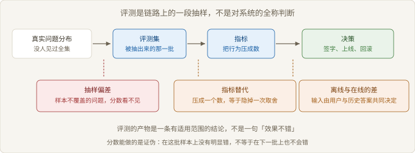
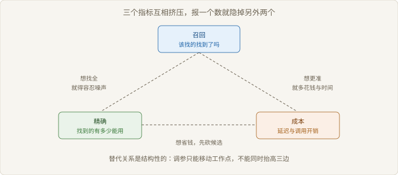

# Ch07 评测能证明什么

> 本章回答：一次评测的结论能支撑多大范围的决策？
> 前置：Ch06｜预计 50 分钟
> 读完你能判断：手里的评测分数够不够给方案签字

## 概念地图



> 图 7-1 评测是链路上的一段抽样

Ch06 判的是要不要上这条链路。上了之后，问题换成另一个：它做得够不够好。评测就是把这件事变成可判断的中间环节。

它不在链路之外，而在链路末端。真实的提问先被抽成一批样本，样本跑出行为，行为被压成指标，指标支撑一个决策。每一步都在丢东西。

四个断点对应本章四节：抽样、指标、离线与在线、以及看不见的部分。判断一份评测报告，就是判断这四个环节各丢了多少。

## 反直觉开场

一个团队把离线分数调上去了，曲线好看，上线之后用户的抱怨没有减少。

复查发现，涨分集中在评测集里那批整理得很规整的题。抱怨来自另一种问法：短、含糊、夹着业务黑话。

反直觉之处在这里。评测没有造假，分数是真的，它只是在它抽到的那批问题上成立。

把分数当结论的人问的是「好不好」。该问的是「对哪一批问题好」。

### 7.1 评测集是抽样，不是全集

> 路径：必读

抽样偏差（Sampling Bias）指评测集与真实问题分布之间的偏离。它不是随机误差。随机误差可以靠加样本压下去，偏差加样本只会把错的结论做得更确信。

样本从哪来，决定了结论的适用范围。三种来源的可信度差别很大。

| 题目来源 | 代表性 | 典型问题 |
| --- | --- | --- |
| 线上真实提问抽样 | 高 | 需要日志与脱敏流程 |
| 业务方口述整理 | 中 | 偏向已知的疑难，漏掉高频的简单问题 |
| 出题人凭经验编写 | 低 | 题面比真实提问规整 |

核对只做三步。

```text
抽样核对
  1. 从近期真实提问里随机抽一批，抽的时候不做人工筛选
  2. 按主题聚类，算出每类在线上与评测集中的占比
  3. 占比差得多的类补题；补不了就把该类从结论里剔除
```

【常见误解】评测集越大越可信。样本量解决的是随机波动，抽样偏差要靠分层与加权解决。一个偏的样本放大十倍还是偏的。

另一个常被漏掉的维度是难例。真实提问里有一批模糊、指代不清、跨主题的问题，出题时最容易被删。删掉它们，分数会变好看，覆盖会变窄。

加权是纠偏的常用手段：按每类问题在线上的实际占比给分加权，让高频类说话更响。代价是低频但高风险的类别被压到听不见，这类要单独留一个专项分数，不看总分。

所以看到分数先问两件事：样本从哪来，它删掉了什么。这两个问题答不上来，分数只是一个内部编号。

抽样的目的是逼近问题分布，不是攒够题量。样本来源与剔除规则，比题数更能决定结论的适用范围。

### 7.2 指标之间的替代关系

> 路径：必读

一个指标是一次取舍的压缩。报「效果好」，等于把找得全、找得准、算得快压成一个数，压的过程就是取舍。



> 图 7-2 三个指标互相挤压

三角关系是结构性的。想让该找到的都被找到，候选集就要放宽；放宽之后噪声进来，能用的一条占比下降；要把占比提回去，就得多排一次、多判一次，成本跟着上去。

调参能做的是移动工作点，不是同时抬高三条边。这句话能解释很多「调了很久没进步」的场面：目标本身互相矛盾，没有参数能解开。

| 指标 | 它换来了什么 | 它压低了什么 | 什么时候骗你 |
| --- | --- | --- | --- |
| 召回 | 少漏 | 精确与成本 | 候选塞满，模型被噪声带偏 |
| 精确 | 少噪 | 召回 | 该有的没进来，系统开始拒答 |
| 人工判正确率 | 贴近真实用处 | 人力与周期 | 样本小，口径随判分人漂 |
| 拒答率 | 少答错 | 可用性 | 把答不出包装成谨慎 |
| 平均响应时间 | 体感 | 候选数与重排深度 | 均值掩盖了长尾 |

【前提】指标可加的前提是口径稳定。同一批评测换一个判分人，分数变化可能比改一版带来的变化还大。口径没锁死之前，跨版本比较没有意义。

所以数字要成组报，并写明口径：谁判的、判了多少条、哪一类被排除。单个数字离开这三项，读不出信息。

没有中性的指标，只有被隐掉的取舍。选指标的动作，本质上是在选你愿意牺牲哪一边。

### 7.3 离线评测与在线表现的差距

> 路径：必读

离线评测的输入是固定的题面。在线输入由用户的措辞、上一轮的回答、当时的上下文共同决定。输入不同，同一套系统会表现不同。

差距主要来自三处失真。

```text
离线到在线的三次失真
  1. 题面：离线题被整理过，线上是随口问的
  2. 判分：离线判对错，线上判有没有解决问题
  3. 回路：线上答案会进入下一轮语料，错误被复读
```

第三条最容易被忽略。离线跑一次就结束，线上每次回答都可能改变下一次的输入。答错一次，错误说法进了知识库或工单，下一次检索会把它当证据。

| 维度 | 离线评测 | 在线表现 |
| --- | --- | --- |
| 输入来源 | 固定题面 | 用户措辞叠加历史上下文 |
| 判分标准 | 对错、要点覆盖 | 是否解决问题、是否被采纳 |
| 时间尺度 | 一次快照 | 持续变化，含反馈回路 |
| 失败代价 | 报表难看 | 用户流失与错误扩散 |

【反例】用固定的离线集做上线后的回归。题不变，系统改过，分数持平，实际已经把一类问题答坏了。

可行的做法是保留两份集合。一份固定的回归集，用来防止改坏；一份从线上持续补充的漂移集，用来发现新问题。两份的作用不同，不能互相替代。

离线评测能证明「没有改坏已知的东西」，不能证明「线上会变好」。这两件事之间隔着输入分布与反馈回路。

### 7.4 评测的盲区

> 路径：选读

有些失效不会让分数下降，因为评测根本没在看它们。这类问题不是分数低，是分数看不见。

| 盲区 | 为什么测不到 | 只能怎么发现 |
| --- | --- | --- |
| 沉默的失败 | 用户问一次就放弃，日志里没有第二次 | 看会话放弃与追问行为 |
| 慢 | 单条回答都对，等待让人走了 | 看分段耗时与流失位置 |
| 不一致 | 每题只跑一次，看不到同题不同答 | 同题重复跑，比对差异 |
| 越权与敏感 | 评测集里没这类题 | 专门的对抗集与人工抽查 |
| 长期漂移 | 评测周期内语料没大改 | 按月重跑同一批题 |

前两条最伤。答错至少留下一条错误记录，不答、慢答、答完没人用，连记录都没有。分数稳定，业务侧却在流失，原因就在这里。

还有一类盲区来自判分的人。判分人知道这套系统大体可用，遇到含糊的答案倾向判对；这种宽松会稳定地抬高分数，而且在数字上完全看不出来。对抗办法是双人盲判，不一致的条目交给第三个人裁定。

【边界】盲区不能靠加指标消灭。你只能决定接受哪几个盲区，并为它们留一条人工通道：抽听会话录音、看工单归因、盯放弃率。

落到判断上：一份报告如果只报分数、不报它没测什么，它的适用范围就是未知的。签字的依据不是分数高低，是盲区清单有没有被写出来。

评测的边界不在指标里，在指标之外。把没测的部分写出来，这份报告才有一条能被复核的适用范围。

## 权衡表

| 方案 | 代价 | 适用条件 |
| --- | --- | --- |
| 小样本人工判 | 慢，判分人之间要校准 | 上线前定基线，题少但要准 |
| 自动指标批量跑 | 只能测表层，容易与真实用处脱节 | 改动频繁，用于防退化 |
| 线上分流对比 | 要流量与埋点，短期体验有损 | 有真实用户，改动可回滚 |
| 用户反馈信号 | 稀疏，偏向极端体验 | 长期监测，发现新型失效 |
| 只做回归不设基线 | 看不出绝对值，只能看方向 | 已有稳定版本，只防倒退 |

## 失效边界

- 样本没覆盖的问题类型，分数再高也不代表那类问题被解决。
- 判分口径没锁死时，跨版本比较不成立，涨跌可能来自换人。
- 离线分数不能换算成线上收益，中间隔着输入分布与反馈回路。
- 只跑单轮时，多轮累积的错误不会被记录，也不会被扣分。
- 盲区类的失效不体现在分数上，只能靠人工通道发现。

## 延伸阅读

- 评测集构建与抽样方法的综述：讲清样本代表性如何决定结论的适用范围。
- 问答基准数据集的原始论文：看它们的题目从哪来，以及作者自己写下的局限。
- 离线与在线评估差异的工业复盘：说明为什么离线涨分不等于线上变好。

## 下一章

Ch08 把这条结论拿去用：在检索、长上下文、微调与查询之间做选择，并说清每条路线换走了什么。
