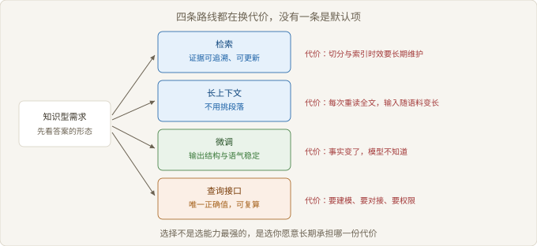
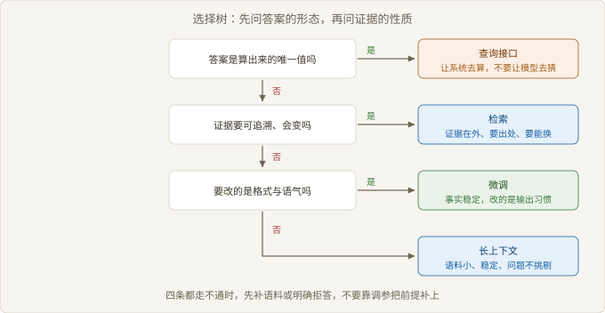

# Ch08 替代方案与选择

> 本章回答：面对一个知识型需求，该在几条路线里选哪一条？
> 前置：Ch07｜预计 50 分钟
> 读完你能判断：放弃检索、改用长上下文、微调或查询接口的条件是否已经成立

## 概念地图



> 图 8-1 四条路线各自换走一份代价

Ch07 给出一条有适用范围的结论。到了选型这一步，评测的作用变了：不再是证明系统好不好，而是判断现状离要求还差在哪一边。

四条路线的差别不在强弱，在它们各自换走了什么。检索用索引维护换时效与出处，长上下文用成本换省事，微调用训练换稳定，查询接口用对接换正确。

它们回答的甚至不是同一个问题。混着比，比出来的结论一定错。

## 反直觉开场

一个团队把整个知识库塞进上下文，演示时效果很好，答得完整、引用齐全。

上线两周后，两个问题同时出现：单次请求的输入变长，成本跟着涨；同一个问题在文档冲突时，答案开始摇摆，这次引这条，下次引那条。

反直觉之处在这里。窗口变大解决的是「装不下」，不是「挑不准」。信息变多之后，互相矛盾的段落也一起进来了。

容量问题解决之后，筛选问题才真正暴露出来。

### 8.1 长上下文能不能替代检索

> 路径：必读

长上下文（Long Context）指把更长的输入一次装进模型，用容量换掉「先挑段落」这一步。它省掉的是检索链路，不是检索要解决的问题。

判断它能不能替代，把下面几条过一遍。

| 条件 | 长上下文成立 | 检索成立 |
| --- | --- | --- |
| 语料规模 | 一次装得下，且不常变 | 远大于窗口，持续增长 |
| 单次成本 | 可接受，请求量不大 | 只送相关段落，成本可控 |
| 冲突处理 | 文档之间少矛盾 | 需要按权威性排序 |
| 可追溯 | 引用位置要能指回去 | 天然带出处 |
| 更新 | 每次替换整份输入 | 增量更新索引 |

【常见误解】窗口够大就不需要检索了。窗口解决容量，检索解决筛选，两者不是同一层的东西。窗口再大，也得决定哪一段该被相信。

成本这一条最容易被低估。检索的输入长度与语料规模基本无关，长上下文的输入长度跟着语料走。请求量一上来，差距不是一点。

冲突这一条更隐蔽。检索把候选压到几条，冲突范围有限；长上下文把整份语料摊在模型面前，互相矛盾的段落同时在场，模型只能凭表面措辞选一个。

所以长上下文适用的场景很具体：语料小、稳定、矛盾少、请求量不大，且不要求逐条给出处。任何一条不成立，就该回到检索。

### 8.2 微调解决哪一类问题

> 路径：必读

微调改的是行为分布：输出的格式、语气、术语习惯、拒答风格。它不改事实库，也不会因为你训练了它就知道昨天改了什么。

判断顺序只有一步：这件事会不会变。

| 要解决的问题 | 微调是否合适 | 原因 |
| --- | --- | --- |
| 输出格式总跑偏 | 合适 | 格式是稳定行为，不随事实变 |
| 语气不符合业务习惯 | 合适 | 同上，样本可造 |
| 某类问题该拒答 | 合适 | 拒答边界属于策略 |
| 产品参数要准确 | 不合适 | 参数会变，训练跟不上 |
| 文档里的规定要能引用 | 不合适 | 固化后的事实指不回原文 |

【前提】微调固化事实只在一种情况下勉强成立：事实集合小、变化慢、且不需要出处。三条同时满足的场景很少，多数团队高估了自己满足几条。

还有一个成本被忽略：微调之后，行为与知识被绑在一起。要更新一条事实，得重训一次，而重训可能把之前调好的格式带偏。检索侧更新一条文档，不会动到行为。

所以顺序上先检索后微调。检索便宜，改错了能退回去，知识缺口一眼就看得见；先做微调，得等训练结束才能发现缺口没被补上。

### 8.3 工具调用与结构化查询

> 路径：必读

有一类问题不该用检索回答：答案由计算得出，且只有一个正确值。库存多少、上月结案多少、某个订单走到哪一步，这些都不是「找一段话」，是「算一个数」。

```text
判断一次提问该走哪条路
  输入：问题 + 可用数据源
  1. 答案是否由已有字段计算得出
     是 → 走查询接口，检索只用来补文字说明
  2. 答案是否只存在于非结构化文本
     是 → 走检索
  3. 两者都需要 → 先查询定范围，再检索补解释
# 顺序不能反：先检索会把范围放大，再算就容易算错对象
```

| 维度 | 检索 | 结构化查询 |
| --- | --- | --- |
| 输入形态 | 自然语言问题 | 明确的条件与字段 |
| 结果形态 | 一段可引用的文字 | 一个可复算的值 |
| 正确性 | 相关即为合格 | 唯一值，可核对 |
| 时效 | 受索引更新影响 | 与源库同步 |
| 主要成本 | 索引维护与切分调优 | 数据建模、接口与权限 |

【反例】用检索回答「上月某类工单有多少」。语料里可能有一份写着某个数字的报告，但那是写报告时点的数，不是当下的数。检索会把它当答案用，而且用得很有底气。

【争议】让模型自己决定调哪个工具，还是把路由写死。前者的覆盖更宽，出错时难定位；后者可预测，但覆盖窄。多数生产系统先用固定路由跑稳，再放开有限的选择。

分工的界线这样定：要一个能核对的数，走查询；要一段能读的理由，走检索。

### 8.4 组合方案的代价

> 路径：选读

组合方案很常见：检索加查询、检索加微调、长上下文加检索。它们确实能覆盖更多场景，代价也跟着叠加。



> 图 8-2 方案选择树

第一份代价是失效面叠加。单条链路的失效边界是清楚的，组合之后变成并集：检索漏召回、查询字段缺失、微调行为漂移，这三种错误都会让最终答案错，而且错得看不出区别。

第二份代价是定位成本。一条链路出错，只需在两层里挑一层；几层组合之后，得先判断是哪一层漏的，再判断漏在这一层的哪一环。

第三份代价是评测负担。Ch07 讲的判分口径在这里变成必须：总分看不出问题出在哪一层，得给每一层单独设一组题。

| 组合 | 换来了什么 | 新增的代价 | 适用条件 |
| --- | --- | --- | --- |
| 检索加查询 | 数值准、理由全 | 路由判错就两头错 | 问题里既有数又有解释 |
| 检索加微调 | 事实可更新、格式稳定 | 两套成本，评测要分层 | 知识与行为同时不满足 |
| 长上下文加检索 | 兜底覆盖 | 成本与延迟叠加 | 语料中等且问题类型杂 |
| 三路以上组合 | 覆盖最宽 | 定位与评测成本陡增 | 有专职团队维护 |

【代价】组合的收益只出现在两层的失效不重叠的地方。两层都在同一个环节出错，组合只是把同一个错误做两遍。

判断组合值不值，问一句：把其中一层拿掉，失败率会不会明显变化。答不上来，说明这层在链路里没有独立贡献。

## 权衡表

| 方案 | 代价 | 适用条件 |
| --- | --- | --- |
| 纯检索 | 切分与索引时效要长期维护 | 证据在外、要出处、会更新 |
| 长上下文 | 每次重读全文，输入随语料变长 | 语料小、稳定、矛盾少 |
| 微调 | 行为与知识绑在一起，更新要重训 | 要改的是格式与语气 |
| 查询接口 | 要建模、要对接、要权限 | 答案是算出来的唯一值 |
| 检索加查询 | 路由判错会两头错 | 数值与解释都要 |
| 明确拒答 | 可用性下降，要话术兜底 | 语料不覆盖且风险高 |

## 失效边界

- 语料规模远超窗口、且请求量大时，长上下文的成本会压过它省下的工程量。
- 事实会变、又需要给出处的场景，微调不能替代检索，重训也追不上变化。
- 答案只存在于非结构化文本时，查询接口无从下手，硬做只会得到空结果。
- 组合方案的收益依赖两层失效不重叠；同一个环节错两次，组合只是重复付费。
- 没有分层评测时，组合方案的问题无法定位，任何调优都是盲调。

## 延伸阅读

- 长上下文与检索的对比实验：用具体任务说明「装得下」与「挑得准」是两件事。
- 关于参数化知识与检索知识的研究：说明事实被固化进参数之后，为什么改不动。
- 结构化查询与文本检索混合系统的工程复盘：讲清路由判错时错误怎么放大。

## 下一章

正文到此为止。把 Ch07 的适用范围与本章的四条路线合在一张纸上，就是那个需求该有的选型依据。
