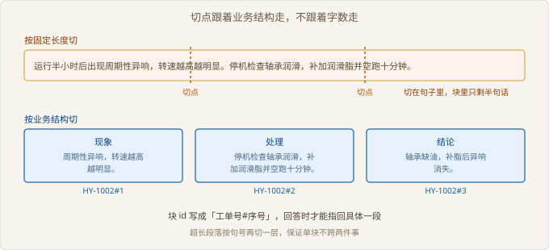

# Ch03 检索链路搭建

> 本阶段：让系统能找对候选
> 前置：Ch02｜工期：8 人天｜交付物：可演示的检索链路
> 阶段目标：Top-5 里至少有一条能回答问题

## 阶段全景


> 图 03-1 项目推进位置

## 现场开场

数据接通第二天，客服主管在工位上随手打了一句「主轴一直响」，屏幕上回来三整篇工单，每篇两千多字。她翻了半分钟，说：「还不如我自己搜。」问题不在检索算法，在这句话之前：整篇工单被当成一个单位，检索只能整篇命中，答不出具体是哪一段。本阶段要做的是把整篇变小块，再让小块能被查出来。判断标准只有一条：Top-5 里至少有一条真的能回答问题。

### 3.1 切分方案

> 路径：必读

**决策**：按业务结构切，不按固定字数切。工单正文天然分成现象、处理、结论三段，切点就落在这三个词上。放弃的是「按五百字切」和「整篇不切」。前者会把一句话劈成两半，后者等于没切。

**实施**：先识别段名，再按段抽正文，超过上限的段按句号再切一层。块 id 写成「工单号#序号」，序号在单篇内递增。切不动或过短的段直接丢掉，不硬凑。

**验证**：拿八篇工单跑一遍，看三件事：每块只讲一件事、块长落在合理区间、单块能靠 id 指回原文。三条都成立才继续。

| 方案 | 切点 | 问题 | 结论 |
| --- | --- | --- | --- |
| 整篇不切 | 无 | 命中整篇，答不到点 | 不采用 |
| 固定字数 | 第 N 个字 | 句中切断，语义残缺 | 不采用 |
| 按段落 | 空行 | 段落长短差太多 | 部分采用 |
| 按业务结构 | 现象 / 处理 / 结论 | 需要正文有结构 | 本阶段采用 |



> 图 03-2 切点跟着业务结构走

```python
# src/ch03/chunk.py
SECTIONS = ("现象", "处理", "结论")

def split_sections(body: str) -> list[tuple[str, str]]:
    parts = []
    for line in body.splitlines():
        for name in SECTIONS:
            prefix = f"{name}："
            if line.startswith(prefix):
                parts.append((name, line[len(prefix):]))
    return parts
```

结构不是每篇都有。老工单是坐席随手写的流水账，没有段名。这类正文退回按段落切，并在块上标一个来源类型。混着切比强行统一更省事，代价是块的质量参差。

【取舍】丢掉过短的块，会损失一些「一句话结论」。这些块单独检索价值低，但作为答案的收尾很有用。第一版先丢，靠后面引用补。

先答这个：固定字数在工单场景为什么一定出问题。

### 3.2 向量化与索引

> 路径：选读

**决策**：先用字符二元组哈希做向量，不接外部向量化服务。放弃的是近义词泛化，「异响」和「杂音」在向量里没有关系。理由是本阶段要的是可复现：断网能跑、结果能解释、出了问题能逐块查。

**实施**：中文按单字与二元组混合编码，哈希到固定维度，再做归一化。索引先落盘成一份 JSON，检索用暴力比对。数量级没上来之前，暴力检索的延迟比任何近似算法都稳定。

**验证**：写盘后重新加载，块顺序必须与内存一致。再拿三条查询看首位结果，人工判断相关性。

| 方案 | 网络依赖 | 近义词 | 可解释性 | 结论 |
| --- | --- | --- | --- | --- |
| 字符哈希 | 无 | 弱 | 强，能列出命中词 | 本阶段采用 |
| 商用向量接口 | 有 | 强 | 弱 | 上线前评估 |
| 本地小模型 | 首次下载 | 较强 | 中 | 机器条件允许时换 |

```python
# src/ch03/index.py
def embed(text: str) -> list[float]:
    vec = [0.0] * DIM
    for term, weight in _terms(text):
        bucket = int(hashlib.md5(term.encode()).hexdigest()[:8], 16) % DIM
        vec[bucket] += weight
    norm = math.sqrt(sum(v * v for v in vec)) or 1.0
    return [v / norm for v in vec]
```

标题也要进向量。工单标题往往就是问题的短写法，「主轴异响」四个字对检索的价值高于正文里的一段描述。只索引正文，等于把最干净的信号丢掉。

【代价】字符向量对同义改写不友好。客户说「开机没反应」，工单写「通电后指示灯不亮」，两边共用的字太少。这个短板只能靠词面匹配兜底，或者换模型补。

想清楚再往下：宁可要可解释的弱模型，是因为它换来了什么。

### 3.3 召回初测

> 路径：必读

**决策**：先手工标二十条，测 Top-5 里有没有 gold 块，再谈调参。不采用「先调参数再测」，也不等换模型。没有基线，调参就是碰运气。

**实施**：二十条覆盖八篇工单，其中四条是口语化改写，专门用来暴露弱点。每条标一个 gold 块 id，跑完记录排名，未命中的单独列出来。

**验证**：看两个数：Top-5 命中多少条，首位命中多少条。再看未命中的那几条错在哪，是切分、编码还是提问方式。

| 指标 | 含义 | 本次结果 |
| --- | --- | --- |
| 命中条数 | Top-5 含 gold 块 | 19 条 |
| 召回 | 命中数除以总条数 | 0.95 |
| 首位命中 | 排第一的正好是 gold | 15 条 |
| MRR | 排名倒数的均值 | 0.83 |

```python
# src/ch03/eval.py
CASES = [
    ("指示灯不亮", "HY-1001#1"),
    ("主轴一直响", "HY-1002#1"),
    ("机器声音不对", "HY-1002#1"),
]
for query, gold in CASES:
    rank = rank_of(idx.search(query, TOP_K), gold)
```

未命中的是「机器声音不对」。这条问法里没有一个字出现在工单中，字符向量自然找不到。它的价值比十九条命中更大：它告诉你真实用户不会照着工单的措辞提问。

十九条命中也不能吹。样本是你自己标的，标的时候已经看过切分结果，天然偏向系统能答的题。这一点要写进验收记录，不能只报一个漂亮数字。

【风险】用自标样本报召回，客户会追问样本怎么来的。提前准备抽样的随机性说明，比事后解释省力。

十九比二十，能证明什么、不能证明什么。

### 3.4 阶段交付

> 路径：必读

**决策**：交付三条命令加一张指标表，不做界面。不打算先做网页给客户看。界面会把注意力引到样式上，掩盖检索本身的问题。

**实施**：把切分、建索引、评测写成三个可独立运行的脚本，README 里贴真实输出。客户拿到仓库，按命令跑一遍就能复现同一组数字。

**验证**：在客户的测试机上按 README 走一遍。不装第三方包、不连外网也能跑通，才算交付完成。

| 交付项 | 内容 | 验收方式 |
| --- | --- | --- |
| 切分脚本 | 结构优先、超长按句切 | 抽八篇看块边界 |
| 索引脚本 | 落盘与重载一致 | 重载后块顺序一致 |
| 评测脚本 | 二十条金标与排名 | 现场重跑得到同结果 |
| 指标表 | 召回、首位命中、未命中清单 | 项目经理确认 |

交付时把「未命中清单」一起交。只交好数字，等于把问题留给下一个人。客户技术负责人看到清单，反而更愿意相信前面那十九条。

Ch04 的引用要指到具体一段，靠的就是这里切出来的块 id。块切得含糊，引用只能指整篇，客户点进去仍要在两千字里自己翻。

交付单上为什么必须附一份未命中清单。

## 阶段交付物

| 交付物 | 验收标准 | 谁来验收 |
| --- | --- | --- |
| 可演示的检索链路 | 三条命令跑通，二十条样本召回达标 | 项目经理 |
| 切分与索引脚本 | 重载一致，块可回指原文 | 技术负责人 |
| 指标表 | 含未命中清单与原因 | 客服主管 |

## 复盘

**做对了什么**：先标二十条再动手，调参时有了基线，争论从「感觉不准」变成「这条排第几」。

**做错了什么**：把标题排除在索引外，导致短查询大面积落到正文噪声上。

**下次怎么改**：建索引时把标题、段名、正文一起编码，并在评测里单列短查询。

## 风险登记

| 风险 | 影响 | 应对 |
| --- | --- | --- |
| 样本自标偏差 | 指标虚高 | 补一批坐席真实提问 |
| 口语化查询 | 召不回 | 关键词兜底，记录未命中 |
| 老工单无结构 | 块质量参差 | 退回按段落切并标记来源 |
| 换模型后指标回退 | 验收不通过 | 新旧模型同批样本对比 |

## 下一阶段

候选能找出来了，但答案还没有依据。Ch04 讲怎么把答案对回具体一段原文，以及证据不够时怎么拒答。
