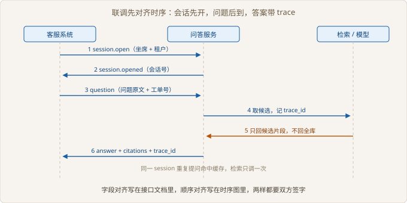

# Ch05 联调与压测

> 本阶段：证明它在真实流量下不塌
> 前置：Ch04｜工期：5 人天｜交付物：压测报告与故障演练记录
> 阶段目标：P95 延迟与错误率达到合同约定

## 阶段全景


> 图 05-1 项目推进位置

## 现场开场

联调第一天，客服系统的开发在群里发了一张截图：同一个问题连点两次，返回了两段不一样的回答。他问：「你们到底哪个是对的？」同一天下午，运维问了一句更要命的话：「上线以后如果检索挂了，坐席会看到什么？」这两个问题都不是模型问题，是接口和退路的问题。本阶段的任务是把问答服务塞进客服系统，再用压测和演练证明：流量上来它不塌，依赖挂掉它有话说。

### 5.1 与业务系统联调

> 路径：必读

**决策**：先对齐字段与时序，再谈联调通过。不打算直接拿真实工单在页面上点。页面点出来的问题，八成会被误判成模型答得不好，实际是字段没对上或顺序反了。

**实施**：先冻结两张表：请求必填字段、响应必填字段。再画一条六步时序：开会话、返会话号、提问、取候选、调模型、返答案。最后约定同一会话同一问题走缓存。

**验证**：三类非法请求都要被挡住。同一问题连提两次，检索只能被调一次。时序图上的每一步，都要在日志里找得到对应记录。

| 接口 | 方向 | 必填字段 | 失败处理 |
| --- | --- | --- | --- |
| 开会话 | 客服系统发起 | 坐席工号、租户标识 | 返回明确错误码 |
| 提问 | 客服系统发起 | 会话号、问题原文 | 缺字段直接拒绝 |
| 返答案 | 问答服务返回 | 答案、引用、链路号 | 超时由客服系统兜底 |



> 图 05-2 联调先对齐时序

```python
# src/ch05/integration.py
def validate(payload: dict, spec: dict[str, type]) -> list[str]:
    errors = []
    for name, kind in spec.items():
        if name not in payload:
            errors.append(f"缺字段 {name}")
        elif not isinstance(payload[name], kind):
            errors.append(f"{name} 类型应为 {kind.__name__}")
    return errors
```

联调最容易吵起来的是「谁兜底」。问答服务超时，客服系统是显示报错，还是显示一句「过一会儿再试」，这个必须提前定。两边都以为对方兜底，结果就是坐席看到一片空白。

链路号要贯穿全流程。出问题时，坐席报一个链路号，你能在日志里一路查到是检索慢、模型慢，还是客服系统自己超时。

【排查】先看链路号断在哪一跳，再看那一跳的入参。模型放到最后怀疑。

联调为什么先对时序、后对接口文档。

### 5.2 延迟与并发

> 路径：必读

**决策**：只报 P95，不报平均值。不打算用一个平均数交差。平均值会把长尾抹平，而用户投诉的正是长尾。

**实施**：分五档并发跑，每档固定请求数，记录 P50、P95、P99 与错误率。跑到出现拐点为止，不跑到系统崩。

**验证**：找到拐点并写进报告。拐点之前加并发只增加吞吐，拐点之后加并发只增加排队。

| 并发 | P50 | P95 | P99 | 超时条数 |
| --- | --- | --- | --- | --- |
| 1 | 928 | 1198 | 1311 | 0 |
| 4 | 878 | 1129 | 1234 | 0 |
| 8 | 885 | 1192 | 1284 | 0 |
| 12 | 1796 | 3032 | 3927 | 0 |
| 16 | 2475 | 4000 | 4000 | 21 |

```python
# src/ch05/loadtest.py
def percentile(values: list[float], pct: float) -> float:
    if not values:
        return 0.0
    ordered = sorted(values)
    idx = max(0, math.ceil(pct / 100 * len(ordered)) - 1)
    return ordered[min(idx, len(ordered) - 1)]
```

表格里最值得看的是并发 12 那一行。P50 还在一秒八，看起来没事，P95 已经是三秒。如果只看平均，这一档会被判成通过，上线后投诉会集中在这里。

并发 16 那一档开始出现超时：每档两百个请求，超时二十一例。不是服务算不过来，是等太久被上游判超时。这类错误在监控里表现为失败率，根因却在排队。

压测报告要写清测试条件：请求从哪来、数据量多大、模型是本地还是远端。换一个条件，数字全变。不写条件的报告，只能证明「跑过」，不能证明「能扛」。

【风险】在客户生产环境压测，必须提前报备时间窗。压出问题不可怕，压的时候正好有真实客户在下单才可怕。

拐点落在并发 12 而不是 16，原因在哪。

### 5.3 故障演练

> 路径：必读

**决策**：演练检索失败、模型超时、从库断连三种，不演练机房断电。不演机房断电那类大故障。大故障有运维兜底，小故障才是坐席每天遇到的。

**实施**：每个场景准备一个注入开关，跑完记录系统动作与对客输出。降级必须落到具体出口：词面兜底、转人工、明确拒答，三选一，不许沉默。

**验证**：四个场景全部有明确出口，且对客话术是人话。判定标准是坐席看完知道下一步做什么，不是「系统没崩」。

| 场景 | 注入方式 | 期望动作 | 对客结果 |
| --- | --- | --- | --- |
| 正常 | 无 | 正常作答 | 答案带引用 |
| 检索超时 | 人为拖慢检索 | 降级到词面兜底 | 明确说明结果有限 |
| 模型超时 | 让上游持续报错 | 重试一次后转人工 | 告知已转人工 |
| 从库断连 | 断开只读连接 | 直接拒答 | 不返回缓存旧答案 |

```python
# src/ch05/drill.py
def handle(ticket: str) -> Outcome:
    try:
        context = call_retrieval(ticket)
    except RetrievalTimeout:
        context = ""
    except ReplicaDown:
        return Outcome("abstain", "现在查不到工单记录，请过一会儿再试或转人工。", "从库不可用")
    if not context:
        return Outcome("degraded", "只找到少量相关记录，先给出关键词结果供参看。", "降级兜底")
```

从库断连这一条最容易被做错。系统里往往有缓存，断连时顺手返回上一版答案，看起来「高可用」，实际是在拿旧数据冒充新答案。工单状态是会变的，旧答案比没有答案更危险。

模型超时的重试次数要克制。重试一次还算合理，重试三次会把一次超时放大成三倍等待，坐席那边早就放弃了。

【代价】降级路径越多，代码分支越多，测试面越大。三种降级已经是上限，再加就要重新设计。

从库断连时，返回缓存旧答案错在哪。

### 5.4 上线前检查

> 路径：选读

**决策**：检查项不过就不上线，没有例外。拒绝「上线之后再补」这套说法。上线后补的成本，通常是上线前补的数倍，而且是在客户盯着的时候补。

**实施**：清单分三类：功能、性能、运维。每项写清谁验、怎么验、证据放哪。空着的项不算通过，算没做。

**验证**：逐项签字。任何一项空着，发版评审直接打回，不看整体进度。

| 类别 | 检查项 | 通过标准 | 谁来签 |
| --- | --- | --- | --- |
| 功能 | 引用回切 | 抽查全部可回切 | 技术负责人 |
| 功能 | 三类拒答 | 话术与签字版一致 | 客服主管 |
| 性能 | P95 与错误率 | 不越过合同约定 | 技术负责人 |
| 运维 | 日志与链路号 | 能按链路号查到全流程 | 客户运维 |
| 运维 | 回滚方案 | 十分钟内可回退上一版 | 客户运维 |

清单不要超过一页。超过一页就没人逐项看，最后变成一场集体点头。

检查项要能被证伪。「系统稳定」不能验，「按链路号能查到六步记录」能验。写不出验证方法的项，说明还没想清楚要保证什么。

Ch06 的灰度第一档，用的就是这张清单里的证据；清单没过的项，灰度时一定会冒出来。

清单里每一项为什么都要写清「怎么验」。

## 阶段交付物

| 交付物 | 验收标准 | 谁来验收 |
| --- | --- | --- |
| 压测报告 | 含测试条件、五档分位数据、拐点结论 | 客户技术负责人 |
| 故障演练记录 | 四个场景各有出口与对客话术 | 客户技术负责人 |
| 上线检查清单 | 逐项有证据、有签字 | 项目经理 |

## 复盘

**做对了什么**：测出拐点再谈优化，优化目标从「越快越好」变成「把并发 12 的 P95 拉回预算内」。

**做错了什么**：第一轮压测没写测试条件，客户拿另一套数据复现不出同样的数字，报告被打回重做。

**下次怎么改**：压测脚本与数据快照一起归档，报告首页写清复现命令。

## 风险登记

| 风险 | 影响 | 应对 |
| --- | --- | --- |
| 生产压测撞上业务高峰 | 影响真实客户 | 提前报备时间窗 |
| 缓存掩盖从库故障 | 返回过期答案 | 断连即拒答，不读缓存 |
| 上游超时判定不一致 | 错误率口径打架 | 联调时统一超时阈值 |
| 清单项无人签字 | 上线后扯皮 | 每项指定签字人 |

## 下一阶段

联调通过、拐点清楚、退路都有结论，剩下的是把它放进真实流量。Ch06 讲灰度怎么分档、监控盯哪几个指标，以及交接文档要写到什么程度。
