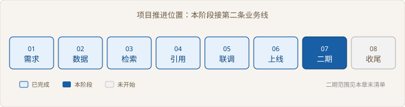
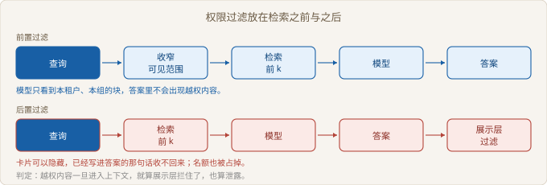

# Ch07 二期扩展

> 本阶段：把一期系统扩到第二条业务线
> 前置：Ch06｜工期：5 人天｜交付物：二期范围与接入方案
> 阶段目标：带权限边界的二期方案通过客户评审

## 阶段全景



> 图 07-1 项目推进位置

## 现场开场

一期上线满一个月，客服总监在周会上说：「备件那条线也想用，顺便把财务的政策问答做了。」他接着说：「两个部门的数据互相不能看，这个你们应该能处理吧。」会议室里没有人反对，只有项目经理低声问了一句：「那这一期算到哪个合同里？」这句话决定了后面两周的全部工作：先划范围，再谈权限，最后才是换模型。

### 7.1 新业务线的接入评估

> 路径：必读

**决策**：先评估再接，评估表只填一次。放弃的是「业务提一条就排一条」——二期的窗口装不下四条线，硬接会把一期的稳定性拖回去。四项打分里只要有一项为零，直接给不接，不进排期讨论。

**实施**：四项分别是数据就绪、权限可得、链路复用、业务负责人，每项零到二分。分数不是在评业务价值，是在标出这条线还缺什么条件。判定写在脚本里，谁来看都是同一套。

```python
# src/ch07/intake.py
def evaluate(r: Request) -> tuple[str, str]:
    if r.verdict == "接入":
        return "接入", f"四项均达线，{r.note}"
    if r.verdict == "观察":
        return "观察", f"卡在{HINTS[r.weakest]}；{r.note}"
    return "不接", f"卡在{HINTS[r.weakest]}；{r.note}"
```

**验证**：四条线跑一遍，两条接入、一条观察、一条不接。不接的那条是供应商合同，理由是数据还在扫描件里，没有可导出的结构化来源。客户当场认了这个结论，没有争。

| 业务线 | 数据就绪 | 权限可得 | 链路复用 | 业务负责人 | 结论 |
| --- | --- | --- | --- | --- | --- |
| 售后备件问答 | 2 | 1 | 2 | 2 | 接入 |
| 财务报销政策 | 2 | 1 | 1 | 2 | 接入 |
| 员工 IT 工单 | 1 | 2 | 1 | 1 | 观察 |
| 供应商合同条款 | 0 | 0 | 1 | 1 | 不接 |

「接入」不等于可以立刻开工。两条接入线各带一个前置条件：备件的成本价只对内部开放，报销要按成本中心分权。前置条件不落地，接了也会在验收时卡住。

「观察」是最容易被含糊掉的一档。它必须带一个复查日和一个明确的补齐动作，否则三个月后还是这四个字。

【取舍】评估表放弃了「业务价值」这一栏。价值由业务方判断，交付方判断的是能不能做、要什么条件。两件事混在一张表里，讨论就会变成争论。

一个总分为零项的业务线，为什么不能先接再补条件。

### 7.2 权限与多租户

> 路径：必读

**决策**：过滤放在检索之前，按租户与受众组先收窄可见范围。放弃的是「先生成答案，再按身份隐藏卡片」——卡片能藏，写进答案的那句话收不回来。

**实施**：每个块带两个标签：所属租户、可见的组。检索前先求可见集，再在可见集里取前 k。两个部门的身份不同，进来看到的候选自然不同，不需要在提示词里叮嘱模型「不要提财务」。



> 图 07-2 权限过滤放在检索之前与之后

```python
# src/ch07/tenancy.py
def allowed(c: Chunk, ctx: Ctx) -> bool:
    return c.tenant == ctx.tenant and c.groups <= ctx.groups

def retrieve(chunks: tuple[Chunk, ...], ctx: Ctx, k: int = K) -> list[Chunk]:
    """先收窄范围，再按分数取前 k。模型只看得到这些。"""
    return sorted(visible(chunks, ctx), key=lambda c: -c.score)[:k]
```

**验证**：同一句「备件多久到货」，售后身份在前置过滤下拿到三条本组文档；换成后置过滤，前三条被物流租户和财务文档占掉两条，展示层过滤完只剩一条可用。按四个问题乘五个身份跑一遍，后置过滤有四十条越权内容进了模型上下文，前置过滤是零。

| 方案 | 模型看到的候选 | 越权条数 | 可用条数 |
| --- | --- | --- | --- |
| 前置过滤 | 本租户本组三条 | 0 | 3 |
| 后置过滤 | 全局前三条 | 2 | 1 |

后置过滤还有一个更隐蔽的代价：名额被占掉之后，系统不是报错，是安静地少给两条依据。坐席看到的是一个看起来正常、其实证据不足的答案。

【风险】组标签靠人工维护。新入库的块如果没有打标签，按默认不可见处理，宁可少答也不要多答。这条规则要写进语料入库脚本，不能靠人记得。

越权扫描为什么按身份乘问题数统计，而不是抽查几条。

### 7.3 模型与索引的升级

> 路径：必读

**决策**：新索引先在影子位跑，和旧索引吃同一批样本，四项达标才切。放弃的是「新模型效果更好就直接换」——效果好在哪一层，得先量出来。

**实施**：影子索引与线上索引并行重建，同一批问题同时问两套，比四个数：前五命中、名次、可回指率、重复块数。名次这一项最容易被跳过，但它决定坐席要不要往下翻。

```python
# src/ch07/upgrade.py
def metrics(index, with_synonym: bool) -> tuple[float, float, list[int]]:
    ranks: list[int] = []
    for q, gold in SAMPLES:
        got = search(index, q, with_synonym)
        ranks.append(got.index(gold) + 1 if gold in got else 0)
    hit = sum(1 for r in ranks if r) / len(ranks)
    mrr = sum(1 / r for r in ranks if r) / len(ranks)
    return hit, mrr, ranks
```

**验证**：八个样本跑下来，命中都是满的，名次从 0.938 升到 1.000，重复块从八块合到七块，可回指的块占比两边都是一。四条都过，切。切换按影子重建、双读比对、切读、保留旧索引可回退的顺序走。

| 判据 | 旧索引 | 新索引 | 是否放行 |
| --- | --- | --- | --- |
| 前五命中 | 1.000 | 1.000 | 放行 |
| 名次 | 0.938 | 1.000 | 放行 |
| 可回指率 | 1.000 | 1.000 | 放行 |
| 重复块 | 8 | 7 | 放行 |

名次提升来自两处：索引里带上了小节标题，以及一份同义词表把「密封圈」映射到文档里的「O 型圈」。同义词表是人工维护的资产，不是模型能力，得有人负责加词。

【代价】双读期间两套索引都在占资源，查询耗时按慢的那套算。这段窗口只留一天，长了会拉低体验。

可回指率满分，为什么还要单独看名次。

### 7.4 二期验收

> 路径：选读

**决策**：二期沿用一期的验收项，只增加权限隔离与索引升级两项。放弃的是「二期另立一套口径」——两套口径会让客户在两个签字页之间来回比较。

**实施**：四条闸门交给脚本汇总：接入条目至少一条、越权扫描为零、名次不下降、每条接入有验收人。任一条不通过就退回，不进评审会。

```python
# src/ch07/report.py
def gate_rows() -> list[tuple[str, str, str, bool]]:
    entered = [r for r in REQUESTS if r.verdict == "接入"]
    bad = sum(leaks(retrieve(CORPUS, ctx), ctx) for ctx in IDENTITIES for _ in QUESTIONS)
    _, m_old, _ = metrics(build(use_title=False, with_synonym=False), False)
    _, m_new, _ = metrics(build(use_title=True, with_synonym=True), True)
    all_owned = all(OWNERS.get(r.name) for r in entered)
    return [
        ("接入条目", f"{len(entered)} 条", "至少 1 条", bool(entered)),
        ("越权扫描", f"{bad} 条", "等于 0", bad == 0),
        ("索引升级", f"名次 {m_old:.3f} → {m_new:.3f}", "不下降", m_new >= m_old),
        ("验收人", "全覆盖" if all_owned else "有缺口", "每条都有", all_owned),
    ]
```

**验证**：四条闸门全通过，脚本输出「可提交评审」。评审会上客户加了一条批注：观察项要写成带复查日的条目，不接受「后续再看」。

| 验收项 | 判据 | 谁来验收 |
| --- | --- | --- |
| 范围与前置条件 | 每条接入线有前置条件与落地人 | 业务主管 |
| 权限隔离 | 越权扫描为零，可复测 | 客户信息安全 |
| 索引升级 | 四项判据全过，旧索引可回退 | 客户技术负责人 |
| 验收人 | 每条接入线有签字人 | 项目经理 |

评审批注比验收项更能暴露问题。它写的是客户真正在意的那条线，通常不在交付方的清单里。

【现场故事】评审结束时客户信息安全的人问：「这个越权扫描，我们自己能跑吗？」得到肯定答复后，他把脚本拷走了。第二周他发来一份自己跑的结果，数字一样。

二期验收为什么不能另立一套口径，而要在一期的清单上做加法。

## 阶段交付物

| 交付物 | 验收标准 | 谁来验收 |
| --- | --- | --- |
| 接入评估表 | 每条业务线有结论与卡点，不接的给出缺什么 | 业务主管 |
| 权限方案 | 越权扫描为零，过滤位置可复测 | 客户信息安全 |
| 升级报告 | 四项判据全过，带回退路径 | 客户技术负责人 |
| 二期范围与接入方案 | 每条接入线有前置条件与验收人 | 客户技术负责人 |

## 复盘

**做对了什么**：接入评估表先出结论再谈排期，把「不接」变成了一个有依据的答复，客户没有把它理解成推脱。

**做错了什么**：权限方案第一版把组标签交给了客户自己填，第一周有三分之一的块没标，检索结果少得吓人。

**下次怎么改**：语料入库脚本默认打上来源组，人工只在例外时改，不让空标签流进索引。

## 风险登记

| 风险 | 影响 | 应对 |
| --- | --- | --- |
| 组标签漏填 | 可见块变少，答不出来 | 入库默认带来源组，空标签不进索引 |
| 观察项没有复查日 | 拖成长期悬空 | 观察项必须带日期与补齐动作 |
| 同义词表无人维护 | 名次回升无望 | 指定维护人，随语料更新一起改 |
| 双读窗口拖长 | 查询变慢，体验下降 | 窗口只留一天，超时按未通过处理 |

## 下一阶段

二期方案通过评审，合同进入收尾。系统要在客户手里独立跑起来，终验怎么取证、交接怎么演练、哪些需求该带进产品，是 Ch08 要处理的事。
