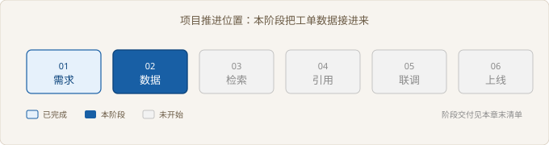
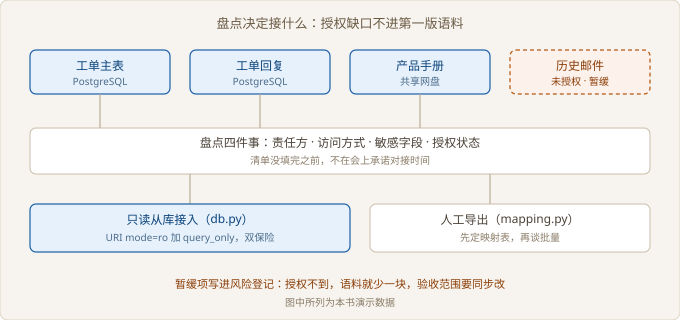

# Ch02 数据接入与清洗

> 本阶段：把工单数据安全接进来
> 前置：Ch01｜工期：5 人天｜交付物：只读库接入层与映射表
> 阶段目标：演示环境与真实库共用一套代码

## 阶段全景



> 图 02-1 项目推进位置

## 现场开场

验收单签完第三天，客户 IT 发来一个数据库账号，附言只有一句：「只读的，随便用。」账号能连上，但没人说得清主库有几张表、工单号存在哪个字段、客户手机号有没有脱敏。项目经理在群里问什么时候能演示。你手上只有一个账号和一句「随便用」。这一阶段要做的，是把这个账号变成一条能复现的接入链路：盘点清楚、只读连上、字段对齐、抽样零差异。少做一步，后面检索出来的内容都说不清来源。

### 2.1 数据源盘点

> 路径：必读

**决策**：先出一张盘点表，再谈对接时间。只把有授权、有责任方的源放进第一版。放弃的是「先把主表接上，其余边做边补」。理由很直接：一旦在演示里承诺了某种回答，没授权的那部分就变成你欠客户的债。

**实施**：每个源记四件事：谁负责、怎么访问、有哪些敏感字段、授权到什么程度。填不满的行标暂缓，不写「待定」。待定等于没人认领。

**验证**：把表分别发给客户 IT 与客服主管确认，两边都点头的行才进接入清单。暂缓项同时写进风险登记，并回改 Ch01 的验收范围。

| 数据源 | 类型 | 访问方式 | 敏感字段 | 结论 |
| --- | --- | --- | --- | --- |
| 工单主表 | 关系库 | 只读从库 | 客户手机号、客户地址 | 可接 |
| 工单回复 | 关系库 | 只读从库 | 坐席工号 | 可接 |
| 产品手册 | 共享网盘 | 人工导出 | 无 | 可接，需先整理 |
| 历史邮件 | 对象存储 | 未授权 | 客户邮箱 | 暂缓 |

盘点表里最容易被跳过的是「敏感字段」这一列。客户 IT 只关心你连不连得上，不问字段内容。可一旦把手机号原文灌进检索语料，后面每一次演示都在泄露客户信息。

第二容易被跳过的是「谁负责」。数据源的责任方不等于开账号的人。开账号的是运维，能确认字段含义的是业务部门。这两拨人对不上，字段就会全靠猜。

图 02-2 画出盘点到接入的分叉：三个源进第一版，一个源挂在暂缓上。挂起不是失败，把挂起的理由写下来才算交付。



> 图 02-2 盘点与接入分叉

```python
# src/ch02/source.py
SOURCES = (
    Source("工单主表", "PostgreSQL", "客服系统厂商", "只读从库", ("客户手机号", "客户地址")),
    Source("工单回复", "PostgreSQL", "客服系统厂商", "只读从库", ("坐席工号",)),
    Source("历史邮件", "对象存储", "客服主管", "未授权", ("客户邮箱",), "暂缓"),
)
```

【取舍】放弃历史邮件，换来的是接入周期不被法务流程拖住。代价是第一版答不了邮件里那批老问题，客服会遇到「这个以前邮件里说过」却查不到的情况。这条要提前告诉客服主管。

自测一句：盘点表里哪一列没填，会让整个接入返工。

### 2.2 只读从库接入

> 路径：必读

**决策**：走只读从库，不直连主库。放弃的是「主库加一个只读账号」这条更快的路。主库上跑的是客户的生产业务，一次大范围扫描就可能把下单接口拖慢，这个责任没人愿意担。

**实施**：连接串从环境变量读，默认值指向本地演示库。打开方式用 URI 的只读模式，再叠一层会话级只读。两层都加上，是因为运维改配置时经常只改一处。

**验证**：连上之后故意执行一条删除。必须报错，且报的是只读拒绝，不是语法错误。这一步不做，你永远不知道自己拿到的是只读账号还是读写账号。

| 方式 | 权限要求 | 对主库影响 | 结论 |
| --- | --- | --- | --- |
| 直连主库 | 独立读写账号 | 大查询抢占连接 | 不采用 |
| 只读从库 | 只读账号 | 基本无影响 | 本阶段采用 |
| 离线导出 | 无 | 无 | 仅作演示兜底 |

```python
# src/ch02/db.py
def connect_readonly(dsn: str) -> sqlite3.Connection:
    uri = f"file:{Path(dsn).as_posix()}?mode=ro"
    conn = sqlite3.connect(uri, uri=True)
    conn.execute("pragma query_only = on")
    return conn

dsn = os.environ.get("TICKET_DSN", str(demo_path))
```

环境变量这一层看着多余，实际是整个阶段最值钱的一行。演示库、测试库、客户的从库，三套环境靠同一个变量切换，代码一行不用改。等到上线，运维只需要改配置，不需要重新走一次发布评审。

【代价】只读模式会挡住所有写操作，包括临时表。后面做批量清洗时不能就地建中间表，得在应用侧处理。这是安全换来的不便，接受它。

换个问法：只读账号与只读连接，少设哪一个都会留下写入口。

### 2.3 字段映射与清洗

> 路径：选读

**决策**：映射表写成代码里的常量，进版本管理。放弃的是「在 SQL 里写 as 别名」和「注释里写一句说明」。前者散落在查询里，后者没人维护，两种都撑不过第二次改字段。

**实施**：一行一个字段，写清源字段、目标字段、清洗规则。清洗只做四件事：去标签、脱敏、统一时间格式、收敛状态取值。不做翻译，不做摘要。

**验证**：把源表的全部字段名丢进检查函数，未登记的字段直接抛错。新字段进来必须显式加映射，不允许悄悄漏过去。

| 源字段 | 目标字段 | 清洗规则 |
| --- | --- | --- |
| ticket_no | doc_id | 去空格并转大写，作为唯一键 |
| title | title | 去 HTML 标签，压缩空白 |
| body | content | 去 HTML 标签，手机号脱敏 |
| customer | customer_alias | 截城市与简称，去掉公司全称 |
| created_at | created_at | 统一为 ISO 8601 |
| status | status | 收敛到三个状态 |

```python
# src/ch02/mapping.py
MAPPING = (
    FieldMapping("ticket_no", "doc_id", "去空格并转大写，作为唯一键"),
    FieldMapping("body", "content", "去 HTML 标签，手机号脱敏"),
    FieldMapping("created_at", "created_at", "统一为 ISO 8601，保留到秒"),
)
```

脱敏这一步要写死在映射里，不能靠下游自觉。下游是检索，检索只关心文本像不像，不关心里面有没有手机号。等到有人导出日志排查问题，原文就跟着流出去了。

【风险】客户全称留在语料里，会让「华远」和「华远机械」被当成两家客户。简称规则要在映射表里定死，不要留给检索去猜。

自查：新增一个源字段时，代码在哪一步拦你。

### 2.4 数据质量验收

> 路径：必读

**决策**：抽样十条，逐条比对，差异必须为零。放弃的是「跑通就行」和「抽样看几条差不多」。十条是客户能当场看完的量，也是足以暴露映射错误的最小量。

**实施**：比对不复用清洗结果，而是从源数据重新算一遍汉字序列，再跟清洗后的正文对齐。另外单独查四项：标签残留、手机号残留、时间格式、单号唯一。

**验证**：十条全过才签字。有差异就回到映射表改规则，改完重跑，不在结果上打补丁。

| 检查项 | 方法 | 通过标准 |
| --- | --- | --- |
| 字段完整 | 源字段逐个查映射 | 未映射字段为零 |
| 正文无损 | 比汉字序列 | 与源逐字一致 |
| 脱敏 | 正则扫手机号 | 无原文残留 |
| 单号唯一 | 计数去重 | 无重复 |
| 时间格式 | 正则匹配 | 全部统一 |

```python
# src/ch02/check.py
src_han = "".join(HAN.findall(TAG.sub("", src["body"])))
out_han = "".join(HAN.findall(cleaned["content"]))
if src_han != out_han:
    problems.append("正文汉字序列与源不一致")
```

为什么比汉字序列而不是比字符串。字符串比的是格式，标签、空格、换行都会造成假差异，十条能报出二十条问题。汉字序列比的是内容，丢字、串行、截断才报得出来。

【验收】验收由数据负责人执行，不是你自测。他随机指一条工单，你当场从源库查到检索语料，两边内容对得上，这一项才算过。

清洗还会影响 Ch03 的切分。正文里的标签没清干净，切分时会把半个标签当成段落边界，切出来的块天然带噪。数据这层偷的懒，检索那层要加倍还。

回过头想：抽样十条零差异，能不能换成「抽查几条看着没问题」。

## 阶段交付物

| 交付物 | 验收标准 | 谁来验收 |
| --- | --- | --- |
| 只读接入层 | 改环境变量即可换库，写操作被拒绝 | 数据负责人 |
| 字段映射表 | 六个字段全覆盖，新字段未登记即报错 | 数据负责人 |
| 数据质量报告 | 抽样十条零差异，四项检查全过 | 客服主管 |

## 复盘

**做对了什么**：先盘点再承诺，把没授权的历史邮件挡在第一版之外，避免了上线前临时补授权。

**做错了什么**：映射漏了客户全称，演示时把「华远」和「华远机械」答成两家，被客户当场指出。

**下次怎么改**：映射表评审时请业务方逐字段念一遍含义，不只对字段名。

## 风险登记

| 风险 | 影响 | 应对 |
| --- | --- | --- |
| 从库延迟 | 刚处理的工单查不到 | 演示脚本避开当天的单 |
| 字段含义靠猜 | 检索答非所问 | 映射表由业务方确认 |
| 敏感字段外泄 | 合规问题 | 映射层强制脱敏，日志不落原文 |
| 历史邮件未授权 | 一部分问题答不了 | 写进验收范围，第二版再谈 |

## 下一阶段

数据接进来了，但还是一堆整篇工单。Ch03 讲怎么按业务结构切分、建索引，并用二十条样本把召回测出来。切分做错，后面的引用再准也点不到关键句。
