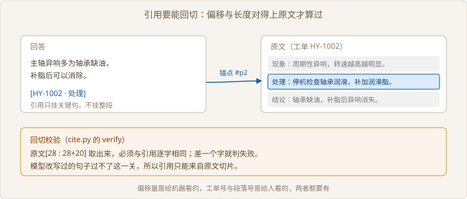

# Ch04 引用与拒答

> 本阶段：让答案有依据、该拒就拒
> 前置：Ch03｜工期：6 人天｜交付物：带引用与拒答的版本
> 阶段目标：每个答案都能点回原文

## 阶段全景


> 图 04-1 项目推进位置

## 现场开场

第二次演示，客服主管问了一个刁钻问题：「你说的这条，是哪个工单里的？」屏幕上只有一段流畅的回答，没有出处。她接着说：「没有出处我不敢用，客户一追问我就露馅。」同一天下午，另一个坐席反馈系统对一条根本没记录的问题也答得很自信。两件事指向同一处缺口：答案缺依据，也缺刹车。本阶段要做两件事：把每个答案接回原文，给系统装一道刹车。

### 4.1 引用格式对齐

> 路径：必读

**决策**：引用精确到段，格式直接复用客户工单系统的编号，不另建一套。不采用「引用整段原文」，也不自建引用序号。整段引用客户还是找不到关键句，自建序号则要客户多学一套对照关系。

**实施**：答案里挂「工单号 · 段名」，链接按客户的地址模板拼接，带上段锚点。引用内容取关键句，不取整段，同时记录这句话在原文里的起始偏移与长度。

**验证**：拿每条引用回切原文，切片必须与引用逐字相同。再点开链接，落点必须在那一句上，不是工单顶部。

| 格式 | 客户能否定位 | 实现成本 | 结论 |
| --- | --- | --- | --- |
| 引用整段 | 要自己找 | 低 | 客户明确否掉 |
| 自建序号 | 需对照表 | 中 | 不采用 |
| 工单号 · 段 | 能 | 低 | 本阶段采用 |
| 工单号 · 段 · 偏移 | 能，且可机器校验 | 中 | 与上一条并用 |



> 图 04-2 引用要能回切

```python
# src/ch04/cite.py
def verify(citation: Citation, source: str) -> bool:
    """按偏移回切原文，必须与引用逐字相同。"""
    return source[citation.start:citation.start + citation.length] == citation.quote
```

回切校验是这一段最值钱的东西。它把「引用对不对」从人眼判断变成机器判断。模型改写过引用里的字，或者切分时错位一个字符，这一步都会失败。

引用条数要克制。一条答案挂五条引用，坐席反而不知道看哪条。一般挂一到两条：主结论一条，补充说明一条。

【取舍】引用取关键句，代价是偶尔一句话说不全。遇到这种情况挂两条相邻的句子，不要退回去引整段。

点开一条引用试试：段名和偏移，缺哪个会定位失败。

### 4.2 拒答策略

> 路径：必读

**决策**：拒答分三类，各配一句对客话术，话术由客户签字。不采用「一类拒答包打天下」。三类问题的处理方式完全不同，一句「抱歉我不知道」会让坐席无法判断下一步该做什么。

**实施**：判定顺序固定为冲突、分数、支撑词。两条记录互相矛盾时优先拦，因为这种情形的分数通常不低。三类拒答都返回候选片段，供坐席自己判断。

**验证**：六个用例覆盖作答与三类拒答，逐个跑出预期动作。话术逐句读给客服主管听，改到她愿意照着念为止。

| 类型 | 触发条件 | 对客话术 | 转人工 |
| --- | --- | --- | --- |
| 无证据 | 最高分低于阈值 | 库里没查到相关记录 | 是 |
| 低相关 | 支撑词少于两个 | 内容关联不大，先不给结论 | 是 |
| 冲突 | 两条记录矛盾 | 需要主管确认后再答 | 是 |
| 正常作答 | 三项都过 | 直接回答并带引用 | 否 |

```python
# src/ch04/abstain.py
def decide(ev: Evidence) -> str:
    if ev.conflict:
        return "conflict"
    if ev.top_score < MIN_SCORE:
        return "no_evidence"
    if ev.support_terms < MIN_TERMS:
        return "low_match"
    return "answer"
```

阈值定高还是定低，是这一阶段最难谈的一件事。定高了，坐席抱怨「十句有八句说不知道」；定低了，答错一次就没人再信。可行的做法是先偏严，把拒答率当成监控指标，跑一周再松。

拒答不是失败。对客服场景来说，答不了并转人工，比答错再被客户发现，代价小得多。

【待确认】拒答率的上限，客户内部有两种意见：客服主管希望不超过两成，运营希望不超过一成。两成更现实，一成的做法需要先补语料。这一条挂在验收会上定，本书不替客户拍板。

判定顺序里，冲突为什么不能排在分数后面。

### 4.3 客户验收口径

> 路径：选读

**决策**：验收标准写成三条可观察的动作，不写「准确率」。放弃的是让客户给答案打分。打分依赖个人尺度，同一句话两个人能给出相反的分数，验收会变成拉锯。

**实施**：三条分别是：引用点得开、内容对得上、拒答有话可说。抽三十条真实提问，逐条走这三步，记录不通过的条目与原因。

**验证**：验收会上请客服主管自己点五条。她点开的每一条都要落在正确段落，且拒答的两条要让她觉得「这么说我能接受」。

| 检查项 | 方法 | 通过标准 | 验收人 |
| --- | --- | --- | --- |
| 引用可点 | 点链接看落点 | 落在被引用的句子 | 客服主管 |
| 内容可对 | 答案与原文对照 | 无改写、无添油加醋 | 客服主管 |
| 拒答可念 | 逐句读话术 | 坐席愿意照念 | 客服主管 |
| 冲突可辨 | 看两类矛盾样本 | 明确转人工 | 项目经理 |

三十条里通常会有一到两条卡在「内容可对」上。原因多半是模型把两段内容拼成一句，读起来顺，但对不上任何一段原文。这类条目不要放过，它是幻觉最容易被掩盖的形态。

验收文档里要写清「不通过的条目怎么处理」。是修、是挂起、还是接受，三种处理方式对应三种签字。

【验收】验收单上签字的是客服主管，不是项目经理。项目经理关心进度，只有客服主管会为「坐席敢不敢用」负责。

「准确率」为什么进不了这一阶段的验收单。

### 4.4 返工记录

> 路径：必读

**决策**：返工只记四件事：现象、原因、改法、代价。放弃的是写「沟通不畅」「需求变更」这类归因。归因给人看，四件事给下一次交付看。

**实施**：每次返工当场记，不等到复盘。记录按时间顺序排，一条一行。原因要写到能复现的程度，比如「切分把句号当段边界」，不写「数据有问题」。

**验证**：复盘会上逐条过，能被别人照着复现的才算记清。复现不了的条目打回重写。

| 现象 | 原因 | 改法 | 代价 |
| --- | --- | --- | --- |
| 引用点开看不到关键句 | 引用整段，未取关键句 | 改取关键句并记偏移 | 有时一句说不全 |
| 矛盾工单答得很自信 | 冲突判定排在分数之后 | 冲突优先级提到最高 | 拒答率上升 |
| 客户说编号对不上 | 自建序号没映射工单号 | 改用客户工单号加段名 | 引用变长 |

第一款返工是这一阶段唯一一次推翻重做。上一版引用整段，客户在验收会上点了三次都没找到关键句，当场否掉。改法是重新设计引用结构，加了偏移与锚点，工作量大约两天。

返工要记代价，不记情绪。代价是信息，情绪是噪音。写「多花两天」有用，写「客户很难沟通」没用，下一次还是会踩同一个坑。

【返工】引用整段被否，根子在 Ch03 的块设计：块里没有句子级定位，引用只能指到块。教训是切分阶段就要想好引用怎么落地。

一条返工记录要写到能被别人照着复现，才算记清。

## 阶段交付物

| 交付物 | 验收标准 | 谁来验收 |
| --- | --- | --- |
| 带引用与拒答的版本 | 引用可点，落点正确 | 客服主管 |
| 拒答话术 | 三类话术客户签字 | 客服主管 |
| 返工记录表 | 每条含现象、原因、改法、代价 | 项目经理 |

## 复盘

**做对了什么**：把引用做成可机器校验的回切，返工时立刻能定位到是切分错位还是模型改写。

**做错了什么**：冲突判定排在分数之后，矛盾样本被当成高分样本直接作答。

**下次怎么改**：判定顺序在需求阶段就定下来，写进验收文档，不等返工再补。

## 风险登记

| 风险 | 影响 | 应对 |
| --- | --- | --- |
| 拒答率过高 | 坐席不愿用 | 先严后松，按周看指标 |
| 引用指错段 | 信任一次崩掉 | 回切校验进自动化测试 |
| 话术未经签字 | 上线后被改口 | 验收单附话术原文 |
| 冲突样本太少 | 判定逻辑没测到 | 从历史工单里专门捞矛盾对 |

## 下一阶段

答案有依据了，但它还没在真实流量下跑过。Ch05 讲怎么和客服系统联调、怎么压出 P95，以及检索失败或模型超时时系统退到哪一步。
