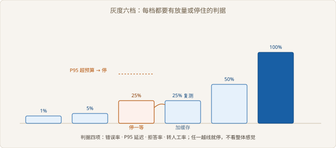

# Ch06 上线与复盘

> 本阶段：灰度、监控、复盘、交接
> 前置：Ch05｜工期：4 人天｜交付物：上线报告与交接文档
> 阶段目标：系统在真实流量下稳定运行一周

## 阶段全景


> 图 06-1 项目推进位置

## 现场开场

发版前一晚，客服主管在群里问：「明天全量上吗？」项目经理说：「先放开吧，出问题再回滚。」运维在旁边补了一句：「回滚要多久？」没人答得上来。这三个人的三句话，正好是上线阶段的三道坎：放多少、看什么、退得回来吗。这一阶段把三件事一次做完：按档放量、盯住质量指标、把系统交给客户的运维。

### 6.1 灰度发布

> 路径：必读

**决策**：分档放量，每档看四项指标，不达标就停在原地。放弃的是「一次全量、有问题再回滚」。回滚本身有成本，坐席已经照着错误答案回复过客户，回滚也收不回来。

**实施**：档位从很小的一档起步，逐档翻倍，每档留一个观察窗口。判定看四项：错误、P95、拒答、转人工。四项里任一越线就停，不前进也不后退。

**验证**：停在第三档时，P95 越过了预算。加一层候选缓存后原地复测，指标回到预算内再继续放量。

| 档位 | 流量 | 观察窗口 | 判定 | 依据 |
| --- | --- | --- | --- | --- |
| 第一档 | 1% | 一个工作日 | 放量 | 四项均在预算内 |
| 第二档 | 5% | 一个工作日 | 放量 | 同上 |
| 第三档 | 25% | 一个工作日 | 停在原地 | P95 越预算 |
| 第三档复测 | 25% | 半个工作日 | 放量 | 加缓存后回到预算内 |
| 第四档 | 50% | 一个工作日 | 放量 | 四项均在预算内 |
| 全量 | 100% | 连续一周 | 完成 | 无回滚 |



> 图 06-2 灰度六档与判据

```python
# src/ch06/canary.py
def decide(s: Sample) -> tuple[str, str]:
    if s.error > MAX_ERROR:
        return "回滚", f"错误率 {s.error:.2%} 超过 {MAX_ERROR:.0%}"
    if s.p95 > MAX_P95:
        return "停在当前档", f"P95 {s.p95} 毫秒超过 {MAX_P95} 毫秒"
    if s.abstain > MAX_ABSTAIN:
        return "停在当前档", f"拒答率 {s.abstain:.0%} 超过 {MAX_ABSTAIN:.0%}"
    return "放量", "四项指标都在预算内"
```

第一档开得越小越好。它的作用不是验证效果，是验证「放出去不会立刻炸」。这一档出问题，影响面只有几个坐席，处理起来是从容的。

「停在原地」和「回滚」是两种动作，不要混用。指标只是越线一点点，停住观察就够；出现错误或错误答案外泄，才需要回滚。判据里写清两者的边界，半夜出事时才不用现场讨论。

【风险】灰度期间两个版本同时在跑，语料和索引必须共用同一份。各跑各的索引，同一句话在两个版本里会给出不同答案，坐席之间会互相打架。

第一档为什么开得足够小，而不是从一半起。

### 6.2 监控与告警

> 路径：必读

**决策**：监控四项：可用性、拒答、空召回、引用点击。不打算只接一块可用性大盘。可用性满分时，系统照样可能整天答「查不到」，而这在可用性上看不出来。

**实施**：四个指标都从埋点算，不靠人工抽查。告警分两级：错误与空召回走即时告警，拒答与引用点击进日报。每条告警带三条链路号样本，方便直接回查。

**验证**：上线第三天，空召回越过阈值。按样本回查，问题集中在一批产品型号问题上，那批内容还在产品部的网盘里，没进语料。

| 指标 | 当日值 | 阈值 | 处置 |
| --- | --- | --- | --- |
| 可用性 | 98.00% | 错误率不高于 2% | 即时告警 |
| 拒答 | 15.0% | 不高于 20% | 日报观察 |
| 空召回 | 16.8% | 不高于 15% | 即时告警 |
| 引用点击 | 34.0% | 不低于 10% | 日报观察 |

```python
# src/ch06/monitor.py
def alerts(m: Metrics) -> list[str]:
    out = []
    if m.error_rate > MAX_ERROR:
        out.append(f"错误率 {m.error_rate:.2%} 超阈值")
    if m.empty_rate > MAX_EMPTY_RECALL:
        out.append(f"空召回 {m.empty_rate:.1%} 超阈值")
    if m.click_rate < MIN_CITATION_CLICK:
        out.append(f"引用点击率 {m.click_rate:.1%} 低于下限")
    return out
```

引用点击这个指标容易被忽略，但它最接近「有没有用」。答案给了引用，坐席一次都不点，说明他要的不是出处，或者引用根本不可信。两种情况要分开处置，得看样本才能分辨。

空召回的处置不是调阈值。阈值调低，告警消失，问题还在。正确动作是回去补语料，把漏掉的那批内容接进来，再跑一遍二十条样本确认没退化。

可用性 98.00% 刚好压在线上，告警没响。但错误集中在一次上游抖动上，这类情况写进周报，不单独回滚。

【排查】空召回先查语料有没有缺口，再查切分是否把长文档切碎。模型放到最后看，否则会花两天调参，最后发现数据没接。

可用性满分时，系统为什么仍可能没人用。

### 6.3 复盘：做对与做错

> 路径：选读

**决策**：复盘只谈可改的事，不谈人。放弃的是「找责任」。找责任会让所有人开始解释自己，而不是解释系统。

**实施**：三段固定：做对了什么、做错了什么、下次怎么改。每条都要带证据：哪一天、哪个工单、哪个指标。没有证据的条目不收。

**验证**：每条「下次怎么改」必须落成一个具体动作，并且有责任人和时间。落不成动作的，不算复盘完成。

| 议题 | 证据 | 结论 | 动作 |
| --- | --- | --- | --- |
| 数据接入 | 映射漏客户全称 | 评审只对字段名不够 | 下次逐字段念含义 |
| 切分 | 老工单无段落结构 | 结构不是每篇都有 | 加来源类型标记 |
| 引用 | 客户点了三次没找到 | 块内没有句子定位 | 切分时就留句子边界 |
| 上线 | 第三档 P95 越线 | 容量估算偏乐观 | 压测条件写进报告 |

复盘会不要开成汇报会。每个人说三句就够：哪件事有效、哪件事无效、下次改哪一个动作。说得越长，越容易变成表态。

做对了什么也要写，而且要写具体。「沟通顺畅」不算，「提前一周锁定验收人」算。做对的条目是下次的默认动作，不写下来就丢了。

【返工】这四次返工里有三次根因在更早的阶段。复盘真正的产出不是安慰，是把根因往前挪一格，下次在更早的地方拦住。

一条「下次怎么改」要落到动作，怎么判断它算完。

### 6.4 交接文档

> 路径：必读

**决策**：交接文档写成可执行步骤，不写架构感想。放弃的是「一份演示文稿加一个仓库链接」。接手的人打开 PPT 学不会运维，打开仓库也不知道从哪跑。

**实施**：五个部分：怎么起、怎么查、怎么改、怎么回滚、找谁。每部分给命令与预期输出，路径写全，不写「见某处」。

**验证**：找一个没参与项目的人，照着文档从零跑一遍。他卡在哪一步，哪一步就是缺口。跑通之后，文档才算交付。

| 部分 | 内容 | 验收方式 |
| --- | --- | --- |
| 怎么起 | 依赖、配置、启动命令 | 新机器上跑通 |
| 怎么查 | 链路号、日志位置、常见错误 | 按文档定位一次故障 |
| 怎么改 | 语料更新、映射调整、索引重建 | 改一条语料并生效 |
| 怎么回滚 | 回退命令与验证点 | 十分钟内退回上一版 |
| 找谁 | 客户侧与交付侧联系人 | 电话能打通 |

文档里最容易缺的是「怎么改」。上线后真正天天发生的是语料更新：新产品上线、手册改版、工单分类调整。这部分没写清，客户每改一次都要找你。

回滚要写成命令，不要写成描述。「回退到上一版镜像」不算，「执行哪条命令、看哪个指标确认回退成功」才算。

交接完成的标志是对方能独立处理一次小故障。不是签收单签了字，也不是培训讲完了。

交接文档里最常被用到、也最容易被漏掉的是哪一部分。

## 阶段交付物

| 交付物 | 验收标准 | 谁来验收 |
| --- | --- | --- |
| 上线报告 | 六档记录完整，停留与放量都有依据 | 客户技术负责人 |
| 监控看板 | 四项指标可查，告警带样本 | 客户运维 |
| 复盘记录 | 每条含证据与具体动作 | 项目经理 |
| 交接文档 | 新人照文档独立跑通一次 | 客户技术负责人 |

## 复盘

**做对了什么**：起步只放极小流量，问题在小范围内暴露，处理时不用惊动客户。

**做错了什么**：监控只盯了可用性两天，空召回报警晚了，一批型号问题多积了两天。

**下次怎么改**：上线首日就把四项指标全部接入告警，不留观察期。

## 风险登记

| 风险 | 影响 | 应对 |
| --- | --- | --- |
| 两版共用不同索引 | 答案不一致 | 索引单份，版本只切流量 |
| 空召回被当成模型问题 | 白调两天参数 | 先查语料缺口 |
| 交接只交文档不交演练 | 出事后无人能修 | 交接必须现场跑一次 |
| 复盘停在表态 | 同类问题再犯 | 每条动作有责任人与时间 |

## 下一阶段

前六个阶段走完，系统在客户环境里跑起来了。Ch07 接着讲二期扩展。这一版能答的范围、拒答的边界、扩量的上限，都写在交接文档里。往后每一次加语料、换模型，都可以按同一套判据重走一遍。
