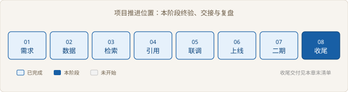
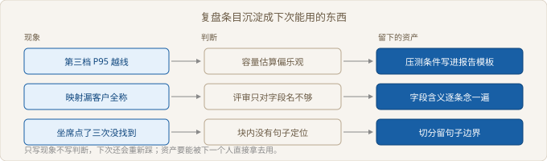

# Ch08 项目收尾与知识转移

> 本阶段：终验、交接、复盘、划定产品边界
> 前置：Ch07｜工期：4 人天｜交付物：交接文档与最终验收报告
> 阶段目标：客户独立运维，项目组退出日常

## 阶段全景



> 图 08-1 项目推进位置

## 现场开场

二期方案签完，客户的信息化部长把合同翻到最后一页，说：「验收单我可以签，但签完你们人走了，出问题谁修？」项目经理答得很实在：「您的人能自己修，我们才走。」部长想了一下，补了一句：「那你们先教会，教会了再谈签字。」这句话把收尾的顺序定死了：先演练，再终验，最后才复盘和谈产品。

### 8.1 最终验收与签字

> 路径：必读

**决策**：终验逐项看证据，任一项不能复测就不发起签字。不采用「一次演示加一份会议纪要」——演示只证明那一刻是好的，纪要也没法让第三个人重跑一遍。

**实施**：六项验收项，每项写清三件事：证据是什么、能不能复测、谁签。脚本只做一件事，把阻断项列出来；签字页在零阻断时才生成。

```python
# src/ch08/signoff.py
def blocked(items: tuple[Item, ...]) -> list[Item]:
    return [i for i in items if i.status != PASS or not i.repro or not i.signer]

def main() -> None:
    show("终验清单（第一轮）", ITEMS)
    first = blocked(ITEMS)
    print(f"阻断 {len(first)} 项，不能签字：")
    for i in first:
        print(f"  - {i.name}：{i.gap or '签字人未定'}")
```

**验证**：第一轮阻断三项。样本表缺两条，补跑后才算数；告警只交了截图，截图不可复测，改成查询语句加当日取值；交接还没演练。三项补完，六项全过，签字页才发起。

| 验收项 | 证据 | 可复测 | 签字人 |
| --- | --- | --- | --- |
| 范围与口径 | 二期范围表 | 是 | 业务主管 |
| 权限隔离 | 越权扫描记录 | 是 | 客户信息安全 |
| 索引升级 | 影子比对报告 | 是 | 客户技术负责人 |
| 回答质量 | 样本逐条结论 | 是 | 业务主管 |
| 监控告警 | 告警查询语句与当日值 | 是 | 客户运维 |
| 交接演练 | 演练记录 | 是 | 客户技术负责人 |

「可复测」这三个字最容易放水。截图、口头确认、聊天记录都不算，能写成一条命令或一句查询的才算。

签字顺序也有讲究：业务方先签，因为他确认的是范围与口径；信息安全的第二；技术负责人最后签，他签的是这套东西能维护。

【验收】终验不是客户点头就算过，是第三个人能按证据重跑一遍。重跑不出来，就是没过。

一项验收的证据是一张截图，为什么不能算过。

### 8.2 交接文档与演练

> 路径：必读

**决策**：交接以演练通过为准，不以签收单为准。放弃的是「培训两小时加一个文档链接」——讲一遍不等于会做，链接也不等于步骤。

**实施**：六个演练项：启动服务、更新一条语料并生效、按链路号查故障、回退一个版本、调一条字段映射、看告警判断要不要处理。让没碰过这个项目的人按文档自己走一遍，哪一步走不下去，文档就在那一步缺东西。

```python
# src/ch08/handover.py
def after_patch(drills: tuple[Drill, ...]) -> tuple[Drill, ...]:
    return tuple(replace(d, result=DONE, note=FIXES[d.task]) if d.result != DONE else d
                 for d in drills)
```

**验证**：第一轮完成三项，卡住两项，一项没敢试。卡住的分别是启动缺环境变量说明、重建命令少了库名参数；没敢试的是回退，文档只写了「回退镜像」四个字。三处补完，换一位新同事重跑，六项全过。

| 演练项 | 文档位置 | 第一轮 | 补文档后 |
| --- | --- | --- | --- |
| 启动服务 | 怎么起 | 卡住 | 通过 |
| 更新语料并生效 | 怎么改 | 卡住 | 通过 |
| 按链路号查故障 | 怎么查 | 通过 | 通过 |
| 回退一个版本 | 怎么回滚 | 未试 | 通过 |
| 调字段映射 | 怎么改 | 通过 | 通过 |
| 看告警判断处置 | 怎么查 | 通过 | 通过 |

【返工】回退那一条返工最不值：上线阶段演练过一次回退，但结论只写进了上线报告，没写进交接文档。经验留在人脑里，人一走就没了。

演练要换人。同一个人做第二遍一定全过，因为他已经知道坑在哪。第二轮的记录要写清是谁做的，否则签字时说不清。

交接到没到位，看对方能不能自己修好一次小毛病。签收单和签到表都证明不了这件事。

第一轮的三项通过，为什么不能直接算交接完成。

### 8.3 复盘：项目做对了什么

> 路径：必读

**决策**：复盘条目必须落成资产，落不成的标为不可复用并写原因。放弃的是「写感受、写感谢、写团队很拼」。

**实施**：每条按三段写：现象是哪天哪件事，判断是什么，最后留下什么可以被人直接拿走的东西。资产是模板、判据、清单或配置项，不是一句口号。



> 图 08-2 复盘条目沉淀成下次能用的东西

| 现象 | 判断 | 留下的资产 |
| --- | --- | --- |
| 第三档 P95 越线 | 容量估算偏乐观 | 压测条件写进报告模板 |
| 映射漏客户全称 | 评审只对字段名不够 | 字段含义逐条念一遍的清单 |
| 坐席点了三次没找到 | 块内没有句子定位 | 切分保留句子边界的规则 |
| 空召回晚报两天 | 首日只接了可用性 | 四项指标首日全接的判据 |
| 客户内部排期推迟一周 | 客户流程问题，交付方无法复制 | 无，标为不可复用 |

**验证**：五条复盘里四条落成了资产，一条落不成——客户内部排期导致的一次延期，判断是客户流程问题，交付方复制不了。这条标为不可复用，写清原因，不进资产库。

做对的条目同样要具体到动作。写成「配合默契」没有用，写成「评审前一周把签字人请到现场」才能照做。

【取舍】复盘会只开一次，不追责。放弃的是追责——一旦开始追究谁的责任，会议就变成各自说明，系统本身没人再看。

一条复盘条目要落到什么程度，才算留下了资产。

### 8.4 从项目到产品的边界

> 路径：选读

**决策**：收尾期涌进来的需求分四类：产品能力、配置项、待评估、不接。判定靠三个问题，不靠感觉。放弃的是「先答应下来再想办法」。

**实施**：三个问题：是不是只改参数或文案、别的客户要不要、动不动数据模型或权限模型。只改参数的直接进配置项清单；多个客户要的进产品需求池；只有一个客户要还要改模型的，当场回绝并给定制路径。

```python
# src/ch08/boundary.py
def classify(a: Ask) -> tuple[str, str]:
    if a.param_only:
        return CONFIG, "只改参数或文案，写进配置项清单，交付侧自己改"
    if a.multi_need and a.model_change:
        return PRODUCT, "多个客户都要，且要动模型，进产品需求池排期"
    if a.multi_need:
        return PRODUCT, "多个客户都要，先做成可选开关"
    if a.model_change:
        return DECLINE, "只有一个客户要，还要改模型，走定制合同另立项"
    return HOLD, "只有一个客户要，改动边界还没看清，定复查日再评"
```

**验证**：八条需求过一遍，三条产品能力、一条配置项、两条待评估、两条不接。客户接受了「不接」的两条，并写进合同附件——写在附件里比写在会议纪要里管用。

| 需求 | 结论 | 去处 |
| --- | --- | --- |
| 导出对话记录 | 产品能力 | 产品需求池 |
| 回答里加客户内部审批流 | 不接 | 定制合同另立项 |
| 支持单点登录 | 产品能力 | 产品需求池 |
| 改欢迎语与拒答话术 | 配置项 | 配置项清单 |
| 接入内部 OA 待办 | 待评估 | 定复查日 |
| 答案改用方言回复 | 待评估 | 定复查日 |
| 按成本中心限制可见范围 | 不接 | 定制合同另立项 |
| 首页加一张使用量卡片 | 产品能力 | 产品需求池 |

【待确认】行业里对定制需求的处理有两种做法：一种全部转产品，一种全部走定制。前者的代价是产品被单客户需求拖重，后者的代价是每个项目重做一遍。这里采用分类，是因为两类成本都要有人承担，混在一起就没人承担。

收尾期最危险的一句是「这个顺便做了吧」。顺便做的东西没有验收标准，也没有维护人，最后都变成项目组的隐性负债。

配置项与产品能力的界线，为什么放在「要不要改模型」上。

## 阶段交付物

| 交付物 | 验收标准 | 谁来验收 |
| --- | --- | --- |
| 最终验收报告 | 六项证据可复测，零阻断，签字齐 | 客户技术负责人 |
| 交接文档 | 新同事按文档独立走完六项演练 | 客户技术负责人 |
| 复盘记录 | 每条含现象、判断、资产，不可复用的注明原因 | 项目经理 |
| 需求边界清单 | 每条需求有结论与去处，不接的写进合同附件 | 业务主管 |

## 复盘

**做对了什么**：把演练排在终验之前，客户先看到自己的人能修，签字时没有犹豫。

**做错了什么**：复盘会开成了汇报会，前半段每个人都在讲自己做了多少，后半段才回到现象和判断。

**下次怎么改**：复盘会前先收书面条目，会上只讨论判断和资产，不讲过程。

## 风险登记

| 风险 | 影响 | 应对 |
| --- | --- | --- |
| 终验靠截图取证 | 出问题无法复现 | 证据必须是命令或查询 |
| 交接只换人不换场景 | 演练全过但真故障不会 | 第二轮演练用真实历史故障 |
| 复盘只写现象 | 同类问题再犯 | 每条补判断与资产 |
| 收尾期需求随口答应 | 变成隐性负债 | 三个问题过一遍，结论进附件 |

## 下一阶段

项目在这里结束，系统转入客户自己的维护节奏。项目组退出日常后，语料更新、同义词维护、告警处理都按交接文档执行；下一次扩容或换模型，回到 Ch07 的判据上重走一遍。
